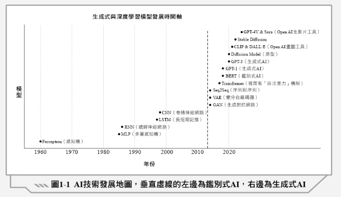

# 📚 生成式 AI 認證考試重點整理（概念與理解導向）

> 💡 **定位原則**：
> 1. 本筆記專注於「觀念理解、名詞定義與技術應用」，不涉及複雜數學計算。
> 2. 全面採用**「5 秒掃讀法（1 行流程箭頭 ＋ 極簡關鍵字表格 ＋ 折疊白話故事）」**，並於各章節首次登場時標註**專有名詞英文全稱**，助你考前極速複習。

---

<a id="top"></a>
## 📑 五大核心主題與章節目錄
- [第一部分 生成式AI基礎知識](#第一部分-生成式ai基礎知識)
  - [1.0 AI 技術發展時間軸與地圖](#10-ai-技術發展時間軸與地圖)
  - [1.1 神經網路基礎 感知器與反向傳播](#11-神經網路基礎-感知器與反向傳播)
  - [1.2 CNN vs RNN](#12-cnn-vs-rnn)
  - [1.3 RNN LSTM 與 GRU](#13-rnn-lstm-與-gru)
  - [1.4 VAE GAN 與 Seq2Seq](#14-vae-gan-與-seq2seq)
  - [1.5 Transformer 自注意力與解碼參數](#15-transformer-自注意力與解碼參數)
  - [1.6 NLP BERT GPT 與 LLM 演進](#16-nlp-bert-gpt-與-llm-演進)
  - [1.7 擴散模型 (Diffusion)](#17-擴散模型-diffusion)
  - [1.8 多模態 AI 與影片生成技術](#18-多模態-ai-與影片生成技術)
  - [1.9 模型預訓練 從無到有的知識建立](#19-模型預訓練-從無到有的知識建立)
  - [1.10 模型最佳化 訓練技巧與過擬合](#110-模型最佳化-訓練技巧與過擬合)
  - [1.11 模型的運作 (推理) AI 怎麼看懂輸入與生出結果](#111-模型的運作-推理-ai-怎麼看懂輸入與生出結果)
  - [1.12 資料基本概念 收集清理與前處理](#112-資料基本概念-收集清理與前處理)
  - [1.13 五大學習範式與經典演算法](#113-五大學習範式與經典演算法)
  - [1.14 模型評估指標 F1-score R-squared 與 BLEU](#114-模型評估指標-f1-score-r-squared-與-bleu)
  - [1.15 AIGC 核心概念](#115-aigc-核心概念)
- [第二部分 生成式AI能力強化](#第二部分-生成式ai能力強化)
  - [2.1 大語言模型 (LLM) 原理 微調與應用模式](#21-大語言模型-llm-原理-微調與應用模式)
  - [2.2 提示工程 原則 咒語 框架提示與三大思維推理](#22-提示工程-原則-咒語-框架提示與三大思維推理)
  - [2.3 生成式 AI 進階強化 RAG RLHF LoRA 與語法分析器](#23-生成式-ai-進階強化-rag-rlhf-lora-與語法分析器)
- [第三部分 生成式AI應用技能](#第三部分-生成式ai應用技能)
  - [3.1 文字與商業文案生成應用](#31-文字與商業文案生成應用)
  - [3.2 圖片生成工具與應用](#32-圖片生成工具與應用)
  - [3.3 聲音 (TTS) 與音樂生成應用](#33-聲音-tts-與音樂生成應用)
  - [3.4 影片生成流程與應用場景](#34-影片生成流程與應用場景)
  - [3.5 簡報生成流程與工具組合](#35-簡報生成流程與工具組合)
  - [3.6 程式生成應用與開發工具](#36-程式生成應用與開發工具)
  - [3.7 數據分析 視覺化與自動化工具](#37-數據分析-視覺化與自動化工具)
- [第四部分 生成式AI倫理法律](#第四部分-生成式ai倫理法律)
  - [4.1 AI 治理核心原則 歐盟 AI 法案與治理制度](#41-ai-治理核心原則-歐盟-ai-法案與治理制度)
  - [4.2 AI 倫理五大原則 各國架構與臺灣 TAIDE 計畫](#42-ai-倫理五大原則-各國架構與臺灣-taide-計畫)
  - [4.3 生成式 AI 著作權 深度偽造 (Deepfake) 與系統風險](#43-生成式-ai-著作權-深度偽造-deepfake-與系統風險)
  - [4.4 資料治理 四大隱私保護策略與隱私法規](#44-資料治理-四大隱私保護策略與隱私法規)
  - [4.5 模型可解釋性 LIME vs SHAP](#45-模型可解釋性-lime-vs-shap)
- [第五部分 生成式AI工具與開發商總覽](#第五部分-生成式ai工具與開發商總覽)
  - [5.1 文本與對話語言模型 (LLMs)](#51-文本與對話語言模型-llms)
  - [5.2 圖像生成與編輯平台 (Image Generation)](#52-圖像生成與編輯平台-image-generation)
  - [5.3 影片生成與剪輯工具 (Video Generation)](#53-影片生成與剪輯工具-video-generation)
  - [5.4 音樂與語音生成工具 (Audio and Music)](#54-音樂與語音生成工具-audio-and-music)
  - [5.5 程式輔助與工作流程自動化 (Coding and Automation)](#55-程式輔助與工作流程自動化-coding-and-automation)
  - [5.6 資料科學與開源社群平台 (Platforms and Communities)](#56-資料科學與開源社群平台-platforms-and-communities)
  - [5.7 開發商 vs 代表工具速查矩陣](#57-開發商-vs-代表工具速查矩陣)

---

## 第一部分 生成式AI基礎知識

### 1.0 AI 技術發展時間軸與地圖
* **核心名詞全稱**：
  * **鑑別式 AI（Discriminative AI）** vs **生成式 AI（Generative AI）**
* **時代演進主軸**：`1960~2010s 鑑別式 AI（理解/分類/辨識）` ➔ `2014 分水嶺（GAN/VAE/Seq2Seq）` ➔ `2017+ 生成式 AI 爆發（無中生有/多模態創作）`
* **三大技術里程碑**：`CNN（看懂世界：影像）` ➔ `RNN（聽懂語言：時序）` ➔ `Transformer（不只理解還能創作：生成基石）`



* **視覺化分水嶺結構圖（垂直虛線左邊 vs 右邊）**：
```text
【1960 ~ 2010s 初：鑑別式 AI 時代】        ┃ 【2014 ~ 2020s：生成式 AI 爆發時代】
（核心：理解、分類、辨識、判斷）           ┃ （核心：無中生有、內容創作、多模態生成）
                                           ┃
                                           ┃  2023-24 ● GPT-4V & Sora (OpenAI 生影片工具)
                                           ┃  2022    ● Stable Diffusion (Stability AI 開源生圖)
                                           ┃  2021    ● CLIP & DALL·E (OpenAI 畫圖工具)
                                           ┃  2020    ● Diffusion Model (擴散模型原型)
                                           ┃  2020    ● GPT-3 (生成式 AI 大語言模型)
                                           ┃  2018    ● GPT-1 (生成式 AI)
                                           ┃  2018    ● BERT (⚠️ 特例：雖在2018，但屬「鑑別式AI」！)
                                           ┃  2017    ● Transformer (內含「自注意力」機制)
                                           ┃  2014    ● Seq2Seq (序列到序列)
                                           ┃  2014    ● VAE (變分自編碼器)
                                           ┃  2014    ● GAN (生成對抗網路)
  1998 ● CNN (卷積神經網路)                ┃
  1997 ● LSTM (長短期記憶)                 ┃
  1986 ● RNN (遞歸神經網路)                ┃
  1985 ● MLP (多層感知機)                  ┃
  1960 ● Perceptron (感知機)               ┃
━━━━━━━━━━━━━━━━━━━━━━━━━━━━━━━━━━━━━━━━━━━┻━━━━━━━━━━━━━━━━━━━━━━━━━━━━━━━━━━━━━━━━━━━
 1960      1970      1980      1990      2000      2010      2014(分水嶺)    2020+
```

* **圖 1-1 全節點速查表（含英文全稱）**：
  | 分水嶺 | 年代 | 模型 / 工具名稱（英文全稱） | AI 類型歸屬 | 核心地位與關鍵字 |
  | :--- | :---: | :--- | :---: | :--- |
  | **虛線左** | ~1960 | **感知機 (Perceptron)** | **鑑別式 AI** | 最早神經網路單元（<span style="color: #7aa2f7">單層線性分類</span>） |
  | **虛線左** | ~1985 | **多層感知機 (MLP, Multilayer Perceptron)** | **鑑別式 AI** | 引入<span style="color: #7aa2f7">隱藏層與反向傳播</span>，深層網路基礎 |
  | **虛線左** | ~1986 | **遞歸神經網路 (RNN, Recurrent Neural Network)** | **鑑別式 AI** | 具<span style="color: #7aa2f7">短期記憶</span>，處理時序與自然語言理解 |
  | **虛線左** | ~1997 | **長短期記憶 (LSTM, Long Short-Term Memory)** | **鑑別式 AI** | <span style="color: #7aa2f7">三個門控</span>解決長序列<span style="color: #e06c75">梯度消失</span>問題 |
  | **虛線左** | ~1998 | **卷積神經網路 (CNN, Convolutional Neural Network)** | **鑑別式 AI** | <span style="color: #7aa2f7">卷積＋池化</span>萃取空間特徵，專攻圖像分類 |
  | **虛線右** | ~2014 | **生成對抗網路 (GAN, Generative Adversarial Network)** | **生成式 AI** | <span style="color: #7aa2f7">生成器＋判別器</span>對抗，<span style="color: #7aa2f7">隨機雜訊</span>生逼真圖 |
  | **虛線右** | ~2014 | **變分自編碼器 (VAE, Variational Autoencoder)** | **生成式 AI** | 編碼壓縮＋<span style="color: #7aa2f7">機率分佈抽樣</span>生成 |
  | **虛線右** | ~2014 | **序列到序列 (Seq2Seq, Sequence-to-Sequence)** | **生成式 AI** | <span style="color: #7aa2f7">Encoder-Decoder</span> 架構，奠定機器翻譯基礎 |
  | **虛線右** | 2017 | **Transformer** | **生成式基石** | 內含「<span style="color: #7aa2f7">自注意力</span> (Self-Attention)」，支援<span style="color: #7aa2f7">平行運算</span> |
  | **虛線右** | 2018 | **BERT (Bidirectional Encoder Representations from Transformers)** | <span style="color: #e06c75">⚠️ 鑑別式 AI</span> | <span style="color: #e06c75">圖上唯一特例！</span> 雙向 Encoder，專攻閱讀理解與分類 |
  | **虛線右** | 2018/20 | **GPT-1 / GPT-3 (Generative Pre-trained Transformer)** | **生成式 AI** | <span style="color: #7aa2f7">單向 Decoder</span> 文字接龍，引爆大型語言模型 (LLM, Large Language Model) 浪潮 |
  | **虛線右** | 2020 | **擴散模型 (Diffusion Model)** | **生成式 AI** | <span style="color: #7aa2f7">正向加噪＋反向去噪</span>生圖，取代 GAN 成主流 |
  | **虛線右** | 2021 | **CLIP (Contrastive Language-Image Pre-training) & DALL·E** | **生成式 AI** | **OpenAI** <span style="color: #7aa2f7">畫圖工具</span>（跨模態圖文對齊生圖） |
  | **虛線右** | 2022 | **Stable Diffusion** | **生成式 AI** | **Stability AI** <span style="color: #7aa2f7">開源免費</span>生圖模型，可本地部署 |
  | **虛線右** | 2023/24 | **GPT-4V (GPT-4 with Vision) & Sora** | **生成式 AI** | **OpenAI** <span style="color: #7aa2f7">多模態與生影片工具</span>（60 秒連貫影片） |

* **三大代表技術定位速查表**：
  | 代表技術 | 技術類型 | 主要功能 | 典型應用場景 |
  | :--- | :--- | :--- | :--- |
  | **CNN** | **鑑別式 AI** | <span style="color: #7aa2f7">圖像分類</span> | 臉部辨識、光學字元辨識 (OCR, Optical Character Recognition)、自駕車視覺、醫療影像診斷 |
  | **RNN** | **鑑別式 AI** | <span style="color: #7aa2f7">語言理解</span> | 語音辨識、機器翻譯、對話系統 |
  | **Transformer** | **生成式 AI** | <span style="color: #7aa2f7">內容生成</span> | ChatGPT、DALL·E、AI 作曲等內容創作 |

* **1.0 考點精華標記**：
  * **🔥 考試常考**：
    1. **鑑別式陣營（分類/理解）**：Perceptron、MLP、RNN、LSTM、CNN、<span style="color: #e06c75">BERT</span>。
    2. **生成式陣營（無中生有）**：GAN、VAE、Seq2Seq、GPT 系列、Diffusion、DALL·E、Stable Diffusion、Sora。
    3. **OpenAI 工具定位**：**CLIP & DALL·E** 是<span style="color: #7aa2f7">畫圖工具</span>；**GPT-4V & Sora** 是<span style="color: #7aa2f7">多模態與生影片工具</span>。
  * **⚠️ 易錯陷阱**：
    1. **BERT 年代假象陷阱（必考！）**：BERT 雖於 2018 年誕生（位於分水嶺右側），但屬於「<span style="color: #e06c75">鑑別式 AI</span>」（專精閱讀理解與分類），<span style="color: #e06c75">絕非生成式 AI</span>！

<div align="right"><sub><a href="#top" style="text-decoration: none; color: #8b949e;">↑ Top</a></sub></div>

---

### 1.1 神經網路基礎 感知器與反向傳播
* **核心名詞全稱**：
  * **Perceptron（感知器）**、**MLP（多層感知器, Multilayer Perceptron）**、**DNN（深度神經網路, Deep Neural Network）**
  * **BM / RBM（波爾茲曼機 / 受限波爾茲曼機, Boltzmann Machine / Restricted Boltzmann Machine）**
  * **Weight（權重）**、**Bias（偏移 / 偏差）**、**Loss Function（損失函數）**、**MSE（均方誤差, Mean Squared Error）**
  * **Backpropagation（反向傳播演算法）**、**Gradient Descent（梯度下降法）**
  * **XOR（互斥或, Exclusive OR）**、**SGD（隨機梯度下降, Stochastic Gradient Descent）**、**Adam（自適應矩陣估計, Adaptive Moment Estimation）**

* **1. 網路架構演進（從單層到多層）**：
  `感知器 Perceptron (1960)` ➔ `多層感知器 MLP (1980s)` ➔ `波爾茲曼機 RBM (1985)` ➔ `RNN / CNN`

  | 模型名稱 | 結構特徵 | 解決能力與歷史定位 | 關鍵限制 / 備註 |
  | :--- | :--- | :--- | :--- |
  | **感知器 (Perceptron)** | <span style="color: #7aa2f7">單層</span>（僅輸入＋輸出層） | 最早神經網路單元，只能畫一條直線做<span style="color: #7aa2f7">簡單線性分類</span> | <span style="color: #e06c75">無法解決 XOR</span>（互斥或, Exclusive OR）這種<span style="color: #e06c75">複雜非線性問題</span> |
  | **多層感知器 (MLP)** | **多層**（中間多加了<span style="color: #7aa2f7">隱藏層</span> Hidden Layer） | 能畫出彎曲分界線，<span style="color: #7aa2f7">成功解決複雜非線性問題</span> | 現代深層神經網路 (DNN, Deep Neural Network) 的標準原型 |
  | **波爾茲曼機 (RBM)** | 隨機生成式雙層網路 | 不用給標準答案，就能從無標籤資料中<span style="color: #7aa2f7">自動摸索出特徵分佈規律</span> | Hinton 用來幫深層網路「暖身預訓練」，突破早期訓練瓶頸 |

* **2. 神經網路訓練 4 步閉環（AI 怎麼學會調參數？）**：
  `① 權重與偏移（做預測）` ➔ `② 損失函數 / MSE（算誤差）` ➔ `③ 反向傳播（算梯度）` ➔ `④ 梯度下降（改參數）`

  | 訓練步驟與核心名詞 | 扮演角色 | 一句話白話秒懂（它到底在做什麼？） | 考試必背關鍵字 |
  | :--- | :--- | :--- | :--- |
  | **① 權重 (Weight) 與偏移 (Bias)** | **模型內部參數** | <span style="color: #7aa2f7">權重</span> $w$ 決定「這項特徵有多重要」；<span style="color: #7aa2f7">偏移</span> $b$ 是「基本起跳門檻」（如計程車起跳價 $y=wx+b$） | 訓練的終極目標就是找出最佳的 $w$ 與 $b$ |
  | **② 損失函數 (Loss) 與 MSE** | **誤差成績單** | 算出「AI 猜的答案跟真實答案差多少」；MSE (Mean Squared Error) 會把<span style="color: #7aa2f7">誤差平方後取平均</span>（錯越大罰越重） | MSE 用於<span style="color: #7aa2f7">迴歸數值預測</span>（如猜房價），數值越小越準 |
  | **③ 反向傳播 (Backpropagation)** | **從後往前抓戰犯** | 像改完考卷<span style="color: #7aa2f7">從最後結果往回檢查</span>，揪出哪個參數害答案算錯，並算出修正方向（梯度） | 只負責「<span style="color: #7aa2f7">反向傳遞誤差、計算梯度</span>」，<span style="color: #e06c75">不直接改權重</span> |
  | **④ 梯度下降 (Gradient Descent)** | **下山找最低谷** | 順著剛剛算出的下坡方向，<span style="color: #7aa2f7">實際動手修改權重</span> $w$ <span style="color: #7aa2f7">與偏移</span> $b$，讓下次猜得更準 | 搭配優化器（SGD, Stochastic Gradient Descent / Adam, Adaptive Moment Estimation）最小化 Loss |

<details>
<summary><b>💡 點擊展開白話案例：計程車起跳價與考數學檢討四部曲</b></summary>

> 🚕 **1. 權重 (Weight) 與偏移 (Bias) 的計程車比喻**：
> 搭計程車算車資 $y = w \cdot x + b$：里程數 $x$ 乘上的「每公里單價 $w$」就是**權重**（決定里程對車資的影響力）；而一上車不管開多遠都固定先收的「起跳價 85 元 ($b$)」就是**偏移**（基準門檻）。
>
> 📝 **2. 神經網路「考數學檢討四部曲」**：
> 1. **寫考卷（權重與偏移）**：學生（感知器/MLP）用腦中現有的公式參數 ($w, b$) 算出預測答案。
> 2. **對答案算扣分（損失函數 / MSE）**：老師批改考卷，算出預測跟標準答案差多少分（MSE 會把粗心大錯平方加倍扣分！）。
> 3. **倒推哪一步算錯（反向傳播）**：從最後結果一步步往回檢查，揪出到底是哪一層神經元的權重害答案算錯（算出梯度）。
> 4. **訂正改掉壞習慣（梯度下降）**：順著正確方向調整腦中的權重與偏移，下次考試誤差就變小了！
</details>

* **1.1 考點精華標記**：
  * **🔥 考試常考**：
    1. **單層感知器 vs MLP**：單層感知器只能解線性問題（<span style="color: #e06c75">無法解 XOR</span>）；MLP 加入「<span style="color: #7aa2f7">隱藏層</span>」後可解決<span style="color: #7aa2f7">非線性問題</span>。
    2. **波爾茲曼機 (BM / RBM)**：基於能量的隨機神經網路，用於學習<span style="color: #7aa2f7">資料機率分佈</span>與早期深層網路特徵預訓練。
    3. **MSE (均方誤差)**：最經典的<span style="color: #7aa2f7">迴歸任務損失函數</span>，將<span style="color: #7aa2f7">誤差平方後取平均</span>，數值越小代表預測越準。
  * **⚠️ 易錯陷阱**：
    1. **反向傳播 vs 梯度下降分工混淆（高頻陷阱！）**：**反向傳播**負責「<span style="color: #7aa2f7">由後往前算梯度</span>（找方向）」；**梯度下降**負責「<span style="color: #7aa2f7">順著梯度更新權重</span>（跨步下山）」，兩者<span style="color: #e06c75">一算一改，切勿記反</span>！

<div align="right"><sub><a href="#top" style="text-decoration: none; color: #8b949e;">↑ Top</a></sub></div>

---

### 1.2 CNN vs RNN
* **核心名詞全稱**：
  * **CNN（卷積神經網路, Convolutional Neural Network）**
  * **RNN（循環神經網路, Recurrent Neural Network）**
  * **Recurrent Connections（記憶機制 / 循環連結）**、**Sequential Dependency（時序依賴性）**、**Vanishing Gradient（梯度消失）**
  * **OCR（光學字元辨識, Optical Character Recognition）**、**NST（神經風格轉換, Neural Style Transfer）**、**GPU（圖形處理器, Graphics Processing Unit）**
* **CNN 視覺辨識 3 步流水線**：`① 卷積層 (Convolutional Layer：掃描找特徵)` ➔ `② 池化層 (Pooling Layer：降維記重點)` ➔ `③ 全連接層 (Fully Connected Layer, FC：整合分類)`
* **RNN 時序理解 2 大關鍵機制**：`① 記憶機制 (Recurrent Connections：循環連結將前一刻資訊傳給現在的自己)` ＋ `② 時序依賴性 (Sequential Dependency：捕捉語音/翻譯/音樂的前後順序關係)`

* **CNN vs RNN 核心對照表**：
  | 比較維度 | 卷積神經網路 (CNN) | 循環神經網路 (RNN) |
  | :--- | :--- | :--- |
  | **專攻資料** | <span style="color: #7aa2f7">空間與網格資料</span>（影像、圖片、照片） | <span style="color: #7aa2f7">時間與序列資料</span>（文字、語音、音樂旋律） |
  | **核心機制** | <span style="color: #7aa2f7">卷積層</span>找局部特徵 ＋ <span style="color: #7aa2f7">池化層</span>降維保留重點 | <span style="color: #7aa2f7">記憶機制</span>（循環連結）＋ <span style="color: #7aa2f7">時序依賴性</span>（順序關係） |
  | **平行運算** | <span style="color: #7aa2f7">極佳</span>（可快速用 GPU, Graphics Processing Unit 平行加速） | <span style="color: #e06c75">極差</span>（必須依時間先後一個字一個字排隊算） |
  | **致命弱點** | <span style="color: #e06c75">不擅長捕捉長時序</span>前後文關聯 | <span style="color: #e06c75">梯度消失</span>（反向傳播時誤差訊號「<span style="color: #e06c75">指數級衰減</span>」，句子一長就忘記開頭講什麼） |
  | **典型應用** | 臉部辨識、**光學字元辨識 (OCR, Optical Character Recognition)**、自駕車視覺、<span style="color: #7aa2f7">神經風格轉換</span> (NST, Neural Style Transfer) | ① <span style="color: #7aa2f7">語音辨識</span> (Speech Recognition：**Google Assistant / Siri**)、② <span style="color: #7aa2f7">自動字幕生成</span> (Automatic Subtitling：**YouTube 即時字幕**)、③ <span style="color: #7aa2f7">機器翻譯</span> (Machine Translation：**Google 翻譯**)、音樂旋律生成 |

<details>
<summary><b>💡 點擊展開白話案例：CNN 拼圖偵探、梵谷濾鏡 (神經風格轉換 NST) vs RNN 傳話遊戲（原著範例）</b></summary>

> 🔍 **1. CNN（拼圖偵探）＆ 為什麼「神經風格轉換 (NST)」要靠 CNN？**：
> * **拼圖偵探看圖**：先用「卷積層」掃描貓咪的耳朵、鬍鬚（**找特徵**）；再用「池化層」濾除背景雜訊、縮小存檔（**記住重要資訊**）；最後「全連接層」整合所有特徵判定：「95% 是一隻貓！」。
> * **為什麼「神經風格轉換 (Neural Style Transfer, NST)」是用 CNN？**：NST 就是「**留住 A 照片的骨架（內容），換上 B 名畫的皮囊（畫風）**」（如把台北 101 照片換成梵谷《星夜》油畫風）。因為 **CNN 看圖是分層的**——**淺層**專門抓局部的「**筆觸、紋理與配色（畫風 Style）**」，**深層**專門抓整張圖的「**建築與物體大輪廓（內容 Content）**」，只有 CNN 能把「輪廓」跟「畫風」拆開擷取再重新融合！
>
> 🎧 **2. RNN 為何需要「記住過去」與「理解順序」？（時序依賴三例）**：
> * **語音識別**：AI 必須記住前面講過的單詞，才能聽懂整句話的意思（如 **Google Assistant、Apple Siri**）。
> * **機器翻譯**：AI 要根據前後語境，才能翻出語意連貫的句子（如 **Google 翻譯**）。
> * **音樂生成**：AI 必須記得前幾節音符，才能延續旋律的邏輯與風格。
>
> 📢 **3. RNN 的「傳話遊戲」悲劇（梯度消失 Vanishing Gradient）**：
> 想像全班玩「傳話遊戲」，前幾個人還能把訊息準確傳下去，但經過太多個人後，原本的內容就越傳越模糊走樣。RNN 處理長文字或長語音時也是如此——**誤差訊號在反向傳播過程中會「指數級衰減」**，假設主詞和形容詞隔了十幾個字，RNN 傳到後面早就把開頭主詞忘光了！
</details>

* **1.2 考點精華標記**：
  * **🔥 考試常考**：
    1. **CNN 三大層分工與 NST**：<span style="color: #7aa2f7">卷積層找特徵</span>、<span style="color: #7aa2f7">池化層記住重要資訊</span>（降維）、<span style="color: #7aa2f7">全連接層整合特徵</span>做出分類決策；圖片生成中使用「<span style="color: #7aa2f7">神經風格轉換 (Neural Style Transfer, NST)</span>」（留住 A 圖內容輪廓、換上 B 圖筆觸畫風）主要基於 **<span style="color: #7aa2f7">CNN</span>**。
    2. **RNN 兩大關鍵機制**：<span style="color: #7aa2f7">記憶機制</span> (Recurrent Connections，循環連結把前一刻資訊傳給現在的自己) 與 <span style="color: #7aa2f7">時序依賴性</span> (Sequential Dependency，捕捉順序關係)。
    3. **RNN 三大經典應用代表**：<span style="color: #7aa2f7">語音辨識</span>（Google Assistant、Siri）、<span style="color: #7aa2f7">自動字幕生成</span>（YouTube 即時字幕）、<span style="color: #7aa2f7">機器翻譯</span>（Google 翻譯）。
    4. **RNN 梯度消失數學本質**：誤差訊號在反向傳播過程中呈「<span style="color: #e06c75">指數級衰減</span>」，導致<span style="color: #e06c75">無法學習長距離依賴</span>關係。
  * **⚠️ 易錯陷阱**：
    1. CNN 與 RNN 傳統上皆屬於「<span style="color: #e06c75">鑑別式 AI</span>」，<span style="color: #e06c75">切勿誤選為生成式 AI</span>。
    2. 看到「<span style="color: #7aa2f7">空間特徵 / 風格轉換 (NST)</span>」選 **CNN**；看到「<span style="color: #7aa2f7">時間前後 / 循環連結 / 時序依賴 / 語音轉錄</span>」選 **RNN**！

<div align="right"><sub><a href="#top" style="text-decoration: none; color: #8b949e;">↑ Top</a></sub></div>

---

### 1.3 RNN LSTM 與 GRU
* **🔗 上下游串聯**：承接 1.2 節——為解決傳統 **RNN** 遇長句子會「<span style="color: #e06c75">梯度消失（忘記開頭）</span>」的弱點，工程師加裝「門控開關」改良出 **LSTM** 與 **GRU**。
* **核心名詞全稱**：
  * **RNN（循環神經網路, Recurrent Neural Network）**
  * **LSTM（長短期記憶模型, Long Short-Term Memory）**
  * **GRU（門控循環單元, Gated Recurrent Unit）**
* **序列模型三代演進**：`傳統 RNN（沒開關門，句子一長誤差訊號越來越弱就忘光）` ➔ `LSTM（裝 3 道開關門＋長途傳送帶，記住長句重點）` ➔ `GRU（精簡成 2 道門，LSTM 輕量加速版）`

* **序列模型三部曲速查表**：
  | 演進階段 | 結構與門控數量 | 記憶能力 | 運算速度 / 參數量 | 考試核心定位 |
  | :--- | :--- | :--- | :--- | :--- |
  | **傳統 RNN** | <span style="color: #e06c75">無門控</span>（像沒篩選機制的傳聲筒） | 僅短期記憶（句子一長誤差訊號越來越弱，造成<span style="color: #e06c75">梯度消失</span>） | 最快 / 參數最少 | 序列起點，<span style="color: #e06c75">長句前面講什麼必忘光</span> |
  | **LSTM** | <span style="color: #7aa2f7">3 個門</span>（遺忘門 Forget、輸入門 Input、輸出門 Output）＋ <span style="color: #7aa2f7">細胞狀態</span> | **長記憶**（決定什麼該記、什麼該忘，<span style="color: #7aa2f7">解決長期依賴</span> Long-term Dependencies） | 較慢 / 結構最繁重 | <span style="color: #7aa2f7">解決長句遺忘代表</span>，但門太多算得慢 |
  | **GRU** | <span style="color: #7aa2f7">2 個門</span>（更新門 Update Gate、重置門 Reset Gate） | **長記憶**（一樣能記住長句重點） | 較快 / <span style="color: #7aa2f7">比 LSTM 輕量</span> | <span style="color: #7aa2f7">LSTM 的瘦身簡化版</span>，參數少、算得快 |

* **LSTM 與 GRU 共同典型應用**：<span style="color: #7aa2f7">聊天機器人</span> (Chatbots)、<span style="color: #7aa2f7">語音轉文字</span> (Speech-to-Text)、<span style="color: #7aa2f7">文本摘要</span> (Text Summarization)。

<details>
<summary><b>💡 點擊展開白話案例：LSTM 的三道嚴格安檢門 vs GRU 的輕量行李箱</b></summary>

> 🚪 **LSTM（三道安檢門）**：
> 為了解決傳統 RNN 忘東忘西的毛病，LSTM 裝設了一條長途傳送帶（細胞狀態）和三道安檢門：「遺忘門」扔掉無用舊資訊、「輸入門」放行關鍵新資訊、「輸出門」決定現在輸出什麼。雖然能記得久，但門太多導致檢查很耗時（運算繁重）。
>
> 🧳 **GRU（精簡版行李箱）**：
> 工程師覺得 LSTM 太重了，幫它「瘦身」，把三道門精簡為「更新門」與「重置門」（只有兩道門），保留抗遺忘能力的同時，讓行李更輕、運算速度大幅飛躍！
</details>

* **1.3 考點精華標記**：
  * **🔥 考試常考**：LSTM 相比傳統 RNN 的最大優勢是「<span style="color: #7aa2f7">更好地處理長期依賴關係</span> (Long-term Dependencies)」。
  * **⚠️ 易錯陷阱**：LSTM 是 <span style="color: #7aa2f7">3 個門</span>（較複雜），GRU 才是 <span style="color: #7aa2f7">2 個門</span>的「<span style="color: #7aa2f7">簡化版</span>」，<span style="color: #e06c75">切勿將兩者門控數與複雜度記反</span>！

<div align="right"><sub><a href="#top" style="text-decoration: none; color: #8b949e;">↑ Top</a></sub></div>

---

### 1.4 VAE GAN 與 Seq2Seq
* **🔗 上下游串聯**：承接 1.2～1.3 節——AI 從「只會辨識分類（鑑別式）」跨入 2014「無中生有（生成式）」分水嶺，誕生圖像生成雙雄（**VAE、GAN**）與結合 RNN/LSTM 的序列翻譯模型（**Seq2Seq**）。
* **核心名詞全稱**：
  * **AE（自編碼器, Autoencoder）** ➔ **VAE（變分自編碼器, Variational Auto-Encoder）**
  * **Mean and Variance（平均值與變異數，潛在變數 $z$ 的機率分佈參數）**
  * **GAN（生成對抗網路, Generative Adversarial Network）**
  * **Seq2Seq（序列到序列模型, Sequence-to-Sequence）**
  * **Word Embedding（詞向量 / 詞嵌入）**、**Sentence Embedding（句向量 / 句嵌入）**、**LDM（潛在擴散模型, Latent Diffusion Model）**
* **VAE「壓縮師＋重建師」3 步流（邊壓縮、邊隨機抽樣再還原）**：`① 編碼器 (Encoder 壓縮師：把輸入資料轉成潛在變數 z 的「平均值與變異數 Mean and Variance」機率分佈，而非固定數值)` ➔ `② 潛在空間隨機抽樣 (從機率分佈抽樣出一個潛在向量，賦予隨機性與多樣性)` ➔ `③ 解碼器 (Decoder 重建師：將潛在向量還原成圖片、語音等類似原來的資料)`
* **Seq2Seq 向量空間翻譯 2 階段流（以 `How are you?` ➔ `你好嗎` 為例）**：
  `① 編碼階段 (Encoding：將詞/句轉為詞向量或句向量，壓縮成單一高維「語意向量 V₁」)` ➔ `② 解碼階段 (Decoding：解碼器依「語意向量 V₁ ＋ 目前已生成上下文」一詞一詞逐步預測：「你」➔「好」➔「嗎」)`
* **2014 早期生成三劍客演進**：`VAE（機率分佈抽樣生圖）` ＆ `GAN（對抗博弈生逼真圖）` ＆ `Seq2Seq（序列編解碼生文字）` ➔ `突破記憶與檢查瓶頸，催生 Attention 與 Transformer`

* **一、 VAE vs GAN vs Seq2Seq 核心對照表（🔥 2014 生成分水嶺三大代表）**：
  | 比較維度 | VAE (變分自編碼器, ~2014) | GAN (生成對抗網路, 2014) | Seq2Seq (序列到序列, Google 2014) |
  | :--- | :--- | :--- | :--- |
  | **核心定位** | 「<span style="color: #7aa2f7">壓縮師＋重建師</span>」機率式生成與特徵壓縮（非監督式） | 早期高逼真圖像對抗生成基石 | 早期文字序列生成與機器翻譯基石 |
  | **運作架構** | <span style="color: #7aa2f7">編碼器</span> (轉機率分佈) ＋ 隨機抽樣 ＋ <span style="color: #7aa2f7">解碼器</span> (還原資料) | <span style="color: #7aa2f7">生成器</span> (Generator) ＋ <span style="color: #7aa2f7">判別器</span> (Discriminator) 博弈對抗 | <span style="color: #7aa2f7">編碼器</span> (Encoder) ＋ 語意向量 $V_1$ ＋ <span style="color: #7aa2f7">解碼器</span> (Decoder) |
  | **招牌特色** | 轉成潛在變數 $z$ 的「<span style="color: #7aa2f7">平均值與變異數</span>」機率分佈（<span style="color: #e06c75">非固定數值</span>），邊壓縮邊抽樣還原 | 像假鈔集團與警察過招，擅長從「<span style="color: #7aa2f7">隨機雜訊</span> (Random Noise)」畫出超逼真圖片 | 打破輸入與輸出「<span style="color: #7aa2f7">序列長度相等</span>」（字數要一樣多）的限制，在向量空間逐步生成 |
  | **代表應用** | <span style="color: #7aa2f7">修補影片/圖像缺失</span>、<span style="color: #7aa2f7">醫療合成資料生成</span>、<span style="color: #7aa2f7">工廠故障預測</span>、潛在擴散模型 (LDM) 壓縮底座 | **StyleGAN (NVIDIA)** 生成虛擬人臉、**Google** 黑白老照片上色 | 跨語言整句機器翻譯、早期語義理解與生成回答 |
  | **致命瓶頸** | 生成<span style="color: #e06c75">圖像邊緣較模糊</span> (Blurry，因追求平均穩健而帶柔焦感) | 訓練易失衡、<span style="color: #e06c75">模式崩潰</span> (Mode Collapse，只會畫同一種圖、沒變化) | 整句壓入<span style="color: #e06c75">單一固定向量</span>且<span style="color: #e06c75">無法回頭檢查</span>原句字詞，句子一長就忘光 |

* **二、 VAE（變分自編碼器）白話拆解：「壓縮師＋重建師」與 3 大實務應用**：
  * **整體結構比喻**：長得像一台「<span style="color: #7aa2f7">壓縮資料再還原</span>」的機器（資料的「**<span style="color: #7aa2f7">壓縮師＋重建師</span>**」），先把複雜資料濃縮成精簡但有意義的向量，再從中重新生出類似原來的資料。
  * **兩大核心角色（「邊壓縮、邊隨機抽樣再還原」兼具結構保留與創造力）**：
    1. **A. 編碼器 (Encoder，壓縮師)**：負責把輸入資料轉換成一組「<span style="color: #7aa2f7">機率分佈</span>」（⚠️ <span style="color: #e06c75">不是固定數值！</span>），也就是潛在變數 $z$ 的「**<span style="color: #7aa2f7">平均值與變異數 (Mean and Variance)</span>**」，讓生成結果帶有隨機性和多樣性。
    2. **B. 解碼器 (Decoder，重建師)**：從這個機率分佈中「<span style="color: #7aa2f7">抽樣出一個潛在向量</span>」，再把它**還原成一筆資料**（如圖片、語音或其他原始格式）。
  * **3 大經典實務應用例子（原著必背）**：
    1. **<span style="color: #7aa2f7">修補影片或圖像缺失</span>**：把壞掉或破洞的畫面補得自然。
    2. **<span style="color: #7aa2f7">醫療合成資料生成</span>**：創造臨床上不易取得的稀有病症資料。
    3. **<span style="color: #7aa2f7">工廠故障預測</span>**：讓 AI 先學會正常情況的資料分佈，進而從異常中發現問題。

* **三、 跨領域橋樑與最終催生工具**：
  * **向量 (Vector) 與向量空間**：將影像特徵（如體型、耳朵大小）或文字轉為空間座標點（<span style="color: #7aa2f7">詞向量 / 句向量</span>）；特徵相似者<span style="color: #7aa2f7">向量距離近</span>，不同類者<span style="color: #7aa2f7">向量距離遠</span>，成為跨越影像分類與語言翻譯的橋樑。
  * **催生現代代表工具**：突破 Seq2Seq 限制後誕生 **Attention（注意力機制）** 與 **Transformer**，進而催生 **ChatGPT**（**OpenAI** 對話大模型）、**DALL-E**（**OpenAI** 文字生圖像模型）。

<details>
<summary><b>💡 點擊展開白話案例：貓狗 2D 向量空間、VAE 配方師、GAN 賽跑失衡與 Seq2Seq 長句失憶（原著範例）</b></summary>

> 🐾 **1. 貓和狗在 2D 向量空間的距離（原著圖 4-3 範例）**：
> 把 X 軸設為「體型大小」、Y 軸設為「耳朵大小」：波斯貓 ($A_1$) 與暹羅貓 ($A_2$) 體型和耳朵相似，座標點距離很近；兩隻貴賓狗 ($B_1, B_2$) 座標點也很靠近，但**貓和狗的向量距離很遠**。此時只要畫一條直線，就能清楚把左邊的貓和右邊的狗區分開來！
>
> 🧪 **2. 傳統 AE（影印壓縮包）vs VAE（掌握「平均值與變異數」的壓縮師＋重建師）**：
> 傳統 AE 像把貓照片壓成固定密碼 `88`（固定數值），只能死板還原同一隻貓；**VAE** 的編碼器則把貓照片轉成潛在變數 $z$ 的「**平均值與變異數（機率分佈範圍）**」，解碼器再從這個範圍隨機抽樣一個向量還原，因此既能保留貓咪結構，又能畫出帶點變化彈性的全新貓咪（也可用來修補壞掉畫面、生成罕見疾病資料或偵測工廠異常），只是因追求平均穩健，畫面邊緣常帶點「柔焦模糊感」。
>
> 🏃 **3. GAN 的「賽跑失衡」與模式崩潰 (Mode Collapse)（原著範例）**：
> 生成器（負責畫）與判別器（負責挑錯）像在賽跑：若**判別器太強**，生成器畫什麼都被嫌棄，永遠學不會；若**生成器跑太快**，判別器還沒搞清楚真假就輸了。這種「沒好好競爭」的失衡結果，會導致**模式崩潰**——AI 只學會畫出一種風格或幾張類似的圖，沒創意也沒變化！
>
> 📝 **4. Seq2Seq 怎麼翻譯 `How are you?`？為何遇長句就失憶？（原著範例）**：
> * **兩階段翻譯**：先在編碼階段把 `How are you?` 壓縮成代表整句意思的「語意向量 $V_1$」；解碼器再看著 $V_1$ 猜第一個字是「你」➔ 結合「你＋$V_1$」猜下一個字「好」➔ 再猜「嗎」，**一詞一詞拼湊出來**（絕非直接把英文向量換成中文向量找句子）。
> * **長句失憶悲劇**：短句如「我喜歡貓」壓成一個向量還 OK；但長句如「*昨天我去臺北車站地下一樓的誠品書店買了一本關於 ChatGPT 的新書，覺得超棒！*」硬塞進**單一向量**，記憶力就招架不住了，而且還**無法回頭檢查**原句某個字詞！
</details>

* **1.4 考點精華標記**：
  * **🔥 考試常考**：
    1. **VAE (變分自編碼器)**：扮演資料的「<span style="color: #7aa2f7">壓縮師＋重建師</span>」——**編碼器**將資料轉成潛在變數 $z$ 的「<span style="color: #7aa2f7">平均值與變異數 (Mean and Variance)</span>」機率分佈（<span style="color: #e06c75">非固定數值</span>），**解碼器**從中抽樣潛在向量還原資料；三大應用為「<span style="color: #7aa2f7">修補影片或圖像缺失、醫療合成資料生成、工廠故障預測</span>」（訓練穩定，但<span style="color: #e06c75">圖像較模糊</span>）。
    2. **GAN (生成對抗網路)**：由「<span style="color: #7aa2f7">生成器＋判別器</span>」相互對抗，以從「<span style="color: #7aa2f7">隨機雜訊</span>」產生逼真圖片聞名；若兩者競爭失衡（一方太強或跑太快）會導致<span style="color: #e06c75">模式崩潰</span>（只畫單一風格、喪失多樣性）。
    3. **Seq2Seq 運作與瓶頸**：編碼階段將單詞/句子轉為<span style="color: #7aa2f7">詞向量 / 句向量</span>並壓成「<span style="color: #7aa2f7">語意向量</span> $V_1$」，解碼階段依「<span style="color: #7aa2f7">$V_1$ ＋ 已生成上下文</span>」<span style="color: #7aa2f7">一詞一詞逐步生成</span>；致命瓶頸為整句僅靠<span style="color: #e06c75">單一固定向量</span>且<span style="color: #e06c75">無法回頭檢查原句字詞</span>，長句易失憶。
  * **⚠️ 易錯陷阱**：
    1. **VAE 編碼輸出陷阱**：VAE 編碼器輸出的是潛在變數 $z$ 的「<span style="color: #7aa2f7">機率分佈（平均值與變異數）</span>」，<span style="color: #e06c75">絕非單一固定數值</span>！
    2. **VAE vs GAN vs LLM 缺陷辨析**：**VAE** 缺點是「<span style="color: #e06c75">圖像較模糊</span>」；**GAN** 缺點是「<span style="color: #e06c75">模式崩潰</span>」；而「<span style="color: #e06c75">幻覺</span>」則是 **LLM** 的缺陷，三者切勿張冠李戴！
    3. **Seq2Seq 解碼陷阱**：Seq2Seq 翻譯<span style="color: #e06c75">並非</span>「將英文向量直接轉成中文向量找最接近句子」，而是透過解碼器<span style="color: #7aa2f7">一詞一詞逐步預測生成</span>！

<div align="right"><sub><a href="#top" style="text-decoration: none; color: #8b949e;">↑ Top</a></sub></div>

---

### 1.5 Transformer 自注意力與解碼參數
* **🔗 上下游串聯**：承接 1.3～1.4 節——為徹底突破 **RNN** 無法平行運算與 **Seq2Seq** 單一向量長句失憶的瓶頸，2017 年 **Transformer** 橫空出世；而其第 ③ 層「**解碼層**」在做文字接龍選字時，則搭配三大「**解碼參數（Temperature / Top-K / Top-P）**」控制說話風格。
* **核心名詞全稱**：
  * **Attention Mechanism（注意力機制）**、**Transformer**（Google 2017 論文《Attention Is All You Need》提出）
  * **Input Embedding Layer（輸入嵌入層）**、**Self-Attention Layer（自注意力層）**、**Decoder Layer（解碼層）**
  * **Auto-regressive（自迴歸機制）**、**Multi-Head Attention（多頭注意力機制）**、**Positional Encoding（位置編碼）**
  * **Temperature（溫度參數）**、**Top-K Sampling（Top-K 取樣）**、**Top-P Sampling / Nucleus Sampling（Top-P 取樣 / 核取樣）**
* **Transformer 突破 RNN 與 Seq2Seq 的「三大絕招」**：
  `第 1 招：一次性整句處理（捨棄 RNN 逐字慢讀）` ＋ `第 2 招：每個詞都有自己獨立的向量（不再用單一向量壓縮整句）` ＋ `第 3 招：搭載「自注意力機制」（像聚焦的眼睛自動抓出重要詞彙）`
* **Transformer 生成與選字完整流水線**：
  `① 輸入嵌入層 (文字轉獨立向量)` ➔ `② 自注意力層 (Q×K 算關聯權重乘 V 抓重點)` ➔ `③ 解碼層 (靠「自迴歸機制」算出下一詞候選機率表)` ➔ `④ 解碼參數 (透過「溫度 / Top-K / Top-P」從機率表抽籤選出下一個字)`

* **1. Transformer 三大關鍵神經層與生成機制表（🔥 核心必考架構）**：
  | 核心神經層 / 生成機制 | 英文名稱 | 一句話白話秒懂（它到底在做什麼？） | 考試必背關鍵字 |
  | :--- | :--- | :--- | :--- |
  | **① 輸入嵌入層** | **Input Embedding Layer** | 把每個文字轉成電腦看得懂的數值座標（向量），讓意思相近的詞靠在一起 | <span style="color: #7aa2f7">每個詞都有獨立向量</span>（搭配位置編碼） |
  | **② 自注意力層** | **Self-Attention Layer** | 像讀文章拿螢光筆劃重點，自動算出句中每個詞跟其他詞的關聯有多強 | 自動聚焦<span style="color: #7aa2f7">抓出重要詞彙</span>與上下文語意關聯 |
  | **③ 解碼層** | **Decoder Layer** | 看懂上文重點後，一個字一個字往後預測並拼湊出完整目標句子 | 依靠<span style="color: #7aa2f7">自迴歸機制</span>將預測詞拼湊成完整句子 |
  | **自迴歸機制（生成核心）** | **Auto-regressive** | 每猜出一個新詞，就把「<span style="color: #7aa2f7">剛生出來的詞</span>」塞回輸入端，繼續猜「<span style="color: #7aa2f7">下一個詞</span>」 | Transformer <span style="color: #7aa2f7">生成句子</span>的核心機制（文字接龍） |

* **2. Transformer 核心特性速查表**：
  | 核心特性 / 元件 | 一句話白話運作邏輯 | 解決痛點與關鍵價值 |
  | :--- | :--- | :--- |
  | **平行化運算 (Parallel Processing)** | 不再像 RNN 一個字一個字排隊慢讀，而是<span style="color: #7aa2f7">一次性把整句話讀進去</span> | 發揮 GPU (Graphics Processing Unit) <span style="color: #7aa2f7">平行算力</span>，訓練速度飛躍 |
  | **自注意力機制 (Self-Attention)** | 讓句中每個詞同時跟<span style="color: #7aa2f7">其他所有詞互相比較算關聯</span>，看誰跟誰最有關 | 精準看懂長句子與代名詞指代，<span style="color: #7aa2f7">生成式 AI 最常搭配技術</span> |
  | **多頭注意力 (Multi-Head)** | 派出<span style="color: #7aa2f7">好幾組注意力「頭」</span>分工合作，同時從不同角度讀句子 | 同時兼顧文法結構、語氣與前後文語意 |
  | **位置編碼 (Positional Encoding)** | 因為整句一起讀會分不清誰前誰後，必須幫每個字貼上「<span style="color: #7aa2f7">位置順序號碼牌</span>」 | 彌補平行運算<span style="color: #e06c75">天生沒有前後詞序感</span>的缺陷 |

* **3. 解碼層怎麼挑出下一個字？——三大解碼參數（Temperature / Top-K / Top-P）白話速查表**：
  | 參數名稱 | 一句話白話秒懂（它在控制什麼？） | 怎麼運作？（直接看例子最懂） | 數值調整與說話風格 |
  | :--- | :--- | :--- | :--- |
  | **溫度 (Temperature)** | 調整 AI 回答要<span style="color: #7aa2f7">多冒險還是多保守</span>（像控制丟骰子瘋不瘋的旋鈕） | 決定解碼層要乖乖挑最安全的詞，還是大膽挑冷門有創意的詞 | <span style="color: #7aa2f7">設得低 (如 0.2)</span>：說話很保守、精準理性；<span style="color: #7aa2f7">設得高 (如 0.9)</span>：說話較放飛、大膽有創意 |
  | **Top-K 取樣** | <span style="color: #7aa2f7">保留前幾個高機率的詞</span>，從中選一個 | 例如設定 $K = 3$，AI 就只挑<span style="color: #7aa2f7">機率最高的前 3 個詞</span>來抽籤，把太冷門的詞直接踢掉 | $K$ 是<span style="color: #7aa2f7">固定數量</span>（挑前幾名）；缺點是<span style="color: #e06c75">名額死板固定</span>，不會隨語境變動 |
  | **Top-P 取樣 (核取樣)** | <span style="color: #7aa2f7">保留累積機率達到 P 的詞</span>，剩下的就不看了 | 例如設定 $P = 0.8$，AI 會從最可能的詞開始<span style="color: #7aa2f7">把機率加總到 80%</span>，其他的詞直接不看 | $P$ 是<span style="color: #7aa2f7">累加機率百分比</span>；能依當下語境<span style="color: #7aa2f7">自動伸縮入圍的候選詞數量</span> |

* **4. 解碼參數實務調校與 Transformer 應用大爆發**：
  * **解碼參數實務調校法則**：「溫度」與「Top-P」都是在控制選詞的隨機性，實務上建議<span style="color: #7aa2f7">二選一調整</span>就好，不要<span style="color: #e06c75">兩個同時改以免互相干擾</span>。
  * **分支 ① 語言理解高手 — BERT (Google, 2018)**：繼承 Transformer 的「<span style="color: #7aa2f7">Encoder 編碼器</span>」，專攻雙向閱讀理解、判斷與分類（屬<span style="color: #e06c75">鑑別式 AI</span>）。
  * **分支 ② 創作文學天才 — GPT (OpenAI, 2018)**：繼承 Transformer 的「<span style="color: #7aa2f7">Decoder 解碼器</span>」，專攻單向自迴歸文字接龍與創作（屬<span style="color: #7aa2f7">生成式 AI</span>）。

<details>
<summary><b>💡 點擊展開白話案例：速讀 5,000 字報告、抬頭看黑板、QKV 搜尋與 5 個候選詞算 Top-K / Top-P（原著範例）</b></summary>

> 📄 **1. 自注意力機制 ＝「速讀 5,000 字報告抓重點」（原著範例）**：
> 拿到一篇 5,000 字的報告要快速看懂，你不會一字一句死讀，而是：**先看標題**知道主題 ➔ **快速掃過內文抓出現最多的關鍵字**（如「AI」、「教育」、「政策」）➔ **最後看總結段落**把重點串聯起來。Transformer 的「自注意力機制」就像這雙聚焦的眼睛，根據不同詞彙互相比較、連結上下文，自動抓出整句話的重點！
>
> 📢 **2. 排隊傳話 (RNN) vs 抬頭看黑板 (Transformer) ＆ QKV 搜尋比喻**：
> * **RNN** 像全班排成一列傳話；**Transformer** 像老師把整句話一次投影在黑板上，全班**一次性整句閱讀**（平行運算），且每個詞都有自己的獨立筆記本（獨立向量）。
> * **QKV**：Query 是你在 YouTube 輸入的「搜尋關鍵字」，Key 是各影片的「標題標籤」，兩者比對算權重，最後取出影片的「具體內容 (Value)」。
>
> 📊 **3. 解碼層 5 個候選詞算給你看——Top-K (K=3) vs Top-P (P=0.8)（原著範例）**：
> 假設解碼層正在寫句子，算出下一個字有 5 個候選詞，機率由高到低分別是：`會 (50%)`、`是 (30%)`、`可能 (10%)`、`變得 (7%)`、`發生 (3%)`
> * **如果用 Top-K（設 $K = 3$）**：硬性規定**只留前 3 名** ➔ 留下「**會、是、可能**」3 個詞抽籤。
> * **如果用 Top-P（設 $P = 0.8$，即 80%）**：從第一名往下加總機率，「**會 (50%) ＋ 是 (30%) ＝ 80%**」剛好湊滿 80% 達標！只留「**會、是**」這 2 個詞，後面三個詞直接不看！
</details>

* **1.5 考點精華標記**：
  * **🔥 考試常考**：
    1. **Transformer 三大關鍵神經層與生成機制**：① <span style="color: #7aa2f7">輸入嵌入層</span>、② <span style="color: #7aa2f7">自注意力層</span>（生成式 AI 最常搭配技術）、③ <span style="color: #7aa2f7">解碼層</span>（依靠「<span style="color: #7aa2f7">自迴歸機制 Auto-regressive</span>」逐詞預測）。
    2. **Transformer 三大突破絕招**：① <span style="color: #7aa2f7">一次性整句平行處理</span>、② <span style="color: #7aa2f7">每個詞擁有獨立向量</span>、③ <span style="color: #7aa2f7">自注意力機制自動抓出重要詞彙</span>。
    3. **三大解碼參數**：<span style="color: #7aa2f7">低溫 (0.2) 保守精準 vs 高溫 (0.9) 放飛有創意</span>；**Top-K** 挑「<span style="color: #7aa2f7">機率最高的前 K 個詞</span>（固定數量）」；**Top-P** 把最可能的詞「<span style="color: #7aa2f7">累加機率到 P% 為止</span>（動態調整入圍詞數）」。
  * **⚠️ 易錯陷阱**：
    1. 生成式 AI 最常搭配<span style="color: #7aa2f7">自注意力機制</span>（切勿選 <span style="color: #e06c75">SVM、CNN 或模糊推理</span>）；且 Transformer <span style="color: #e06c75">天生沒有詞序資訊</span>，須靠<span style="color: #7aa2f7">位置編碼</span>補上。
    2. <span style="color: #e06c75">切勿把低溫誤認為更有創意</span>，也別把 Top-P 的 $P$ <span style="color: #e06c75">誤認為固定挑幾個字</span>！

<div align="right"><sub><a href="#top" style="text-decoration: none; color: #8b949e;">↑ Top</a></sub></div>

---

### 1.6 NLP BERT GPT 與 LLM 演進
* **🔗 上下游串聯**：承接 1.5 節——2017 年 **Transformer** 問世後，2018 年同一年分化誕生兩位語言界巨星：繼承 **Encoder（編碼器）** 成為理解王 **BERT**，繼承 **Decoder（解碼器）** 成為創作王 **GPT** 與現代 **LLM**。
* **核心名詞全稱**：
  * **NLP（自然語言處理, Natural Language Processing）**：涵蓋 **NLU（自然語言理解, Natural Language Understanding）** 與 **NLG（自然語言生成, Natural Language Generation）**
  * **BERT（來自 Transformer 的雙向編碼語言表示模型, Bidirectional Encoder Representations from Transformers）**
  * **GPT（生成式預訓練 Transformer, Generative Pre-trained Transformer）**
  * **LLM（大型語言模型, Large Language Model）**
  * **MLM（遮蔽語言模型, Masked Language Model）**、**NSP（下一句預測, Next Sentence Prediction）**、**NER（命名實體辨識, Named Entity Recognition）**
* **前後因果演進流（先有 Transformer，才有 BERT 與 GPT！）**：
  `2017 年 Transformer 架構出現（AI 語言能力開外掛）` ➔ `2018 年同一年應用大爆發，誕生兩位語言界超級明星（名字最後一個字 T 都是 Transformer！）`：
  * **BERT（AI 的語言理解專家）**：繼承 Transformer 的「<span style="color: #7aa2f7">Encoder 編碼器</span>」，是那個「<span style="color: #7aa2f7">聽得懂你在說什麼</span>」的人（AI 界閱讀王）。
  * **GPT（AI 的創作文學天才）**：繼承 Transformer 的「<span style="color: #7aa2f7">Decoder 解碼器</span>」，是那個「<span style="color: #7aa2f7">會接話、能創作</span>」的人（超強寫作機器）。
* **詞向量演進（破解一詞多義 Polysemy）**：`獨熱編碼 (One-Hot Encoding：只給每個字編流水號，完全看不出字義遠近)` ➔ `靜態詞嵌入 (Static Word Embedding, Word2Vec [Word to Vector] / GloVe [Global Vectors]：一個詞只有固定一組數字，分不清「吃蘋果」與「蘋果手機」)` ➔ `動態上下文詞嵌入 (Contextualized Embedding, BERT/Transformer：依前後文動態換座標，徹底解決一詞多義)`
* **BERT 輸入向量合成**：`Token Embedding ([CLS] Classification 分類標記 / [SEP] Separator 分句標記)` ＋ `Segment Embedding (句A/句B)` ＋ `Position Embedding (位置)`

* **BERT vs GPT 雙雄終極對照表（🔥 Transformer 雙胞胎對決）**：
  | 比較維度 | BERT（AI 的語言理解專家） | GPT（AI 的創作文學天才） |
  | :--- | :--- | :--- |
  | **開發商 / 誕生年** | **Google** (2018) | **OpenAI** (2018，同年推出) |
  | **白話角色定位** | 「<span style="color: #7aa2f7">聽得懂你在說什麼</span>」的語言理解高手（AI 界閱讀王） | 「<span style="color: #7aa2f7">會接話、能創作</span>」的創作文學天才（超強寫作機器） |
  | **與 Transformer 關係** | 繼承 Transformer 的 <span style="color: #7aa2f7">Encoder</span>（<span style="color: #7aa2f7">自編碼模型</span> Autoencoder） | 繼承 Transformer 的 <span style="color: #7aa2f7">Decoder</span>（<span style="color: #7aa2f7">自迴歸模型</span> Autoregressive） |
  | **AI 類別歸屬** | <span style="color: #e06c75">⚠️ 鑑別式 AI</span> (Discriminative AI，因擅長判斷與分類) | <span style="color: #7aa2f7">生成式 AI</span> (Generative AI，擅長無中生有接龍寫作) |
  | **NLP 子領域** | <span style="color: #7aa2f7">NLU (自然語言理解, Natural Language Understanding)</span>：判斷語意、做分類、回答問題 | <span style="color: #7aa2f7">NLG (自然語言生成, Natural Language Generation)</span>：產出自然流暢的文章與對話 |
  | **語意方向性** | <span style="color: #7aa2f7">雙向</span> (Bidirectional)：同時參考句子的前後文來理解語境 | <span style="color: #7aa2f7">單向自迴歸</span> (Autoregressive)：每生出一個詞，就把整段話拿回來再接下一個 |
  | **訓練方式（怎麼練功？）** | 玩「<span style="color: #7aa2f7">猜字遊戲</span>」：① <span style="color: #7aa2f7">MLM（遮蔽語言模型</span>, **Masked Language Model**，靠前後文雙向猜遮住的字）＋ ② <span style="color: #7aa2f7">NSP（下一句預測</span>, **Next Sentence Prediction**，判斷兩句接不接得通） | 玩「<span style="color: #7aa2f7">文字接龍</span>」：<span style="color: #7aa2f7">次字預測</span> (**Next-Token Prediction**，給開頭預測下一個最自然的詞） |
  | **典型應用** | **Google 搜尋引擎核心**、情緒分析、關鍵字推薦、問答系統、**命名實體辨識 (NER, Named Entity Recognition)** | 寫新聞、說明書、小說、詩歌、聊天、解釋、翻譯、寫程式碼 |

* **BERT 經典變體速記**：
  * **RoBERTa (Robustly Optimized BERT Approach, Meta)**：<span style="color: #7aa2f7">拿掉 NSP 任務</span>、改用<span style="color: #7aa2f7">動態遮字 (Masking)</span> 並餵入更多文章，理解力更強。
  * **DistilBERT (Distilled BERT, Hugging Face)**：透過<span style="color: #7aa2f7">知識蒸餾</span>（大模型老師教小模型學生）縮小 40% 體積、快 60%，仍保留 97% 理解力。
  * **ALBERT (A Lite BERT, Google)**：讓<span style="color: #7aa2f7">不同層共用參數</span>來幫模型大幅瘦身、減少記憶體消耗。

* **大型語言模型 (LLM) 表現改進關鍵與多元影響（GPT-1 ➔ GPT-3 / LLaMA 演進核心）**：
  | 核心主題 | 關鍵考點結論 | 常見誘答與陷阱排除 |
  | :--- | :--- | :--- |
  | **LLM 表現改進關鍵** | <span style="color: #7aa2f7">擴展多樣化的語言模式和結構</span> | ❌ <span style="color: #e06c75">非單靠增加參數或提高算力</span>；❌ <span style="color: #e06c75">絕不可減少訓練資料</span> |
  | **多元 LLM 的技術影響** | <span style="color: #7aa2f7">提升生成內容的多樣性和品質</span> | ❌ LLM 本身「<span style="color: #e06c75">不會自產/提供更多訓練資料</span>」（資料由外部收集） |

* **LLM 演進核心邏輯**：`擴展多樣化的語言模式和結構（表現改進關鍵）` ➔ `提升生成內容的多樣性和品質`（💡 *臺灣繁中在地化 LLM 代表實踐：**國科會 TAIDE 計畫**，詳見 4.2 與 5.1 節*）

<details>
<summary><b>💡 點擊展開白話案例：BERT 猜字遊戲、GPT 文字接龍、蘋果的多重身分與讀萬卷書的文豪（原著範例）</b></summary>

> 🔍 **1. BERT 的「猜字遊戲」（遮蔽語言模型 MLM, Masked Language Model，原著範例）**：
> 輸入一句話：「`我 ___ 買了一本書`」，BERT 的任務就是猜出中間被遮蔽的那個詞（如「昨天」或「去書店」）。為了猜中這個詞，它會**同時參考句子的前後文**（也就是「**雙向**」理解語境），因此練就一身閱讀理解本事，成為 Google 搜尋引擎的核心之一！而且因為它擅長「判斷和分類」，所以被歸類為**鑑別式 AI**。
>
> ✍️ **2. GPT 的「文字接龍」（自迴歸模型 Autoregressive，原著範例）**：
> 給它一句開頭：「`我今天早上去吃了……`」，GPT 就會預測下一個最自然的詞，可能是「`拉麵`」、「`蛋餅`」或「`炒飯`」。**每生成一個詞，它會把整段話拿回來，再接下一個**——這種做法就叫做**自迴歸 (Autoregressive) 模型**，讓 GPT 成為幾乎無所不能的寫作機器！
>
> 🍎 **3. 蘋果的多重身分（動態詞向量破局）**：
> 傳統 Word2Vec 就像給每個單字發一張「永久身分證」，不管在哪個句子裡，「蘋果」都只有同一組固定數字。但基於 Transformer 的 BERT 能看到「我咬了一口蘋果」貼上「水果」向量；看到「蘋果推出新 iPhone」貼上「科技公司」向量——徹底解決一詞多義！
>
> 📚 **4. 為什麼 LLM 改進關鍵是「擴展多樣化的語言模式和結構」？（讀萬卷書的文豪）**：
> 增加參數像給作家「更大的腦袋」，提高算力像喝「提神飲料」；但如果他一輩子只讀同一本童話書，文筆永遠不會進步！唯有廣泛閱讀詩歌、論文、法律與程式碼（**擴展多樣化的語言模式和結構**），才能真正提升生成內容的多樣性和品質。
</details>

* **1.6 考點精華標記**：
  * **🔥 考試常考**：
    1. **歷史因果關係**：2017 年先有 <span style="color: #7aa2f7">Transformer</span> 架構，2018 年才從中分化出 **BERT**（繼承 <span style="color: #7aa2f7">Encoder 自編碼模型</span>）與 **GPT**（繼承 <span style="color: #7aa2f7">Decoder 自迴歸模型</span>）。
    2. **NLU vs NLG**：<span style="color: #7aa2f7">NLU 重理解</span>（代表：**BERT**，語言理解高手，屬<span style="color: #e06c75">鑑別式 AI</span>）；<span style="color: #7aa2f7">NLG 重生成</span>（代表：**GPT**，創作文學天才，屬<span style="color: #7aa2f7">生成式 AI</span>）。
    3. **訓練方式對比**：BERT 玩「<span style="color: #7aa2f7">猜字遊戲</span>」——<span style="color: #7aa2f7">遮蔽語言模型 (MLM, Masked Language Model)</span> ＋ <span style="color: #7aa2f7">下一句預測 (NSP, Next Sentence Prediction)</span>；GPT 玩「<span style="color: #7aa2f7">文字接龍</span>」——<span style="color: #7aa2f7">自迴歸次字預測 (Next-Token Prediction)</span>。
    4. **解決一詞多義**：靠 **BERT / Transformer** <span style="color: #7aa2f7">動態上下文詞嵌入</span>（Word2Vec <span style="color: #e06c75">靜態向量無法解決</span>）。
    5. **LLM 演進關鍵**：表現改進關鍵為「<span style="color: #7aa2f7">擴展多樣化的語言模式和結構</span>」；多元 LLM 發展能「<span style="color: #7aa2f7">提升生成內容的多樣性和品質</span>」。
  * **⚠️ 易錯陷阱**：
    1. **BERT** <span style="color: #e06c75">絕非生成式 AI</span>！因為它擅長判斷和分類，屬於<span style="color: #e06c75">鑑別式 AI</span>（雙向 Encoder）。
    2. **方向性切勿記反**：BERT 是<span style="color: #7aa2f7">雙向</span>（同時看前後文猜中間字）；GPT 是<span style="color: #7aa2f7">單向自迴歸</span>（每生一詞把整段話拿回來再接下一個）。
    3. **LLM 演進陷阱**：LLM 本身<span style="color: #e06c75">不會自己提供更多訓練資料</span>，且改進關鍵<span style="color: #e06c75">非單靠增加參數或減少訓練資料</span>！

<div align="right"><sub><a href="#top" style="text-decoration: none; color: #8b949e;">↑ Top</a></sub></div>

---

### 1.7 擴散模型 (Diffusion)
* **🔗 上下游串聯**：承接 1.4 節——為解決早期 **GAN** 訓練易失衡「模式崩潰」與 **VAE**「畫面模糊」的痛點，2020 年 **擴散模型 (Diffusion)** 以穩定去噪生圖成為新一代視覺生成霸主。
* **核心名詞全稱**：
  * **Diffusion Model（擴散模型）**、**LDM（潛在擴散模型, Latent Diffusion Model）**
  * **SR（超解析重建, Super-Resolution）**
* **Diffusion 訓練與生成雙過程**：`正向過程 (Forward Process：清晰原圖 ➔ 逐步加噪破壞成純雜訊)` ➔ `反向過程 (Reverse Process：隨機純雜訊 ➔ 逐步去噪修復生成新圖)`
* **打敗 GAN 的 3 大優勢**：`① 訓練極穩定（無模式崩潰）` ＋ `② 畫質超細膩` ＋ `③ 提示詞 (Prompt) 精準導引創意`

* **主流圖像生成工具速查表**：
  | 工具名稱 | 開發商 | 授權性質 | 技術基礎 | 核心考點標籤 |
  | :--- | :--- | :--- | :--- | :--- |
  | **Stable Diffusion** | **Stability AI** | <span style="color: #7aa2f7">開源免費</span> (Open Source) | LDM (潛在擴散模型, Latent Diffusion Model) | <span style="color: #7aa2f7">可自由修改與本地部署</span> |
  | **DreamStudio** | **Stability AI** | 閉源網頁 (Closed Source) | LDM (Latent Diffusion Model) | 官方簡化介面，<span style="color: #7aa2f7">適合初學者入門</span> |
  | **Midjourney** | **Midjourney** | 閉源平台 | 自研 Diffusion 變體 | <span style="color: #7aa2f7">畫面風格穩定、藝術美感極強</span> |
  | **Leonardo AI** | **Leonardo.Ai** | 閉源平台 | 微調 Stable Diffusion | 擅長<span style="color: #7aa2f7">遊戲美術、概念圖與幻想風格</span> |
  | **DALL·E 2 / 3** | **OpenAI** | **閉源服務** | Diffusion + CLIP (Contrastive Language-Image Pre-training) | 語意對齊佳，常用於生成<span style="color: #7aa2f7">電影風格圖片</span> |
  | **Adobe Firefly** | **Adobe** | 商業閉源 | 自研 Diffusion | <span style="color: #7aa2f7">合法授權素材訓練，商用版權安全無虞</span> |

* **影像增強：超解析重建 (SR) vs 干擾項對照表**：
  | 處理方法 | 一句話白話效果 | 對圖片細節影響 | 考試選型定位 |
  | :--- | :--- | :--- | :--- |
  | **超解析重建 (SR, Super-Resolution)** | AI 自動腦補並補齊模糊照片遺失的細節紋理 | ✅ <span style="color: #7aa2f7">使圖片細節更清晰、提升解析度</span> | 「<span style="color: #7aa2f7">提升細節清晰度</span>」唯一正解 |
  | **降低解析度** | 把圖片像素砍少、縮小尺寸 | ❌ <span style="color: #e06c75">變模糊、產生馬賽克顆粒</span> | 僅用於縮小檔案體積 |
  | **模糊處理** | 把相鄰像素的顏色抹平柔化 | ❌ <span style="color: #e06c75">主動消除細節與邊緣</span> | 用於去雜點或背景虛化 |
  | **黑白轉彩色** | AI 猜測並塗上合理的顏色 | ❌ <span style="color: #e06c75">僅加上顏色，不提升清晰度</span> | 用於歷史黑白老照片上色 |

<details>
<summary><b>💡 點擊展開白話案例：電視雪花螢幕擦拭術（加噪 vs 去噪的繪畫奇蹟）</b></summary>

> 📺 **電視雪花螢幕擦拭術**：
> * **正向破壞（加噪）**：把一張虎斑貓照片一步步潑上黑白雪花雜訊，直到變成滿屏亂碼雪花點。
> * **反向還原（去噪作畫）**：AI 像神級修復師，盯著滿屏雪花點，依照提示詞「畫一隻虎斑貓」，一步步擦掉雜訊還原出輪廓、貓毛與鬍鬚，無中生有畫出全新影像！
</details>

<details>
<summary><b>💡 點擊展開白話案例：開放共創廚房 (Stable Diffusion) vs 封閉頂級私廚 (DALL-E)</b></summary>

> 🍳 **開源 vs 閉源比喻**：
> * **DALL-E（閉源私廚）**：OpenAI 的頂級私廚，只能點菜取餐，看不到食譜也無法自己改底層權重。
> * **Stable Diffusion（開放廚房）**：Stability AI 把完整食譜（開源權重）免費公開，人人都能搬回自己電腦（本地部署）微調新畫風！
</details>

<details>
<summary><b>💡 點擊展開白話案例：從實驗室走進日常生活的商業生成平台（原著範例）</b></summary>

> 🎨 **原著精選範例**：
> 像 Midjourney、Leonardo、Firefly 這樣的商業平臺，背後都在延續同一件事——**讓圖像生成從實驗室走進日常生活**。不需要會寫程式，只要輸入一句話，就能創造出專屬插畫。
</details>

* **1.7 考點精華標記**：
  * **🔥 考試常考**：
    1. **從雜訊逐步去噪生圖**：<span style="color: #7aa2f7">擴散模型</span> (Diffusion Model)（生成作畫時走的是<span style="color: #7aa2f7">反向過程</span> Reverse Process）。
    2. **使圖片細節更清晰**：<span style="color: #7aa2f7">超解析重建</span> (Super-Resolution)。
    3. **生成電影風格圖片常用平台**：<span style="color: #7aa2f7">DALL·E</span>（OpenAI）。
    4. **商用版權安全首選**：<span style="color: #7aa2f7">Adobe Firefly</span>（合法素材訓練）；**開源免費本地部署首選**：<span style="color: #7aa2f7">Stable Diffusion</span>（Stability AI）。
  * **⚠️ 易錯陷阱**：
    1. 問哪個平台常用於生成電影風格圖片，選 <span style="color: #7aa2f7">DALL·E</span>！切勿選 <span style="color: #e06c75">Notion</span>（筆記）、<span style="color: #e06c75">GPT-3</span>（純文字）或 <span style="color: #e06c75">Perplexity</span>（搜尋）。
    2. Stable Diffusion 的開發商是 <span style="color: #7aa2f7">Stability AI</span>，<span style="color: #e06c75">切勿誤選 OpenAI 或 Google</span>！

<div align="right"><sub><a href="#top" style="text-decoration: none; color: #8b949e;">↑ Top</a></sub></div>

---

### 1.8 多模態 AI 與影片生成技術
* **🔗 上下游串聯**：結合 1.5～1.6 節的 **語言導演 (Transformer / GPT)** ＋ 1.7 節的 **畫圖工人 (Diffusion)** ＋ 1.2 節的 **語音模型 (RNN / TTS)**，讓原本獨立的模型「共同理解語意」，跨入同時處理文、圖、音、影的多模態時代。
* **核心名詞全稱**：
  * **Multi-modal AI（多模態人工智慧）**
  * **Guidance Module（引導模組）**、**Condition Controller（條件控制器）**
  * **Space-Time U-Net（時空 U-Net 架構，Google Lumiere 核心技術）**
  * **TTS（文字轉語音, Text-to-Speech）**、**Emotional TTS（情感語音合成）**

* **承先啟後演進脈絡（為什麼從單一模型走向「多模態 AI」？）**：
  * **什麼是多模態 (Multi-modal) AI？**：能**同時處理多種感官輸入**的 AI（例如：<span style="color: #7aa2f7">文字、聲音、圖像、影片</span>等）。人類日常感知世界本來就是多模態的——我們一邊聽話、一邊看表情，也會從語境中理解意思。
  * **與前章節的前後呼應（從各自獨立到共同理解語意）**：前面章節介紹的**語言模型 (Transformer / GPT)**、**影像模型 (CNN / Diffusion)**、**語音模型 (RNN / TTS)** 原本都是各自獨立訓練的；要讓 AI 真正理解人類並與人互動，就必須把這些原本獨立的模型結合起來，找到一種「<span style="color: #7aa2f7">共同理解語意</span>」的方式。這也是為什麼現在的大型 AI 模型（如 **Gemini**、**GPT-4o**、**Claude**）都朝向<span style="color: #7aa2f7">多模態整合</span>發展！
  * **核心技術基石**：多模態模型常結合「<span style="color: #7aa2f7">深度學習與神經網路</span> (Deep Learning & Neural Networks)」（<span style="color: #e06c75">非支援向量機 SVM, Support Vector Machine / 決策樹 / 遺傳演算法 / 字典規則</span>）。
  * **跨模態資料結構與讀圖 3 步曲**：
    * **資料結構差異**：**文字** ＝ <span style="color: #7aa2f7">一維線性序列</span>；**圖像** ＝ <span style="color: #7aa2f7">二維空間網格</span>；**影片** ＝ <span style="color: #7aa2f7">時間＋空間多維結構</span>。
    * **Transformer 讀懂圖像 3 步曲**：`① 圖片切塊 (Patches, 16×16)` ➔ `② 攤平為數值向量 (Vector)` ➔ `③ 加上位置編碼 (Positional Encoding)`。

* **影片生成黃金拍檔：為什麼要結合 `Diffusion（畫圖工人）` ＋ `Transformer（導演／編劇）`？**：
  * 👷 **Diffusion 模型 ＝ 「<span style="color: #7aa2f7">畫圖工人</span>」**：真正動手把畫面從雜訊一步步去噪畫出來的主力，負責把每一張（每一幀）畫面畫得精細清晰。
  * 🎬 **Transformer 模型 ＝ 「<span style="color: #7aa2f7">在旁邊指揮的導演或編劇</span>」**：它<span style="color: #e06c75">不直接動手畫畫</span>（<span style="color: #e06c75">不是主導整個畫面的產生</span>），而是站在旁邊指揮——幫忙**理解前後文、語意順序**，控制 AI 要照著哪段文字、或哪一幀接下來該畫什麼。技術上，Transformer 是當成一個「<span style="color: #7aa2f7">引導模組</span> (Guidance Module)」或「<span style="color: #7aa2f7">條件控制器</span> (Condition Controller)」加入影片生成流程！

* **Sora (OpenAI, 2024) 影片生成三層架構分工表**：
  | 架構層次 | 角色比喻 | 採用技術元件 | 核心職責與效果 |
  | :--- | :--- | :--- | :--- |
  | **第 1 層：單幀畫面細節** | 👷 **畫圖工人** | <span style="color: #7aa2f7">Diffusion 模型</span> | 負責實際動手作畫，確保每幀<span style="color: #7aa2f7">細節豐富、光影自然、畫質穩定</span> |
  | **第 2 層：跨幀時間一致性** | 🎬 **導演控場** | <span style="color: #7aa2f7">時序感知模組 ＋ Transformer</span> | 指揮前後幀動作連貫性，<span style="color: #7aa2f7">控制每一幀接下來畫什麼，防止畫面閃爍跳幀</span> |
  | **第 3 層：語意故事線對齊** | 📝 **編劇導引** | <span style="color: #7aa2f7">語意編碼 (Transformer 條件控制器)</span> | 理解長篇文字前後文與語意順序，作為<span style="color: #7aa2f7">引導模組</span>讓畫面精準對齊故事線 |

* **多模態影片生成系統技術比較表（原著核心對照＋認證考題補充）**：
  | 系統名稱 | 技術基礎 | 特點／應用方向 | 優勢特色與必考重點 |
  | :--- | :--- | :--- | :--- |
  | **Sora (OpenAI)** | <span style="color: #7aa2f7">Diffusion + Transformer</span>（畫圖工人＋導演編劇） | 文生成影片（<span style="color: #7aa2f7">語意驅動敘事</span>） | <span style="color: #7aa2f7">畫質佳、敘事強、世界理解力高</span>（可生成長達 60 秒高連貫電影級影片） |
  | **Runway Gen-2** (及 Gen-1 ~ Gen-4) | <span style="color: #7aa2f7">改良版 Diffusion</span>；認證考題常考核心技術原理為「<span style="color: #7aa2f7">GAN (生成對抗網路) ＋ 自動編碼器 (Autoencoder)</span>」 | <span style="color: #7aa2f7">創作者影片草圖、剪輯特效</span> | <span style="color: #7aa2f7">操作簡易、生成快速、商業應用已落地</span>（專門協助「<span style="color: #7aa2f7">非專業創作者</span>」） |
  | **Pika Labs (Pika)** | <span style="color: #7aa2f7">動畫導向 Diffusion + 多模態控制</span> | <span style="color: #7aa2f7">原創角色動畫、社群短片</span> | <span style="color: #7aa2f7">風格自由、互動性高、創作流程友善</span> |
  | **Google Lumiere** (及 Google Veo) | <span style="color: #7aa2f7">Space-Time U-Net</span>（時空 U-Net 架構） | <span style="color: #7aa2f7">高畫質敘事影片</span> | <span style="color: #7aa2f7">畫面穩定、邏輯一致、細節表現極佳</span>（一次生成整段時空連貫影片） |

* **情感語音合成 (Emotional TTS, Text-to-Speech) 關鍵**：
  * **最重要成功要素**：「<span style="color: #7aa2f7">情緒標註資料</span> (Emotionally Annotated Data)」（讓模型學會情緒對應的語調起伏）。
  * **干擾項排除**：<span style="color: #e06c75">音量均衡</span>（僅標準化大小聲）、<span style="color: #e06c75">語速一致</span>（反而呆板無情緒）、<span style="color: #e06c75">音高轉換</span> (Pitch Shifting，僅變聲無情感)。

<details>
<summary><b>💡 點擊展開白話案例：畫圖工人 (Diffusion) 搭檔導演編劇 (Transformer) 與照片拼圖讀字術（原著範例）</b></summary>

> 🎬 **1. 為什麼影片生成要把 Diffusion 和 Transformer 加在一起？（畫圖工人 vs 導演編劇）**：
> 在影片生成流程裡，主要的「**畫圖工人**」還是 **Diffusion 模型**（負責一筆一畫把每張畫面去噪畫出來）；但 **Transformer** 就像站在旁邊指揮的「**導演或編劇**」——它不直接畫畫，而是幫忙理解前後文、語意順序，作為「**引導模組**」或「**條件控制器**」，指揮畫圖工人要照著哪段文字劇本、或哪一幀接下來該畫什麼，讓整部影片連貫不跳戲！
>
> 🧩 **2. 讓 Transformer 讀懂照片的「拼圖切塊術」**：
> 圖像沒有自然語序，不能直接餵進 Transformer。工程師把圖片切成 $16 \times 16$ 像素的小拼圖 (Patches)，每塊攤平成一組向量，再加上「位置編碼」標記座標，Transformer 就能像讀一串單字一樣讀懂整張圖！
</details>

* **1.8 考點精華標記**：
  * **🔥 考試常考**：
    1. **多模態核心價值與技術**：結合原本獨立的語言、影像、語音模型達成「<span style="color: #7aa2f7">共同理解語意</span>」；底層結合「<span style="color: #7aa2f7">深度學習與神經網路</span>」；代表大模型為 **Gemini、GPT-4o、Claude**。
    2. **影片生成角色分工（必考比喻）**：<span style="color: #7aa2f7">Diffusion 是「畫圖工人」</span>（負責單幀畫質細節）；<span style="color: #7aa2f7">Transformer 是「導演或編劇」</span>（作為<span style="color: #7aa2f7">引導模組 / 條件控制器</span>，管前後文、語意順序與跨幀連貫）。
    3. **四大影片生成系統配對**：**Sora**（<span style="color: #7aa2f7">Diffusion + Transformer</span>，語意驅動敘事）、**Runway Gen**（核心技術原理考題選 <span style="color: #7aa2f7">GAN 與自動編碼器 Autoencoder</span> 或教材之 <span style="color: #7aa2f7">改良版 Diffusion</span>，助<span style="color: #7aa2f7">非專業創作者</span>做影片草圖與剪輯特效）、**Pika Labs**（<span style="color: #7aa2f7">動畫導向 Diffusion + 多模態控制</span>，角色動畫/社群短片）、**Google Lumiere**（<span style="color: #7aa2f7">Space-Time U-Net</span>，高畫質敘事影片，畫面穩定邏輯一致）。
    4. **情感語音生成最重要要素**：<span style="color: #7aa2f7">情緒標註資料</span>。
  * **⚠️ 易錯陷阱**：
    1. Transformer 在影片生成中是「<span style="color: #7aa2f7">引導模組 / 條件控制器（導演）</span>」，<span style="color: #e06c75">並非直接動手畫畫或主導整個畫面的產生</span>（畫圖工人是 Diffusion）！
    2. 情感語音切勿選「<span style="color: #e06c75">語速一致</span>」或「<span style="color: #e06c75">音量均衡</span>」；多模態技術切勿選「<span style="color: #e06c75">SVM、決策樹、遺傳演算法</span>」。

<div align="right"><sub><a href="#top" style="text-decoration: none; color: #8b949e;">↑ Top</a></sub></div>

---

### 1.9 模型預訓練 從無到有的知識建立
* **🔗 上下游串聯**：總結 1.1～1.8 節的各類 AI 模型——介紹 AI 學徒如何透過 **6 大預訓練步驟** 從無到有學會知識（其中 Step 4 訓練問題詳見 **1.10 模型最佳化**），並與畢業上線後的 **1.11 模型的運作（推理）** 共用同一個「**5 大內部結構單元**」舞台。
* **核心名詞全稱**：
  * **Pre-training（模型預訓練：從無到有的知識建立過程）**
  * **Encoder（編碼器）**、**Latent Space Representation（潛在空間表示）**、**Decoder（解碼器）**
  * **Hyperparameters（超參數：層數、學習率、批次大小等）**、**Loss Function（損失函數）**
  * **Training Set（訓練集）**、**Validation Set（驗證集 / 練習考）**、**Test Set（測試集 / 期末考）**
  * **Prompt（提示 / 提示詞）**

* **1. 深度生成式 AI 的「5 大內部結構單元」**：
  * **為什麼要懂預訓練？**：生成式 AI 能寫詩、畫圖、聊天、寫程式，除了靠模型本身的學習能力，還必須依賴「<span style="color: #7aa2f7">大量資料</span>」與「<span style="color: #7aa2f7">完整的預訓練與推理流程</span>」——就像**一位 AI 學徒從白紙一張、什麼都不懂，一步步學會理解資料、進行創作，最後正式畢業上線**的成長歷程。
  * **5 大內部結構單元（不論文字、圖像、語音系統，預訓練與實際運作都共用這 5 個單元）**：
    `① 接收輸入 (Input Reception)` ➔ `② 編碼器 (Encoder)` ➔ `③ 潛在空間表示 (Latent Space Representation)` ➔ `④ 解碼器 (Decoder)` ➔ `⑤ 輸出 (Output)`

* **2. AI 學徒的成長歷程——模型預訓練「6 大步驟」總覽表**：
  | 步驟順序 | 預訓練步驟名稱 | 所在內部結構單元 | 原著白話定位 | 一句話看懂這一步在做什麼？ |
  | :---: | :--- | :---: | :--- | :--- |
  | **Step 1** | **資料收集與處理** | `① 接收輸入` | 📚 **先給 AI 學徒教材** | 收集照片、文字、語音等資料，並先經過「<span style="color: #7aa2f7">清洗、統一格式、去除錯誤</span>」（詳見 1.12 節），準備好乾淨教材 |
  | **Step 2** | **選擇適當模型** | `② 編碼器` | 🧠 **選對大腦才能聰明學** | 依任務選對 AI 模型（如 RNN、Transformer、GAN、Diffusion），並微調「<span style="color: #7aa2f7">超參數</span>」（層數、學習率、批次大小） |
  | **Step 3** | **決定損失函數** | `③ 潛在空間表示` | 📏 **設計一個評分標準** | 用「<span style="color: #7aa2f7">損失函數 (Loss Function)</span>」幫 AI 打分數，衡量預測結果與真實答案差多遠（<span style="color: #7aa2f7">選對損失函數＝選對訓練方向</span>） |
  | **Step 4** | **參數最佳化** | `③ 潛在空間表示` | 🔧 **錯了就調整、變聰明** | 與 Step 3 同步互動；算出誤差後，用「<span style="color: #7aa2f7">梯度下降</span>」與「<span style="color: #7aa2f7">反向傳播</span>」自動微調內部參數，讓下次更準（詳見 1.10 節） |
  | **Step 5** | **生成、評估與反覆運算** | `④ 解碼器` | 📝 **驗收成績、持續修正** | 透過訓練中的「內部生成」練習，並用「<span style="color: #7aa2f7">驗證集（練習考）</span>」與「<span style="color: #7aa2f7">測試集（期末考）</span>」驗收成績、反覆檢討修正 |
  | **Step 6** | **結果轉成文字（正式上線）** | `⑤ 輸出` | 🎓 **畢業正式上線應用** | 預訓練完成且表現穩定後，根據使用者輸入的「<span style="color: #7aa2f7">提示 (Prompt)</span>」產生新文字、圖片、音樂（如 ChatGPT、文生圖工具，詳見 1.11 節） |

* **3. Step 2 重點拆解：不同任務怎麼選對「大腦（模型）」與調「超參數」？**：
  * **選對模型大腦（就像畫漫畫要選筆、紙和畫板，而不是選油漆和刷子）**：
    * 要理解**時間順序**（像聽一首歌）➔ 用 <span style="color: #7aa2f7">RNN</span> **(循環神經網路, Recurrent Neural Network)**
    * 要**快速吸收全域訊息** ➔ 用 <span style="color: #7aa2f7">Transformer</span>
    * 要**創造新圖片** ➔ <span style="color: #7aa2f7">GAN</span> **(生成對抗網路, Generative Adversarial Network)** 是經典選擇、<span style="color: #7aa2f7">Diffusion</span> **(擴散模型)** 正當紅
  * **微調「超參數 (Hyperparameters)」**：選好大腦後，還要調整腦迴路與神經元的連結設定（例如：<span style="color: #7aa2f7">層數、學習率、批次大小</span>等），決定這位學徒的學習效率與風格。

* **4. Step 5 重點拆解：內部生成 vs 成績檢討會**：
  * **什麼是訓練中的「內部生成（模擬推理）」？**：模型在訓練中會執行預測下一個字、還原遮蔽詞、從雜訊重建圖片等動作——⚠️ 注意：這是模型在訓練中用來**算損失、調參數的學習方式**，<span style="color: #e06c75">不會對外輸出給使用者</span>！
  * **成績不理想時的「檢討會」**：若評估結果不好，就要從頭檢查（是不是<span style="color: #7aa2f7">資料不夠乾淨</span>？<span style="color: #7aa2f7">模型設計錯了</span>？還是<span style="color: #7aa2f7">學習率設太高</span>？），反覆修正直到穩定。

* **5. 三種資料集（教材與考卷）白話對照表（訓練集 vs 驗證集 vs 測試集）**：
  | 資料集名稱 | 原著白話比喻 | 用在哪個階段？ | 考試必記重點 |
  | :--- | :--- | :--- | :--- |
  | **訓練集 (Training Set)** | 📖 **平時上課的課本教材** | **Step 1 ~ Step 4** 上課學習時 | 讓 AI 直接看教材練習、算損失並更新模型參數 |
  | **驗證集 (Validation Set)** | 📝 **平時的「練習考 / 模擬考」** | **Step 5** 訓練過程中 | 幫我們「<span style="color: #7aa2f7">邊學邊調整模型與超參數</span>」，看有沒有走偏或死背 |
  | **測試集 (Test Set)** | 🏆 **最後的「期末考」** | **Step 5** 訓練完成後的總驗收 | 拿模型「<span style="color: #7aa2f7">從沒見過的新題目</span>」來驗收最終真實成績（<span style="color: #e06c75">絕對不能拿來調參數作弊</span>！） |

<details>
<summary><b>💡 點擊展開白話案例：AI 學徒從「白紙一張」到「畢業上線」的 6 步修行故事（原著範例）</b></summary>

> 🧑‍🎨 **把模型預訓練想成「培養一位 AI 學徒」**：
> 1. **Step 1 給教材（接收輸入）**：不能把髒亂錯誤的廢紙丟給學徒，要先幫他把照片、文字、語音**清洗乾淨、統一格式**。
> 2. **Step 2 選大腦與調腦迴路（編碼器）**：就像**畫漫畫要選筆、紙和畫板，而不是拿油漆刷**——聽音樂看時間順序選 **RNN**、快速讀懂全篇選 **Transformer**、畫新圖選 **GAN / Diffusion**，還要幫他調好「**超參數**」（層數、學習率、批次大小）。
> 3. **Step 3 定評分標準 ＋ Step 4 錯了就改（潛在空間）**：先用「**損失函數**」幫學徒的作品打分數，再用「**梯度下降＋反向傳播**」告訴他哪裡畫歪了、怎麼修正變聰明。
> 4. **Step 5 練習考與期末考檢討會（解碼器）**：學徒在教室裡練習猜字、修圖（**內部生成，不對外公開**），先考「**驗證集（練習考）**」邊考邊調，再考「**測試集（期末考）**」驗收沒看過的新題；考不好就開檢討會找原因（教材太髒？大腦選錯？學習率太高？）。
> 5. **Step 6 正式畢業出道（輸出）**：學徒成績穩定畢業後，只要客人給一句「**提示 (Prompt)**」，就能立刻寫文章、畫美圖、譜曲（如 ChatGPT、Midjourney）！
</details>

* **1.9 考點精華標記**：
  * **🔥 考試常考**：
    1. **深度生成式 AI 的 5 大內部結構單元**：`接收輸入 ➔ 編碼器 ➔ 潛在空間表示 ➔ 解碼器 ➔ 輸出`。
    2. **模型預訓練 6 大步驟順序與記憶錨點**：`① 資料收集與處理 ➔ ② 選擇適當模型 ➔ ③ 決定損失函數 ➔ ④ 參數最佳化 ➔ ⑤ 生成、評估與反覆運算 ➔ ⑥ 正式上線應用（結果輸出）`。
       * 💡 **秒記錨點（5 個單元配 6 個步驟）**：唯一**兩個步驟同時發生在同一個單元**的就是「<span style="color: #7aa2f7">③ 潛在空間表示 (Latent Space Representation)</span>」＝ **<span style="color: #7aa2f7">Step 3 決定損失函數 ＋ Step 4 參數最佳化</span>**！
    3. **任務與模型大腦配對**：理解時間順序選 <span style="color: #7aa2f7">RNN</span>、快速吸收全域訊息選 <span style="color: #7aa2f7">Transformer</span>、創造新圖片選 <span style="color: #7aa2f7">GAN / Diffusion</span>；微調「<span style="color: #7aa2f7">超參數</span>」包含<span style="color: #7aa2f7">層數、學習率、批次大小</span>。
    4. **練習考 vs 期末考**：<span style="color: #7aa2f7">驗證集 (Validation Set)</span> 像「**練習考**」（邊學邊調整模型）；<span style="color: #7aa2f7">測試集 (Test Set)</span> 像「**期末考**」（用從沒見過的新題驗收成績）。
  * **⚠️ 易錯陷阱**：Step 5 訓練過程中的生成動作（如預測下一字、還原遮蔽詞、從雜訊重建圖片）屬於「<span style="color: #7aa2f7">內部生成 / 模擬推理</span>」，目的是幫模型算損失與調參數，<span style="color: #e06c75">不會直接對外輸出給使用者</span>（Step 6 才會根據 Prompt 正式對外輸出）！

<div align="right"><sub><a href="#top" style="text-decoration: none; color: #8b949e;">↑ Top</a></sub></div>

---

### 1.10 模型最佳化 訓練技巧與過擬合
* **🔗 上下游串聯**：直接承接 **1.9 節預訓練的「Step 4 參數最佳化」** 與 1.1 節「**梯度下降**」——專門解決模型在訓練階段卡關的 4 大重要問題（梯度消失、梯度爆炸、過擬合、欠擬合），解決後即可進入下一節 **1.11 模型的運作（上線推理）**。
* **核心名詞全稱**：
  * **Vanishing Gradient（梯度消失）**、**Exploding Gradient（梯度爆炸）**
  * **Overfitting（過擬合）**、**Underfitting（欠擬合）**、**Generalization Ability（概括能力 / 泛化能力）**
  * **Activation Function（啟動函數，如 Sigmoid、ReLU [線性整流函數, Rectified Linear Unit]）**
  * **Optimizer（最佳化器 / 優化器）**：**SGD（隨機梯度下降, Stochastic Gradient Descent）**、**Momentum（動量法）**、**RMSprop（均方根傳播, Root Mean Square Propagation）**、**Adam（自適應矩陣估計, Adaptive Moment Estimation）**、**AdaGrad（自適應梯度演算法, Adaptive Gradient Algorithm）**
  * **BN（批次正規化 / 標準化, Batch Normalization）**、**Mini-batch（小批次）**
  * **ResNet（殘差網路, Residual Network，引入跳接結構 Skip Connection）**、**Weight Initialization（權重初始化）**
  * **Normalization（正規化）** vs **Regularization（正則化 / L1 與 L2 正規化）**、**Dropout（隨機丟棄）**、**Data Augmentation（資料增強）**、**Early Stopping（早停法）**

* **1. 模型最佳化會遇到的「4 大重要問題」與對應解法總覽表**：
  | 四大問題 | 白話症狀與成因 | 🎯 對應解決方法（一眼秒懂配對） |
  | :--- | :--- | :--- |
  | **① <span style="color: #e06c75">梯度消失</span> (Vanishing Gradient)** | 網路太多層，更新訊號往回傳時越變越小、<span style="color: #e06c75">傳不回最前面</span>（坡太緩學不動） | **5 大訓練穩定技巧**：<span style="color: #7aa2f7">啟動函數</span>、<span style="color: #7aa2f7">最佳化器</span>、<span style="color: #7aa2f7">批次正規化</span>、<span style="color: #7aa2f7">殘差網路 (ResNet)</span>、<span style="color: #7aa2f7">權重初始化</span> |
  | **② <span style="color: #e06c75">梯度爆炸</span> (Exploding Gradient)** | 更新訊號往回傳時數值暴衝失控（坡太陡滑過頭、參數飆太誇張） | <span style="color: #7aa2f7">最佳化器</span>、<span style="color: #7aa2f7">批次正規化</span>、<span style="color: #7aa2f7">權重初始化</span> ＋ <span style="color: #7aa2f7">L1/L2 正規化（正則化）</span>、<span style="color: #7aa2f7">Dropout</span> |
  | **③ <span style="color: #e06c75">過擬合</span> (Overfitting)** | 「<span style="color: #e06c75">太會背、學得太像</span>」：把訓練資料當考古題死背，遇到新資料就完蛋 | <span style="color: #7aa2f7">L1/L2 正規化（正則化）</span>、<span style="color: #7aa2f7">Dropout</span>（以及<span style="color: #7aa2f7">資料增強</span>、<span style="color: #7aa2f7">早停法</span>） |
  | **④ <span style="color: #e06c75">欠擬合</span> (Underfitting)** | 「<span style="color: #e06c75">模型太笨、學不來</span>」：模型太簡單或訓練不夠久，連基本規律都學不會 | <span style="color: #7aa2f7">增加模型的複雜度</span>（加層數、加參數、加非線性單元）＋ <span style="color: #7aa2f7">增加訓練時間</span> |

* **2. 解決「梯度消失」＝ AI 模型訓練的「5 大穩定技巧」**：
  | 五大穩定技巧 | 核心工具與代表名稱 | 一句話白話秒懂（考試必記重點！） |
  | :--- | :--- | :--- |
  | **(a) 啟動函數 (Activation Function)** | **Sigmoid ➔ <span style="color: #7aa2f7">ReLU</span>** | ⚠️ **它<span style="color: #e06c75">不是參數</span>，是一個「<span style="color: #7aa2f7">非線性的轉換函數</span>」**！改用 ReLU 可讓訊號順暢通過防消失 |
  | **(b) 最佳化器 (Optimizer)** | <span style="color: #7aa2f7">SGD、Momentum、RMSprop、Adam、AdaGrad</span> | 專門用來「<span style="color: #7aa2f7">更新參數</span>」的領航員（其中 **Adam** 結合 Momentum + RMSprop 為最常用預設值） |
  | **(c) 批次正規化 (Batch Normalization)** | <span style="color: #7aa2f7">BN（有人稱為標準化）</span> | **對資料使用**，每次處理一小批資料叫做 <span style="color: #7aa2f7">mini-batch（小批次）</span>，把數值拉回穩定範圍 |
  | **(d) 殘差網路 (ResNet)** | <span style="color: #7aa2f7">ResNet（跳接結構 Skip Connection）</span> | 當**神經網路很多層、梯度沒辦法有效傳回最前面**時，搭一條跨層捷徑讓梯度直接傳回去 |
  | **(e) 權重初始化 (Weight Initialization)** | <span style="color: #7aa2f7">適當的權重初始化</span> | 起跑前先把初始權重設得剛剛好（不大不小），避免一開始梯度就消失或暴衝 |

* **3. 同時對付「梯度爆炸」與「過擬合」的 2 大煞車神器**：
  * **(a) L1 與 L2 正規化／正則化 (Regularization)**：在「<span style="color: #7aa2f7">損失函數 (Loss Function) 裡面加上一點懲罰項</span>」，限制參數大小——既能**讓參數不會飆得太誇張（防梯度爆炸）**，又能**阻止模型把單一考題背得太死（防過擬合）**！
  * **(b) Dropout（隨機丟棄）**：在訓練時「<span style="color: #7aa2f7">隨機關掉一部分神經元，讓那條路徑先休息一下</span>」——避免單一路徑權重過度集中暴衝，也逼所有神經元學會通則、不靠少數死背王！
  * *(💡 補充：防止過擬合還可搭配 **資料增強 Data Augmentation**［圖片旋轉翻面變出更多花樣］與 **早停法 Early Stopping**［看到開始死背就提早喊卡］。)*

* **4. 一字之差翻譯提醒：Normalization vs Regularization**：
  * 中文教材常把兩者都翻成「正規化」，考試時看上下文或英文最準：
    1. **對「資料 / mini-batch」做調整** ➔ **批次正規化 / 標準化 (Batch Normalization)**（把輸入數值範圍拉齊）。
    2. **在「損失函數加懲罰項」壓制參數** ➔ **L1 / L2 正規化 / 正則化 (Regularization)**（防參數飆太誇張、防過擬合）。

<details>
<summary><b>💡 點擊展開白話案例：5 大穩定技巧、優化器領航員 ＆ 背考古題 vs 模型太笨（原著範例）</b></summary>

> 🛠️ **1. 為什麼「梯度消失」與「梯度爆炸」要靠這幾招？**：
> * **梯度消失（訊號傳不回最前面）**：當神經網路蓋得像 100 層大樓（深層網路），一樓算出的修正訊號傳到頂樓早就沒力了。這時靠 **5 大穩定技巧**：換個非線性轉換開關（**啟動函數 ReLU**）、請聰明領航員更新參數（**最佳化器**）、每一小批 **mini-batch** 資料先整隊（**批次正規化 BN**）、蓋一座跨樓層直達電梯讓梯度直接傳回最前面（**殘差網路 ResNet**），以及一開始給合理的起跑值（**權重初始化**）。
> * **梯度爆炸（參數飆太誇張）**：除了靠**最佳化器、批次正規化、權重初始化**穩住陣腳，還可以在損失函數裡加「超速罰單（**L1/L2 懲罰項**）」壓住參數別亂飆，並用 **Dropout** 隨機關掉一部分神經元讓那條路徑休息一下！
>
> 🧭 **2. 五大最佳化器 (Optimizer) 一句話快速印象（不用背複雜公式）**：
> * **SGD**：拿手電筒摸黑找路（每次看單筆，慢但有隨機性）。
> * **Momentum**：踩滑板加慣性（保留歷史方向，衝過小凹陷）。
> * **AdaGrad / RMSprop**：看地形自動調整步伐大小（變動大走慢點、變動小走快點）。
> * **Adam**：滑板上還帶著導航（結合 Momentum + RMSprop，最常用的萬用預設值）。
>
> 📚 **3. 過擬合（太會背，學得太像）vs 欠擬合（模型太笨，學不來）**：
> * **過擬合 (Overfitting)**：把訓練資料當考古題死背，大考遇到新資料就完蛋 ➔ 用 **L1/L2 加懲罰項** 與 **Dropout 關神經元休息** 來治它。
> * **欠擬合 (Underfitting)**：模型太笨太簡單，連基本題都學不會 ➔ 直接**增加模型複雜度**（加層數、加參數）！
</details>

* **1.10 考點精華標記**：
  * **🔥 考試常考**：
    1. **AI 模型訓練的 5 大穩定技巧（主治梯度消失）**：<span style="color: #7aa2f7">啟動函數</span>、<span style="color: #7aa2f7">最佳化器</span>、<span style="color: #7aa2f7">批次正規化 (Batch Normalization)</span>、<span style="color: #7aa2f7">殘差網路 (ResNet)</span>、<span style="color: #7aa2f7">權重初始化</span>。
    2. **各技巧關鍵定義**：**啟動函數**是「<span style="color: #7aa2f7">非線性的轉換函數</span>」（<span style="color: #e06c75">不是參數</span>）；**最佳化器**用來「<span style="color: #7aa2f7">更新參數</span>」（含 **SGD、Momentum、RMSprop、Adam、AdaGrad**）；**批次正規化**對一小批資料（<span style="color: #7aa2f7">mini-batch</span>）使用；**殘差網路 (ResNet)** 解決「<span style="color: #7aa2f7">神經網路太多層、梯度無法有效傳回最前面</span>」。
    3. **L1/L2 與 Dropout 的雙重功效**：同時能解決「<span style="color: #7aa2f7">梯度爆炸</span>」與「<span style="color: #7aa2f7">過擬合</span>」——**L1/L2 正規化（正則化）**是在<span style="color: #7aa2f7">損失函數加上懲罰項</span>，讓參數不會飆太誇張；**Dropout** 是在訓練時<span style="color: #7aa2f7">隨機關掉一部分神經元讓路徑休息</span>。
    4. **過擬合 vs 欠擬合**：「**太會背、學得太像**」是<span style="color: #e06c75">過擬合</span>（做正規化與 Dropout）；「**模型太笨、學不來**」是<span style="color: #e06c75">欠擬合</span>（<span style="color: #7aa2f7">增加模型複雜度</span>）。
  * **⚠️ 易錯陷阱**：
    1. **啟動函數陷阱**：啟動函數（如 ReLU、Sigmoid）<span style="color: #e06c75">絕對不是模型參數</span>，而是固定的「<span style="color: #7aa2f7">非線性轉換函數</span>」！
    2. **最佳化器陷阱**：問何者「不是 AI 最佳化器」，必選 <span style="color: #e06c75">LDA (線性判別分析)</span>（**SGD、Momentum、RMSprop、Adam、AdaGrad** 才是最佳化器）！

<div align="right"><sub><a href="#top" style="text-decoration: none; color: #8b949e;">↑ Top</a></sub></div>

---

### 1.11 模型的運作 (推理) AI 怎麼看懂輸入與生出結果
* **🔗 上下游串聯**：承接 **1.9 模型預訓練（Step 6 正式上線）** 與 **1.10 模型最佳化**——當 AI 學徒完成訓練並解決卡關問題正式畢業後，面對使用者提問時，如何在同一個「**5 大內部結構單元**」舞台上執行 5 步推理並生出答案。
* **核心名詞全稱**：
  * **Inference（推理：模型執行與生成的運作流程總稱）**
  * **Latent Vector Space（潛在向量空間 / 潛在空間表示 Latent Space Representation）**
  * **Token（標記：模型思考語言的最小拼圖單位）**、**Tokenization（標記化：將句子拆解成 Token 的動作）**
  * **Contextual Embedding（帶有語境資訊的語意向量 / 語境嵌入向量）**

* **1. 與 1.9 預訓練的前後呼應：同一個「5 大單元舞台」，為什麼預訓練 6 步、運作變 5 步？**：
  * **什麼是「推理 (Inference)」？**：當 AI 完成預訓練（1.9 節）正式畢業上線後，當你要求它「幫我寫一首詩」或「明天的天氣？」，AI 從**看懂輸入、腦中思考到生出結果**的所有執行與生成運作，總稱為「<span style="color: #7aa2f7">推理 (Inference)</span>」。
  * **為什麼說它像「翻譯工作」？**：整個推理流程就像**翻譯官**——先把輸入的「<span style="color: #7aa2f7">人類世界的資料</span>」翻譯成「<span style="color: #7aa2f7">模型能懂的高維度向量</span>」，在**潛在向量空間（AI 的思考中心）**裡處理並得出結果，再**翻譯回人類可讀的文字、圖像或聲音**端上桌！（💡 *註：這套流程除生成式 AI 外，也同樣適用於有使用「潛在向量空間」的**鑑別式 AI 模型**！*）
  * 💡 **秒記錨點（1.9 預訓練 6 步 vs 1.11 運作 5 步）**：
    * **預訓練（上學練功，6 步）**：在 `③ 潛在空間表示` 要算誤差並調參數（`Step 3 決定損失函數 + Step 4 參數最佳化`）。
    * **推理運作（畢業工作，5 步）**：模型已經畢業<span style="color: #7aa2f7">不用再算損失與改參數了</span>，所以在 `③ 潛在空間表示` 只做 **<span style="color: #7aa2f7">Step 3 語意理解</span>** 1 件事，剛好 **5 個單元 1 對 1 對齊 5 個步驟**！
  * **推理運作 5 大步驟必背順序（1 對 1 對應 5 大內部結構單元）**：
    `① 接收輸入 (Input Reception)` ➔ `② 資料編碼 (Encoder)` ➔ `③ 語意理解 (Latent Space Representation)` ➔ `④ 生成解碼 (Decoder)` ➔ `⑤ 輸出回應 (Output)`

* **2. 模型推理運作「5 大步驟 × 5 大單元 ×『明天的天氣？』圖例」三合一總覽表（對應圖 6-3）**：
  | 步驟與名稱 | 所在內部結構單元 | 原理角色與工作（在做什麼？） | 🌤️ 問 AI「明天的天氣？」實際發生了什麼事？（圖 6-3 完整拆解） |
  | :---: | :---: | :--- | :--- |
  | **Step 1 接收輸入** | `① 接收輸入` (Input Reception) | 👀 **感官啟動**：接收原始訊號（文字 <span style="color: #7aa2f7">Token</span>、圖片像素、聲音波形）；此時<span style="color: #e06c75">還無法直接理解意思</span> | 把「明天的天氣？」切成 <span style="color: #7aa2f7">token（標記）</span>：**`「明」「天」「的」「天氣」「？」`**；轉成向量編碼送入模型 |
  | **Step 2 資料編碼** | `② 編碼器` (Encoder) | 🌐 **翻譯成向量**：用編碼器（**RNN / LSTM / GRU / Transformer**）抓脈絡，轉成帶有語境的向量 (<span style="color: #7aa2f7">Contextual Embedding</span>) | 模型知道「明天」是時間，「天氣」是主題，「？」是問句，整體語意是「<span style="color: #7aa2f7">想知道明天的天氣</span>」 |
  | **Step 3 語意理解** | `③ 潛在空間表示` (Latent Space Representation) | 🧠 **思考中心**：在高維度潛在空間中進行<span style="color: #7aa2f7">理解、推理與概念運算</span>，建立內部語意地圖 | 模型內部用<span style="color: #7aa2f7">高維向量</span>表示「<span style="color: #7aa2f7">詢問明天天氣如何</span>」，這個向量會被送去生成回答 |
  | **Step 4 生成解碼** | `④ 解碼器` (Decoder) | ✍️ **產出內容**：根據預訓練知識與潛在語意開始產出（文字接龍、畫出像素、生成波形） | <span style="color: #7aa2f7">文字接龍</span>開始（依機率分佈逐字生成）：產生 **`「明」➔「天」➔「可」➔「能」➔「會」➔「下」➔…`** |
  | **Step 5 輸出回應** | `⑤ 輸出` (Output) | 🍽️ **答案端上桌**：綜合考慮語意一致性與上下文邏輯，轉成人類可讀結果呈現 | 把產出的 token 拼成「**<span style="color: #7aa2f7">明天可能會下雨</span>**」，並顯示給使用者（<span style="color: #e06c75">一步步計算推理，絕非背好答案直接吐出</span>！） |

* **3. 🔥 必考觀念澄清：AI 回答「明天可能會下雨」，是真的去查氣象局資料嗎？**：
  * **這要看你問的是「哪一種 AI 模型」**：
    1. **不連網的純語言模型（如一開始推出的純 ChatGPT）**：<span style="color: #e06c75">不會去查氣象局資料！</span>它的回答只是「<span style="color: #7aa2f7">根據預訓練資料中的統計語言知識</span>」，用機率預測出一個看起來最合理、最通順的句子（因為訓練語料裡問天氣常接「可能會下雨」）。
    2. **有網路連線能力的 AI 系統（如 ChatGPT-4o 結合連網搜尋）**：才會真正去搜尋外部網站，查詢「你所在地明天的真實天氣」來回答你。

<details>
<summary><b>💡 點擊展開白話案例：翻譯官的大腦思考中心 ＆「明天的天氣？」文字接龍實況（原著範例）</b></summary>

> 🌐 **1. 把 AI 推理當成「跨界翻譯官」**：
> AI 其實看不懂中文字或照片，所以它工作時分三階段：① **Step 1~2（聽見並翻譯成腦波）**：把你說的「明天的天氣？」切成小拼圖 (**Token**：`「明」「天」「的」「天氣」「？」`)，用編碼器翻譯成帶有前後文語境的高維度密碼 (**Contextual Embedding**)，搞懂整體語意是「想知道明天的天氣」；② **Step 3（思考中心運轉）**：在「**潛在空間**」這個內心世界裡用高維向量表示「詢問明天天氣如何」並送去生成回答；③ **Step 4~5（文字接龍說出答案）**：解碼器根據前一個字算下一個字的機率，像接龍一樣一個字一個字吐出 `「明」➔「天」➔「可」➔「能」➔「會」➔「下」➔…`，最後拼成「明天可能會下雨」顯示給使用者！
>
> ☔ **2. 為什麼沒連網的 AI 敢回答你「明天可能會下雨」？**：
> 因為純語言模型是個「**統計接話王**」，不是氣象預報員！如果不連網，它根本不知道明天有沒有鋒面，只是因為以前讀過幾億篇文章裡，「明天…」後面很高機率接著「可能會下雨」，所以它就順著統計機率接出來了！
</details>

* **1.11 考點精華標記**：
  * **🔥 考試常考**：
    1. **模型推理 (Inference) 5 大步驟與 5 大單元（1 對 1 配對）**：`① 接收輸入 (Input Reception：切 Token 轉向量) ➔ ② 資料編碼 (Encoder：Contextual Embedding 抓整體語意) ➔ ③ 語意理解 (Latent Space：高維向量表示意圖並送去生成) ➔ ④ 生成解碼 (Decoder：文字接龍逐字產出) ➔ ⑤ 輸出回應 (Output：拼成完整句子顯示)`。
    2. **Token 與 Contextual Embedding**：模型思考語言的最小拼圖單位叫 <span style="color: #7aa2f7">Token（標記）</span>，拆解動作叫 <span style="color: #7aa2f7">Tokenization（標記化）</span>；經過編碼層轉換成帶有語境資訊的向量叫 <span style="color: #7aa2f7">Contextual Embedding</span>。
    3. **編碼器四大常見結構**：<span style="color: #7aa2f7">RNN</span>（記住前一詞順序）、<span style="color: #7aa2f7">LSTM</span>（強化記憶防忘太快）、<span style="color: #7aa2f7">GRU</span>（簡化輕巧版 LSTM）、<span style="color: #7aa2f7">Transformer</span>（自注意力抓全域重點脈絡）。
  * **⚠️ 易錯陷阱**：
    1. **Step 1 原始訊號陷阱**：在「接收輸入」階段，文字 Token、圖片像素、聲音波形還只是原始訊號，此時模型<span style="color: #e06c75">還無法直接理解輸入的資料</span>（要經過編碼器轉成向量進入潛在空間才能理解）！
    2. **不連網模型陷阱**：不連網的基礎語言模型回答問題，是靠「<span style="color: #7aa2f7">預訓練資料中的統計語言知識與機率分佈逐字推理</span>」，<span style="color: #e06c75">並不是背好標準答案直接吐出</span>，也<span style="color: #e06c75">不會自己去查外部即時氣象資料</span>！

<div align="right"><sub><a href="#top" style="text-decoration: none; color: #8b949e;">↑ Top</a></sub></div>

---

### 1.12 資料基本概念 收集清理與前處理
* **🔗 上下游串聯**：直接對應 **1.9 節預訓練的「Step 1 資料收集與處理」** 與 **4.3 資料治理**——無論是鑑別式 AI 或生成式 AI，都必須先為模型準備乾淨安全的資料：從「**認識資料型態與結構 ➔ 收集、儲存與清理 (ETL) ➔ 送入模型前的資料前處理**」一站式完成。
* **核心名詞全稱**：
  * **Data Warehouse（資料倉儲）** vs **Data Lake（資料湖）**、**ETL（提取、轉換、載入, Extract, Transform, Load）**
  * **Box Plot（盒鬚圖）**、**Z-score（Z 分數標準化）**、**PCA（主成分分析, Principal Component Analysis）**
  * **Normalization（正規化）** vs **Standardization（標準化）** vs **Regularization（正則化，詳見 1.10 節）**
  * **NLP 語言前處理 5 步驟**：**Tokenization（斷詞 / 標記化）**、**Lowercasing（轉小寫）**、**Stop Words Removal（停用詞移除）**、**Stemming（詞幹提取）**、**Lemmatization（詞形還原）**
* **資料分析 4 大通用流程**：`① 收集資料 / 資料擷取（第一步）` ➔ `② 數據清理與前處理` ➔ `③ 模型建構 / 分析` ➔ `④ 視覺呈現與報告撰寫（最後一步）`

* **1. 資料的型態與結構（認識 AI 的食材）**：
  | 分類維度 | 子類別 | 包含項目與白話舉例（一眼秒懂） |
  | :--- | :--- | :--- |
  | **(a) 資料型態** | **內容的形式** | **<span style="color: #7aa2f7">數值</span>**（100、3.14）、**<span style="color: #7aa2f7">文字</span>**（文章、姓名）、**<span style="color: #7aa2f7">圖像</span>**（照片像素）、**<span style="color: #7aa2f7">布林值</span> (Boolean)**（True / False 是非值） |
  | **(a) 資料型態** | **統計型態** | **<span style="color: #7aa2f7">數值</span>**（身高、體重）、**<span style="color: #7aa2f7">類別</span>**（性別、職業、血型）、**<span style="color: #7aa2f7">時間序列</span>**（按時間先後排列，如每日股價、每小時氣溫） |
  | **(b) 資料結構** | **<span style="color: #7aa2f7">結構化資料</span>** | 有固定欄位與整齊表格格式，電腦最容易直接查（如 **Excel 表格、SQL 關聯式資料庫**） |
  | **(b) 資料結構** | **<span style="color: #7aa2f7">半結構化資料</span>** | 沒有固定死板的表格，但有「標籤或階層符號」包起來（如 **JSON、XML** 網頁資料交換格式） |
  | **(b) 資料結構** | **<span style="color: #7aa2f7">非結構化資料</span>** | **無明確格式**、佔現實世界最多，也是生成式 AI 最常處理的對象（如 **社群網站留言、影片、照片、錄音**） |
  | **(b) 資料結構** | **程式結構** | 寫程式處理資料時的容器：**`list`（串列）**、**`vector`（一維向量）**、**`矩陣`（二維陣列）**、**`DataFrame`（程式裡的 Excel 表格）** |

* **2. 資料收集、儲存與清理（採買、入庫與洗菜）**：
  * **(a) 資料收集 ＆ AI 數據分析應用**：包含**內部資料**（企業交易紀錄）與**外部資料**（公開數據），常用方法有 **<span style="color: #7aa2f7">線上問卷、感測器資料 (IoT)、網路爬蟲</span>**。數據分析最常見的 AI 應用為「**<span style="color: #7aa2f7">自動化資料清洗</span>**」；生成式 AI 改善傳統分析的方式為「**<span style="color: #7aa2f7">提供預測與模式探索</span>**」（常搭配 **ETL [提取 ➔ 轉換 ➔ 載入]** 與 **Hadoop / Spark** 大量平行運算）。
  * **(b) 儲存形式雙雄（資料倉儲 vs 資料湖）**：**<span style="color: #7aa2f7">資料倉儲 (Data Warehouse)</span>** 像 **Excel 一樣整齊分格**，只存整理好的結構化資料（查報表快，但<span style="color: #e06c75">靈活性低</span>）；**<span style="color: #7aa2f7">資料湖 (Data Lake)</span>** 像大型倉庫**全部先原封不動堆著、要用時再分類**（可存文字影音等非結構化資料，<span style="color: #7aa2f7">靈活性極高</span>）。

* **2-(c) 資料清理 3 大核心技術速查表**：
  | 清理項目 | 處理方法與工具 | 考試必記重點與陷阱排除 |
  | :--- | :--- | :--- |
  | **① 缺失值處理** | **刪除法** vs **填補法（平均數 / 中位數 / 眾數）** | 只有極少數漏填才能刪（<span style="color: #e06c75">漏填達 1/3 絕不可直接刪</span>）；填補口訣：一般數值用**<span style="color: #7aa2f7">平均數</span>**、有極端值用**<span style="color: #7aa2f7">中位數</span>**、文字類別型用**<span style="color: #7aa2f7">眾數</span>**（<span style="color: #e06c75">類別資料算不出平均數！</span>） |
  | **② 異常值處理** | **<span style="color: #7aa2f7">盒鬚圖 (Box plot)</span>**、**<span style="color: #7aa2f7">Z 分數標準化 (Z-score)</span>** | 抓出偏離常態太遠的怪咖數據；當 Z 分數偏離平均**<span style="color: #7aa2f7">超過 3 個標準差</span>** ($|Z| > 3$)，即判定為異常值 |
  | **③ 標註一致性** | **<span style="color: #7aa2f7">統一標註標準</span>** ＋ 交叉驗證 | AI 學會分類要靠標註好的數據，若不同人標註標準不一，模型就會<span style="color: #e06c75">越學越混亂</span> |

* **3. 資料前處理——(a) 通用資料轉換 ＆ (b) 正規化 vs 標準化**：
  | 前處理類別 | 方法名稱 | 一句話白話定義與舉例（在做什麼？） | 適用場景與考試提醒 |
  | :--- | :--- | :--- | :--- |
  | **(a) 通用資料轉換** | **格式轉換 / 型態轉換** | 換檔案格式（如 `CSV 轉 JSON 或 Excel`）；換資料型態（如 `文字轉數值`） | 讓不同來源的資料能統一餵給電腦讀取 |
  | **(a) 通用資料轉換** | **<span style="color: #7aa2f7">資料離散化</span> (Discretization)** | 把**連續數值變成區間**（如將具體年齡 `33 歲` 變成 `30~39 歲` 區間） | 簡化細碎數字，方便做分群或統計分析 |
  | **(a) 通用資料轉換** | **<span style="color: #7aa2f7">資料縮減</span> (Data Reduction)** | 把上百個繁雜欄位濃縮成幾個最核心的特徵指標（代表：**主成分分析 <span style="color: #7aa2f7">PCA</span>**） | 降低資料維度與運算負擔，保留最多原始資訊 |
  | **(b) 常見數值縮放** | **<span style="color: #7aa2f7">正規化</span> (Normalization)** | **把所有數據按比例壓縮到同一個範圍內（<span style="color: #7aa2f7">$0 \sim 1$</span>）** | 適合**非常態分佈**與**<span style="color: #7aa2f7">神經網路</span>**（⚠️ 切勿與加懲罰項防過擬合的「正則化 Regularization」搞混！） |
  | **(b) 常見數值縮放** | **<span style="color: #7aa2f7">標準化</span> (Standardization)** | **調整資料讓它呈現平均分佈（<span style="color: #7aa2f7">平均值 $= 0$、標準差 $= 1$</span>）** | 適合**常態分佈**與 **<span style="color: #7aa2f7">K-NN / SVM</span>**（看每筆資料偏離平均幾個標準差） |

* **3-(c) 語言資料處理（LLM / NLP 自然語言前處理 5 步驟）**——不論鑑別式或生成式 AI 皆以 **LLM** 為語言核心，送入模型前須先透過 **NLP** 基礎技術將自然語言轉成電腦讀得懂的 **<span style="color: #7aa2f7">Token</span>**：
  | 處理步驟 | 中文名稱 | 一句話看懂它怎麼處理文字？（以英文句子為例） |
  | :--- | :--- | :--- |
  | **① Tokenization** | **<span style="color: #7aa2f7">斷詞 / 標記化</span>** | 把整句話切開成最小詞彙拼圖（如 `"The dogs are running"` ➔ `["The", "dogs", "are", "running"]`） |
  | **② Lowercasing** | **<span style="color: #7aa2f7">轉小寫</span>** | 把英文字母統一轉成小寫（`"The"` ➔ `"the"`），避免大小寫被電腦當成兩個不同字 |
  | **③ Stop Words Removal** | **<span style="color: #7aa2f7">停用詞移除</span>** | 刪掉高頻率但沒實質重點意義的虛詞贅字（如英文的 `the, is, are`、中文的 `的、了、嗎`） |
  | **④ Stemming** | **<span style="color: #7aa2f7">詞幹提取</span>** | 🪓 **直接切字尾（快但粗糙）**：硬把字尾 `ing / ed / s` 砍掉（如 `running` ➔ `run`，`studies` 切成 `studi`） |
  | **⑤ Lemmatization** | **<span style="color: #7aa2f7">詞形還原</span>** | 📖 **查字典還原原型（準確有文法）**：依詞性還原成真正的字典原形字（如 `studies` ➔ `study`、`went` ➔ `go`） |

<details>
<summary><b>💡 點擊展開白話案例：備料三部曲——從「買菜入庫」到「切塊調味與英文單字瘦身」</b></summary>

> 🛒 **1. 資料結構與入庫（倉儲 vs 資料湖）**：
> **結構化資料**像整齊的 Excel 帳本，直接放進分好格子的「**資料倉儲**」；而社群留言、照片、錄音是沒有固定格式的「**非結構化資料**」，適合先全部丟進「**資料湖**」大倉庫堆著，要用時再撈出來分類。
>
> 🧹 **2. 洗菜與切塊（缺失值、正規化 vs 標準化）**：
> 問卷漏填年齡用「**平均數**」補，若有 150 歲亂填的極端值改用「**中位數**」，漏填性別則用出現最多的「**眾數**」。把 `33 歲` 歸類成 `30~39 歲` 叫「**資料離散化**」；把身高體重全部壓進 $0 \sim 1$ 同一個範圍叫「**正規化**」，調整成平均為 0 的常態分佈叫「**標準化**」。
>
> 🔤 **3. LLM 讀英文前的「單字瘦身 5 步驟」**：
> 給 AI 讀 `"The Dogs are running!"`：① 先切開成單字 (**Tokenization**) ➔ ② 全部變小寫 (**Lowercasing**) ➔ ③ 刪掉沒重點的 `the, are` (**Stop Words Removal**) ➔ ④ 把動詞打回原形：如果直接拿菜刀砍掉字尾變字根叫「**詞幹提取 (Stemming)**」；如果翻字典把 `went` 還原成正確原形 `go` 則叫「**詞形還原 (Lemmatization)**」！
</details>

* **1.12 考點精華標記**：
  * **🔥 考試常考**：
    1. **資料結構三分類**：**結構化**（<span style="color: #7aa2f7">Excel、資料庫</span>）、**半結構化**（<span style="color: #7aa2f7">JSON、XML</span>）、**非結構化**（<span style="color: #7aa2f7">社群留言、影片、照片、錄音</span>）。
    2. **資料儲存與清理**：整齊像 Excel 的是<span style="color: #7aa2f7">資料倉儲</span>，全部堆著要用再分的是<span style="color: #7aa2f7">資料湖</span>；異常值用<span style="color: #7aa2f7">盒鬚圖 (Box plot)</span> 或 <span style="color: #7aa2f7">Z-score ($|Z|>3$)</span>；分類數據需確保<span style="color: #7aa2f7">標註一致性</span>。
    3. **資料前處理轉換**：連續年齡 33 歲變 30~39 歲叫「<span style="color: #7aa2f7">資料離散化</span>」；用 **PCA** 濃縮欄位叫「<span style="color: #7aa2f7">資料縮減</span>」；壓縮到同一範圍 ($0 \sim 1$) 叫「<span style="color: #7aa2f7">正規化</span>」，讓資料平均分佈 ($\mu=0, \sigma=1$) 叫「<span style="color: #7aa2f7">標準化</span>」。
    4. **LLM 語言前處理 5 步**：<span style="color: #7aa2f7">Tokenization（斷詞）</span>、<span style="color: #7aa2f7">Lowercasing（轉小寫）</span>、<span style="color: #7aa2f7">Stop words removal（去停用詞）</span>、<span style="color: #7aa2f7">Stemming（詞幹提取：切字尾）</span>、<span style="color: #7aa2f7">Lemmatization（詞形還原：還原字典原型）</span>。
  * **⚠️ 易錯陷阱**：
    1. **缺失值與類別陷阱**：<span style="color: #e06c75">缺失達 1/3 切勿直接刪除</span>；性別/職業等類別型資料只能用<span style="color: #7aa2f7">眾數</span>補，<span style="color: #e06c75">切勿選平均數</span>！
    2. **正規化 vs 正則化**：「把所有數據壓縮到同一範圍 ($0 \sim 1$)」是資料前處理的<span style="color: #7aa2f7">正規化 (Normalization)</span>；「在損失函數加懲罰項防過擬合」則是 1.10 節的<span style="color: #7aa2f7">正則化 / L1, L2 正規化 (Regularization)</span>！

<div align="right"><sub><a href="#top" style="text-decoration: none; color: #8b949e;">↑ Top</a></sub></div>

---

### 1.13 五大學習範式與經典演算法
* **🔗 上下游串聯**：承接 **1.12 資料收集清理與前處理**完成特徵轉換與縮放後，便依資料「有無標籤」進入**五大學習範式**與經典演算法訓練（其中**自監督學習**即為 **1.9 / 2.1 LLM 預訓練**的核心，**神經網路優化器**則對應 **1.10 梯度下降領航員**）。
* **標籤光譜速記**：`監督式（全有標籤）` ➔ `半監督（少標籤＋多無標籤）` ➔ `自監督（無人工標籤，資料自產標籤）` ➔ `非監督（全無標籤）` ｜ `強化學習（靠環境獎懲回饋）`

* **機器學習五大學習範式速查表（含英文全稱）**：
  | 學習範式（英文全稱） | 標籤狀態 | 一句話白話秒懂（怎麼學？） | 典型任務與代表模型 |
  | :--- | :--- | :--- | :--- |
  | **監督式學習 (Supervised Learning)** | <span style="color: #7aa2f7">有人工標籤</span> | 像做有附標準答案的題庫，給 AI 看「題目＋正確答案」配對練習 | 分類 (Classification)、迴歸 (Regression)（<span style="color: #7aa2f7">鑑別式 AI 最常用</span>） |
  | **非監督式學習 (Unsupervised Learning)** | <span style="color: #7aa2f7">無標籤</span> | 不給標準答案，讓 AI 自己觀察資料長相，把相似的聚在一起 | <span style="color: #7aa2f7">分群 (Clustering: K-Means)</span>、<span style="color: #7aa2f7">降維 (PCA, Principal Component Analysis / t-SNE, t-Distributed Stochastic Neighbor Embedding)</span>、**VAE (Variational Autoencoder)** |
  | **自監督學習 (Self-Supervised Learning)** | <span style="color: #7aa2f7">無人工標籤（資料自產）</span> | 不用人工標註，把文章遮住幾個字或遮最後一字，讓資料「自己生出考題與答案」 | <span style="color: #7aa2f7">LLM (Large Language Model) 預訓練核心</span>（**GPT 玩文字接龍、BERT 玩克漏字**） |
  | **半監督式學習 (Semi-Supervised Learning)** | <span style="color: #7aa2f7">少量標籤＋大量無標籤</span> | 只請專家標註少數幾張圖，搭配海量沒標籤的圖一起學，省下高額人工費 | 醫療影像辨識、語音辨識 |
  | **強化學習 (RL, Reinforcement Learning)** | <span style="color: #7aa2f7">無標籤（靠獎懲回饋）</span> | 像打電動或訓練寵物，做對給獎勵加分、做錯扣分，摸索出最高分策略 | 下圍棋 (AlphaGo)、電玩 AI、機器人控制 |

* **經典演算法與優化器 (Optimizer) 配對速查表（含英文全稱）**：
  | 類別歸屬 | 演算法 / 元件名稱（英文全稱） | 一句話白話秒懂與必考關鍵字 |
  | :--- | :--- | :--- |
  | **監督式（分類）** | **邏輯迴歸 (Logistic Regression)** | 名字雖叫迴歸，其實是做「<span style="color: #7aa2f7">是非題二元分類</span>」（如判斷是不是垃圾信，輸出 $0 \sim 1$ 機率） |
  | **監督式（分類）** | **支援向量機 (SVM, Support Vector Machine)** | 在兩群資料中間畫出一條「<span style="color: #7aa2f7">最寬、最清楚的分界線</span>」（最大化分類邊界超平面） |
  | **監督式（分類/迴歸）** | **決策樹 (Decision Tree) / 隨機森林 (Random Forest)** | 像玩心理測驗走樹狀分支做判斷；隨機森林則是找<span style="color: #7aa2f7">好多棵樹一起投票</span>，防單一棵樹死背 |
  | **監督式（分類/迴歸）** | **K-最近鄰 (KNN, K-Nearest Neighbors)** | 看離你最近的 $K$ 個鄰居大多數是什麼身分，你就跟他們同類（<span style="color: #7aa2f7">鄰居有標籤！</span>） |
  | **監督式（特徵降維）** | **線性判別分析 (LDA, Linear Discriminant Analysis)** | 把資料壓縮降維，讓「不同類分得越開、同一類聚得越近」（⚠️ <span style="color: #e06c75">絕非神經網路優化器！</span>） |
  | **非監督式（分群）** | **K-均值分群 (K-Means Clustering)** | 沒給標籤，自動把距離相近的資料分成 $K$ 小隊（如把客群自動分 3 類，<span style="color: #7aa2f7">無標籤！</span>） |
  | **非監督式（降維）** | **主成分分析 (PCA, Principal Component Analysis)** | 把好幾百個複雜特徵<span style="color: #7aa2f7">濃縮成幾個最重要的核心指標</span>（線性降維），保留最多原始資訊 |
  | **非監督式（視覺化）** | **t-SNE (t-Distributed Stochastic Neighbor Embedding)** | 把高維度複雜資料壓平畫在 <span style="color: #7aa2f7">2D / 3D 平面圖上</span>，方便人類肉眼觀察分群 |
  | **神經網路優化器** | **SGD (隨機梯度下降, Stochastic Gradient Descent)**、**Momentum (動量法)**、**RMSProp (Root Mean Square Propagation)**、**Adam (Adaptive Moment Estimation)**、**AdaGrad (Adaptive Gradient Algorithm)** | 模型訓練的「<span style="color: #7aa2f7">總指揮 / 領航員</span>」，負責順著梯度方向更新權重（<span style="color: #7aa2f7">Adam 結合 Momentum+RMSProp 為萬用預設值</span>，詳見 1.10 節） |

<details>
<summary><b>💡 點擊展開白話案例：垃圾信過濾、下棋試錯與接話高手（原著範例精煉）</b></summary>

> 📧 **監督式（垃圾信）**：給 AI 1000 封標好「正常/垃圾」的信，讓它學會看到「中獎」就分類為垃圾信。
> 🤖 **強化學習（學走路/下棋）**：像小孩打電動，走對加分、走錯扣分，靠獎懲摸索出最高分策略。
> 💬 **自監督（GPT vs BERT）**：不用人工標註，把文章最後一字遮住練接龍（GPT），或挖空中間字練克漏字（BERT），自己生出答案來練功！
</details>

* **1.13 考點精華標記**：
  * **🔥 考試常考**：
    1. **常見 AI 優化器**：<span style="color: #7aa2f7">SGD、Momentum、RMSProp、Adam、AdaGrad</span>（詳見 1.10 節）。
    2. **自監督學習代表**：**GPT** 與 **BERT** 的海量預訓練；**非監督降維視覺化**：<span style="color: #7aa2f7">PCA、t-SNE</span>。
  * **⚠️ 易錯陷阱**：
    1. **優化器陷阱**：問何者「不是 AI 優化器」，必選 <span style="color: #e06c75">LDA</span>（LDA 是降維/分類演算法）！
    2. **雙 K 與迴歸陷阱**：<span style="color: #7aa2f7">KNN 是監督式分類</span>，<span style="color: #7aa2f7">K-Means 是非監督式分群</span>；<span style="color: #e06c75">邏輯迴歸是分類器，非數值迴歸</span>！

<div align="right"><sub><a href="#top" style="text-decoration: none; color: #8b949e;">↑ Top</a></sub></div>

---

### 1.14 模型評估指標 F1-score R-squared 與 BLEU
* **🔗 上下游串聯**：承接 **1.13 監督式與自監督學習**訓練出的各類模型，最後一步必須針對「**分類、迴歸、文本生成**」三大任務選對專屬考官指標進行成效驗收（考題最愛跨任務亂配對誘答！）。
* **核心名詞全稱**：
  * **F1-score（F1 分數）**：**Precision（精確率 / 查準率）** 與 **Recall（召回率 / 查全率）** 之 **Harmonic Mean（調和平均數）**
  * **R-square ($R^2$, Coefficient of Determination 決定係數)**、**Accuracy（準確率）**、**Class Imbalance（資料不平衡）**
  * **BLEU（雙語評估替補指標, Bilingual Evaluation Understudy）**、**ROC-AUC（接收者操作特徵曲線下面積, Area Under the Receiver Operating Characteristic Curve）**
* **三大任務指標總配對流**：`① 分類任務（資料不平衡） ➔ F1-score（調和平均）/ ROC-AUC` ｜ `② 迴歸任務（連續數值預測） ➔ R-square (R² 決定係數)` ｜ `③ 文本生成（聊天機器人/機器翻譯） ➔ BLEU`

* **一、 三大任務評估指標（F1-score vs R-square vs BLEU）核心對照表**：
  | 評估指標 | 所屬任務類型 | 核心公式 / 運算機制（白話秒懂） | 關鍵優勢與必考排除陷阱 |
  | :--- | :--- | :--- | :--- |
  | **F1-score** | **<span style="color: #7aa2f7">分類任務</span>** (Classification) | $2 \times \frac{\text{Precision} \times \text{Recall}}{\text{Precision} + \text{Recall}}$（精確率與召回率的<span style="color: #7aa2f7">調和平均數</span>） | 只要精確率或召回率一邊考太爛，總分就極低；為「<span style="color: #7aa2f7">資料不平衡 (Class Imbalance) 時的最佳分類指標</span>」（❌ <span style="color: #e06c75">非算術平均或幾何平均</span>） |
  | **R-square ($R^2$)** | **<span style="color: #7aa2f7">迴歸任務</span>** (Regression) | 看預測出來的連續數字跟真實答案有多接近（決定係數） | 衡量「<span style="color: #7aa2f7">連續數值預測（如猜房價/猜銷量）準不準</span>」；介於 $0 \sim 1$，越接近 1 越準（❌ <span style="color: #e06c75">不可用於是非分類題</span>） |
  | **BLEU** | **<span style="color: #7aa2f7">文本生成任務</span>** (Text Generation) | ① <span style="color: #7aa2f7">N-gram 詞彙重疊度比對</span>（看 AI 寫的句子跟標準答案有幾個詞一樣）＋ ② <span style="color: #7aa2f7">簡短懲罰 (Brevity Penalty)</span>（防 AI 只寫一兩字偷懶） | 評估「<span style="color: #7aa2f7">聊天機器人 (Chatbot) 回答品質</span>」與「<span style="color: #7aa2f7">機器翻譯 (Machine Translation) 準確度</span>」核心演算法指標（❌ 排除：<span style="color: #e06c75">ROC-AUC、對話次數、用戶滿意度</span>） |

* **二、 精確率 (Precision) vs 召回率 (Recall) 1 行秒懂**：
  * **精確率 (Precision)**：AI 抓出來的壞人裡面，真的有幾個是壞人？（寧缺毋濫，<span style="color: #7aa2f7">防誤抓好人</span>）。
  * **召回率 (Recall)**：所有真正的壞人裡面，AI 成功抓到了幾個？（天羅地網，<span style="color: #7aa2f7">防漏掉壞人</span>）。

<details>
<summary><b>💡 點擊展開白話案例：1% 詐騙郵件的準確率騙局 vs 改英文翻譯作文的 BLEU 老師</b></summary>

> 🚨 **1. 1% 詐騙郵件的準確率騙局 (F1-score)**：
> 1,000 封信裡只有 10 封詐騙信 (1%)。笨模型把 1,000 封全猜「正常」，準確率 (Accuracy) 高達 99%，卻漏掉全部詐騙信（召回率 0%）！改用 **F1-score（調和平均）**，只要召回率是 0，F1 就直接歸零，完美戳破假象。
>
> 📝 **2. 改英文翻譯作文的關鍵字比對法 (BLEU)**：
> **BLEU** 像英文老師拿標準答案逐行比對你的翻譯作文，數有幾個單字、片語吻合（N-gram 匹配）；若你投機只寫一個字交卷，老師就啟動「簡短懲罰」扣分。
</details>

* **1.14 考點精華標記**：
  * **🔥 考試常考**：
    1. **資料不平衡最佳分類指標**：<span style="color: #7aa2f7">F1-score</span>（精確率與召回率的<span style="color: #7aa2f7">調和平均數</span>）。
    2. **迴歸數值預測首選指標**：<span style="color: #7aa2f7">R-square ($R^2$)</span>。
    3. **聊天機器人 / 機器翻譯生成評估指標**：<span style="color: #7aa2f7">BLEU</span>。
  * **⚠️ 易錯陷阱**：
    1. F1-score 是<span style="color: #7aa2f7">調和平均數</span>（<span style="color: #e06c75">非算術/幾何平均</span>）；評估房價/銷量預測選 <span style="color: #7aa2f7">$R^2$</span>，<span style="color: #e06c75">不可選 F1-score</span>！
    2. 評估聊天機器人或翻譯效能必選 <span style="color: #7aa2f7">BLEU</span>，切勿選業務指標（<span style="color: #e06c75">對話次數、用戶滿意度</span>）或分類指標（<span style="color: #e06c75">ROC-AUC</span>）！

<div align="right"><sub><a href="#top" style="text-decoration: none; color: #8b949e;">↑ Top</a></sub></div>

---

### 1.15 AIGC 核心概念
* **核心名詞全稱**：
  * **PGC（專業生產內容, Professional Generated Content）**
  * **UGC（用戶生產內容, User Generated Content）**
  * **AIGC（人工智慧生成內容, Artificial Intelligence Generated Content）**
  * **OCR（光學字元辨識, Optical Character Recognition）**
* **內容生產三代演進**：`PGC（專業生產 / Web 1.0）` ➔ `UGC（用戶生產 / Web 2.0）` ➔ `AIGC（AI 演算法生產 / Web 3.0）`

* **PGC vs UGC vs AIGC 演進對照表**：
  | 生產模式 | 英文全稱 | 生產主體 | 代表平台與核心特徵 |
  | :--- | :--- | :--- | :--- |
  | **PGC** | Professional Generated Content | <span style="color: #7aa2f7">專業團隊 / 專家</span> | 傳統媒體、新聞門戶；品質高但<span style="color: #e06c75">產能低、成本高</span> |
  | **UGC** | User Generated Content | <span style="color: #7aa2f7">一般網友大眾</span> | YouTube、IG、FB；產量大互動高，但<span style="color: #e06c75">品質參差</span> |
  | **AIGC** | **Artificial Intelligence Generated Content** | <span style="color: #7aa2f7">生成式 AI 演算法</span> | ChatGPT、Midjourney、Sora；<span style="color: #7aa2f7">高效率、跨模態海量原創</span> |

* **四大易混淆概念辨析表**：
  | 概念名稱 | 本質定位 | 輸出結果 | 是否為 AIGC 生成應用？ |
  | :--- | :--- | :--- | :--- |
  | **AIGC** | 利用深度學習生成多模態內容之應用總稱 | 全新文本、影像、音訊、影片 | ✅ <span style="color: #7aa2f7">是（核心本體）</span> |
  | **CNN (卷積神經網路, Convolutional Neural Network)** | 鑑別式影像特徵萃取與分類模型 | 類別標籤或機率 | ❌ <span style="color: #e06c75">否（屬判別式模型）</span> |
  | **OCR (光學字元辨識, Optical Character Recognition)** | 將圖片文字轉為數位文字之識別技術 | 辨識出之既有文字 | ❌ <span style="color: #e06c75">否（屬鑑別識別技術）</span> |
  | **NLP (自然語言處理, Natural Language Processing)** | 涵蓋語言理解 (NLU) 與生成 (NLG) 的學科領域 | 理解分析或文本生成 | ⚠️ 為學科領域，<span style="color: #e06c75">非單指生成應用</span> |

<details>
<summary><b>💡 點擊展開白話案例：從報社印刷廠到 AI 夢工廠（內容生產演進比喻）</b></summary>

> 🏭 **PGC ➔ UGC ➔ AIGC**：
> **PGC** 是專業報社寫書；**UGC** 是全民拿手機發 IG 限動；**AIGC** 是給 AI 一句話，幾秒內自動寫小說、畫名畫、拍短片！而 CNN / OCR 就像「驗鈔機」，只負責辨識真假，不會無中生有印出新鈔票。
</details>

* **1.15 考點精華標記**：
  * **🔥 考試常考**：
    1. **AIGC 定義**：利用<span style="color: #7aa2f7">深度學習技術生成各種形式內容和資料</span>的應用（支援模型：<span style="color: #7aa2f7">GAN、VAE、Diffusion、Transformer</span>）。
  * **⚠️ 易錯陷阱**：<span style="color: #e06c75">CNN</span> 與 <span style="color: #e06c75">OCR</span> 皆屬於「鑑別/識別技術」，<span style="color: #e06c75">絕非 AIGC 生成式模型或應用</span>！

<div align="right"><sub><a href="#top" style="text-decoration: none; color: #8b949e;">↑ Top</a></sub></div>

---

## 第二部分 生成式AI能力強化

### 2.1 大語言模型 (LLM) 原理 微調與應用模式
* **🔗 上下游串聯**：將第一部分 **1.5 Transformer 架構**、**1.9 自監督預訓練（產出通才 Base Model）** 與 **1.10 損失函數＋反向傳播** 整合落地，透過本節的「**微調 (Fine-tuning) ＋ RLHF 行為對齊**」把通才調教成 ChatGPT 等專業助手，並衍生出下一節 **2.2 提示工程 (Prompt Engineering)** 的免重訓引導技術。
* **核心名詞全稱**：
  * **LLM（大語言模型, Large Language Model）**、**Base Model（基礎模型 / 預訓練通才模型）**
  * **Pre-training（預訓練）**、**Self-Supervised Learning（自監督學習）**、**Fine-tuning（微調）**
  * **Alignment（行為對齊）**、**RLHF（人類回饋強化學習, Reinforcement Learning from Human Feedback）**
  * **Reduction（縮減）**、**Transform（轉換）**、**Expansion（擴展）**
* **LLM 養成與強化一行流**：`底層結構（類神經網路 ＋ Transformer）` ➔ `① 預訓練 Pre-training（自監督讀千萬篇文章，靠梯度下降＋反向傳播 ➔ 產出「通才」基礎模型 Base Model）` ➔ `② 微調 Fine-tuning（角色扮演 ＋ 任務訓練 ＋ RLHF 行為對齊 ➔ 蛻變為「專才」如 ChatGPT）`

* **一、 大語言模型原理：預訓練（通才）vs 微調（專才）速查表**：
  | 階段 / 維度 | 核心機制與訓練方式 | 產出成果與核心定位（白話秒懂） |
  | :--- | :--- | :--- |
  | **底層結構** | **<span style="color: #7aa2f7">類神經網路</span> ＋ <span style="color: #7aa2f7">Transformer 架構</span>** | 透過自注意力機制平行處理上下文語意關聯 |
  | **1. 預訓練 (Pre-training)** | 屬「<span style="color: #7aa2f7">自監督學習</span> (Self-Supervised Learning)」，讀上千萬篇文章自學；先用<span style="color: #7aa2f7">梯度下降</span>找最佳解、再靠<span style="color: #7aa2f7">反向傳播</span>修正權重 | 產出「<span style="color: #7aa2f7">基礎模型 (Base Model)</span>」——博學但只會接話的「**通才**」（<span style="color: #e06c75">尚不懂扮演專業角色或遵守安全規範</span>） |
  | **2. 微調 (Fine-tuning)** | 在基礎模型上進行專業特訓，涵蓋「<span style="color: #7aa2f7">角色扮演、任務訓練、行為對齊</span>」三大目標 | 將通才調教成客服助理、數學老師或法律顧問等「<span style="color: #7aa2f7">專才</span>」（如 **ChatGPT**） |

* **二、 微調 (Fine-tuning) 的 3 大核心目標與翻譯微調挑戰**：
  * **(a) <span style="color: #7aa2f7">角色扮演（角色訓練）</span>**：讓模型學會扮演特定身分與語氣（如客服助理、醫療諮詢專員、法律助理）。
  * **(b) <span style="color: #7aa2f7">任務訓練</span>**：強化特定工作技能，讓模型在特定任務更熟練（如寫報告、寫程式、數學推理、語言翻譯）。
    * 💡 **延伸必考：AI「文字生成工具」進行語言翻譯微調時的挑戰**：
      * ✅ **三大真實挑戰**：① <span style="color: #7aa2f7">在相似語言中適應語言差異</span>（如繁簡用語、英美慣用語）、② <span style="color: #7aa2f7">在沒有人工介入下達到完美的翻譯準確性</span>、③ <span style="color: #7aa2f7">優化跨語言配對及專業領域（如法律/醫療）的表現</span>。
      * ❌ **非屬其挑戰（必選排除項）**：「<span style="color: #e06c75">在翻譯過程中整合非文字資料（如圖片）</span>」——因為題目限定是「**文字生成工具**」，只管文字轉文字，不管圖片！
  * **(c) <span style="color: #7aa2f7">行為對齊 (Alignment)</span>**：讓模型回答貼近人類價值與安全期待，避免胡言亂語、<span style="color: #e06c75">歧視或洩密</span>（例如 **ChatGPT** 先用 GPT-3.5 加上 **<span style="color: #7aa2f7">人類回饋強化學習 (RLHF)</span>**，讓回答更有邏輯、更禮貌且不會脫序失控）。

* **三、 LLM 三大應用模式（縮減、轉換、擴展）速查表**：
  | 應用模式 | 資訊量變化（輸入 ➔ 輸出） | 一句話白話秒懂與實務案例 |
  | :--- | :--- | :--- |
  | **1. <span style="color: #7aa2f7">縮減 (Reduction)</span>** | **多 ➔ 少**（長文變短） | **去蕪存菁抓重點**：長篇會議紀錄摘要、萬字財報重點提煉、文章關鍵字萃取 |
  | **2. <span style="color: #7aa2f7">轉換 (Transform)</span>** | **A 形式 ➔ B 形式**（換包裝） | **換語言或換格式**：多國語言翻譯、口語改寫成正式公文、文法糾錯、自然語言轉程式碼 |
  | **3. <span style="color: #7aa2f7">擴展 (Expansion)</span>** | **少 ➔ 多**（短指令變長文） | **無中生有發散創作**：輸入一句主題自動擴寫成完整企劃書、行銷文案、客服回信或故事腳本 |

* **四、 主流 LLM 產品與科技巨頭生態系速查表（統計至 2025）**：
  | 公司 | 主打產品 / 模型 | 核心策略特色與必考題眼 |
  | :--- | :--- | :--- |
  | **OpenAI** | **ChatGPT**、**GPTs**、**DALL·E 3**、**Sora** | 即時互動、全能多模態（文/圖/音/影）、<span style="color: #7aa2f7">平臺化（GPTs 客製生態系）</span> |
  | **Google** | **Gemini 1.5 系列 (Pro / Flash)** | 搜尋整合、手機端導入（Pixel + Android）、<span style="color: #7aa2f7">多模態加強（影片、文件解析）</span> |
  | **Anthropic** | **Claude 3 系列 (Opus / Sonnet / Haiku)** | <span style="color: #7aa2f7">符合人類價值觀、安全性高</span>、支援超長上下文（達 <span style="color: #7aa2f7">200K tokens</span>） |
  | **Meta** | **Meta AI**、**LLaMA 3 (Large Language Model Meta AI)** | 主打「<span style="color: #7aa2f7">開源推廣</span>」標竿、社群導向整合（Meta App 內建 AI 助手） |
  | **xAI (Elon Musk)** | **Grok** | 結合 **X（原 Twitter）社群**、強調<span style="color: #7aa2f7">言論自由與即時資訊</span> |
  | **Amazon (AWS)** | **Bedrock**、**CodeWhisperer** | 雲端整合、<span style="color: #7aa2f7">B2B 工具型 AI、企業級部署</span>（與 AWS 深度結合） |
  | **Apple** | **Apple Intelligence** | Foundation Models 框架，強調「<span style="color: #7aa2f7">離線運算、隱私保護</span>」與多語言支援 |
  | **NVIDIA** | **H100 / B100**、**NIMs (NVIDIA Inference Microservices) 推論平臺** | 提供 LLM 訓練與部署核心基礎，為各家 AI 模型的「<span style="color: #7aa2f7">GPU 心臟</span>」 |

<details>
<summary><b>💡 點擊展開白話案例：大學通識畢業生 (Base Model) vs 企業入職特訓 (Fine-tuning)（原著概念精煉）</b></summary>

> 🎓 **預訓練 vs 微調**：
> **預訓練 (Pre-training)** 就像讓學生自己泡在圖書館讀完上千萬本書（自監督學習），畢業時成了博學多聞的「**通才（基礎模型 Base Model）**」；**微調 (Fine-tuning)** 則是進公司後的「職前特訓」，教他穿上制服說話（**角色扮演**）、熟練寫報告寫程式（**任務訓練**），並透過人類主管打分數調教（**RLHF 行為對齊**），讓他講話有禮貌、守規矩不失控，正式成為像 **ChatGPT** 一樣的專業助手！
</details>

* **2.1 考點精華標記**：
  * **🔥 考試常考**：
    1. **預訓練 vs 微調**：預訓練屬<span style="color: #7aa2f7">自監督學習</span>，產出通才型的「<span style="color: #7aa2f7">基礎模型 (Base Model)</span>」；微調包含<span style="color: #7aa2f7">角色扮演、任務訓練、行為對齊 (Alignment)</span> 三大目標。
    2. **ChatGPT 行為對齊關鍵**：以 GPT-3.5 結合 **<span style="color: #7aa2f7">人類回饋強化學習 (RLHF)</span>**，確保回答合乎人類價值觀與安全。
    3. **LLM 三大應用模式**：<span style="color: #7aa2f7">縮減 (Reduction，摘要提煉)、轉換 (Transform，翻譯改寫)、擴展 (Expansion，文案擴寫)</span>。
    4. **AI 文字生成工具做「語言翻譯微調」的挑戰**：包含<span style="color: #7aa2f7">適應相似語言差異、無人工介入下達完美準確性、優化跨語言配對與領域表現</span>；**不包含**「<span style="color: #e06c75">整合非文字資料（如圖片）</span>」。
  * **⚠️ 易錯陷阱**：
    1. 剛完成預訓練的 Base Model 只是<span style="color: #7aa2f7">通才</span>，<span style="color: #e06c75">尚未具備專業角色扮演與安全對齊能力</span>，必須經過「<span style="color: #7aa2f7">微調 (Fine-tuning)</span>」與「<span style="color: #7aa2f7">RLHF</span>」才能成為專業可靠的對話助手！
    2. 看到「**AI 文字生成工具**在語言翻譯微調面臨的挑戰**不包含**何者」，立刻抓題幹關鍵字「**文字生成**」，直接選「<span style="color: #e06c75">整合非文字資料 (如圖片)</span>」！

<div align="right"><sub><a href="#top" style="text-decoration: none; color: #8b949e;">↑ Top</a></sub></div>

---

### 2.2 提示工程 原則 咒語 框架提示與三大思維推理
* **🔗 上下游串聯**：承接 **2.1 歷經「預訓練＋微調」的 LLM**，若不想花大錢重新訓練改權重，只需在推論階段運用本節的「**提示工程 (Prompt Engineering)**」：從**一般提示 6 原則**與**特殊咒語 (Directive Prompt)** 起步，進階到把複雜任務拆解為流程的**框架提示 (`3W` ＋ `COSEED`)** 與**樣本提示 (`Zero / One / Few-Shot` ＋ `ICL`)**，最終升級為**三大思維推理框架（思維鏈 `CoT`、思維樹 `ToT`、思維骨架 `SoT`）**解決高難度推理與長文總結問題。
* **核心名詞全稱**：
  * **Prompt Engineering（提示工程）**、**Directive Prompt（指示性提示 / 特殊咒語）**、**Separator / Delimiters（分隔符號，如 `{}`、`""`）**
  * **3W（`Who` 角色、`Where` 情境、`What` 任務）**、**COSEED（`Constraint`、`Output format`、`Separator`、`Example`、`EQ`、`Directive prompt`）**
  * **Zero-Shot / One-Shot / Few-Shot Prompt（零 / 單 / 少樣本提示）**、**ICL（上下文學習, In-Context Learning）**
  * **三大思維框架**：**CoT（思維鏈, Chain-of-Thought）**、**Self-Consistency（思維鏈自我一致性）**、**ToT（思維樹, Tree of Thoughts）**、**SoT（思維骨架, Skeleton-of-Thought）**
* **提示工程進階全景一行流**：`① 一般提示 6 原則（精準/簡潔/對題/目的明確/加背景/善用標示 {}）` ➔ `② 特殊咒語 Directive Prompt（深呼吸一步一步來，正確率 34% 飆至 80%）` ➔ `③ 框架提示（任務 3 原則 ＋ 3W ＋ COSEED）` ➔ `④ 樣本提示（Zero/One/Few-Shot 與 ICL）` ➔ `⑤ 三大思維推理（CoT 單線/自我一致性 ➔ ToT 樹狀多路徑回溯 ➔ SoT 思維骨架濃縮長文）`

* **一、 一般提示 6 大原則與考題正反向陷阱速查表**：
  | 類別 | 核心重點與必背關鍵字 | 考題應用與防坑說明 |
  | :--- | :--- | :--- |
  | **一般提示 6 大原則** | ① **<span style="color: #7aa2f7">精準 (Precise)</span>**、② **<span style="color: #7aa2f7">簡潔 (Concise)</span>**、③ **<span style="color: #7aa2f7">對題 (Relevant)</span>**、④ **<span style="color: #7aa2f7">目的明確 (Clear purpose)</span>**、⑤ **<span style="color: #7aa2f7">加上背景 (Contextual)</span>**、⑥ **<span style="color: #7aa2f7">善用標示 (Quotation & Symbols)</span>** | 提問中用符號 **`{}`** 或 **`""`**（如 `觀看一部{小說}並評論`），用意是「**<span style="color: #7aa2f7">區隔關鍵資訊</span>**」（❌ 切勿誤選「可替換的資訊」） |
  | **Prompt 必要考量 vs 錯誤迷思** | ✅ 必要考量：<span style="color: #7aa2f7">適當表達任務需求</span>、<span style="color: #7aa2f7">使用模型熟悉的單詞</span>、<span style="color: #7aa2f7">嘗試不同的 Prompt 方式</span> | ❌ **非必要考量**：「<span style="color: #e06c75">確保 Prompt 長度足夠長</span>」（違反**簡潔 Concise** 原則，浪費 Token 又易生幻覺） |
  | **Prompt 優化技巧 vs 錯誤迷思** | ✅ 協助技巧：<span style="color: #7aa2f7">測試不同組合與格式</span>、<span style="color: #7aa2f7">累積正確回答並訂正錯誤</span>、<span style="color: #7aa2f7">監控與調整提問</span> | ❌ **非協助技巧**：「<span style="color: #e06c75">開放式的抽象描述</span>」（違反**精準 Precise 與目的明確**原則，導致回答發散離題） |

* **二、 特殊咒語原則（Directive Prompt / 指示性提示）**：
  * **(a) 經典實證（Google DeepMind, 2023）**：在提示詞中加入一句 **<span style="color: #7aa2f7">`"Take a deep breath and work on this problem step by step."`</span>（深呼吸，一步一步解決這個問題）**，AI 的解題正確率直接從 **<span style="color: #e06c75">34%</span> 大幅飆升至 <span style="color: #7aa2f7">80%</span>**！
  * **(b) 為什麼這些「咒語」會有效？（歸功於 LLM 養成的 2 大重要階段，呼應 2.1 節）**：
    1. **<span style="color: #7aa2f7">預訓練 (Pre-training)</span>**：讓模型學會**語言、規則以及文句的邏輯**（知道人類說「深呼吸、一步一步來」後面通常接著嚴謹清晰的推論過程）。
    2. **<span style="color: #7aa2f7">微調 (Fine-tuning)</span>**：讓模型學會**如何扮演一個幫助使用者的助手**（願意聽從指令，順著你的要求調整思考深度與回答方式）。
  * **(c) 常見 7 大實用咒語（Directive Prompts）**：
    * ① `<span style="color: #7aa2f7">請一步一步推理 (think step by step)</span>`、② `<span style="color: #7aa2f7">請解釋詳細一點</span>`、③ `<span style="color: #7aa2f7">請確認事實再回答</span>`、④ `<span style="color: #7aa2f7">請避免使用太多術語</span>`、⑤ `<span style="color: #7aa2f7">請提供引用來源</span>`、⑥ `<span style="color: #7aa2f7">請從不同角度分析</span>`、⑦ `<span style="color: #7aa2f7">請扮演唱反調的角色</span>`。

* **三、 框架提示（Framework Prompting）：把複雜任務拆解成解決問題的流程**：
  * **核心目的**：掌握基本原則後，進一步把複雜任務拆解成一套標準流程，讓 ChatGPT **不只是被動「回答問題」，而是具備主動「<span style="color: #7aa2f7">解決問題</span>」的能力**。
  * **提示工程任務執行的 3 大原則**：
    1. **<span style="color: #7aa2f7">分解任務</span>**：把大型的任務拆解成小步驟。
    2. **<span style="color: #7aa2f7">審核評估</span>**：先判斷 AI 的回答有沒有切中目標。
    3. **<span style="color: #7aa2f7">反覆運算提問</span>**：根據評估結果修正問題，再試一次（迭代優化）。

* **四、 結構化提問公式：基本要素 `3W` ＋ 輔助強化 6 要素 `COSEED` 速查表**：
  | 框架分類 | 縮寫代碼 | 要素名稱 | 一句話白話秒懂與實務舉例 |
  | :--- | :--- | :--- | :--- |
  | **基本要素 (`3W`)** | **`Who`** | **<span style="color: #7aa2f7">角色</span>** | 幫 AI **定義身分**（如老師、工程師、營養師），有助於 AI **調整回答的深度與使用的語言** |
  | **基本要素 (`3W`)** | **`Where`** | **<span style="color: #7aa2f7">情境</span>** | **提供背景資訊**（如問怎麼減肥時，提供自己的年齡、健康狀況、生活習慣，回答會更具體、更有參考價值） |
  | **基本要素 (`3W`)** | **`What`** | **<span style="color: #7aa2f7">任務</span>** | **明確說明希望 AI 做什麼**（如擬定一週減脂菜單、撰寫產品文案） |
  | **輔助強化 (`COSEED`)** | **`C`** | **<span style="color: #7aa2f7">Constraint（限制條件）</span>** | 設定邊界與不可踩的紅線（如：字數限 300 字內、不可使用生僻專業術語） |
  | **輔助強化 (`COSEED`)** | **`O`** | **<span style="color: #7aa2f7">Output format（輸出格式）</span>** | 指定呈現樣式（如：請以 Markdown 表格、JSON 或 5 點條列式輸出） |
  | **輔助強化 (`COSEED`)** | **`S`** | **<span style="color: #7aa2f7">Separator（分隔符號）</span>** | 使用 `{}`、`""`、`###` 等標示符號，把「背景資料」與「指令」清楚隔開 |
  | **輔助強化 (`COSEED`)** | **`E`** | **<span style="color: #7aa2f7">Example（範例）</span>** | 提供標準回答樣本，讓 AI 照著模仿格式與邏輯（即 Few-Shot 概念） |
  | **輔助強化 (`COSEED`)** | **`E`** | **<span style="color: #7aa2f7">EQ（情感語句）</span>** | 定義回答的**語氣、風格還有態度**（如：溫暖鼓勵、幽默風趣、客觀嚴謹） |
  | **輔助強化 (`COSEED`)** | **`D`** | **<span style="color: #7aa2f7">Directive prompt（提示性語句）</span>** | 加入特殊引導指令（如：「請一步一步來 (`step by step`)」） |
  | **其他常見框架** | **`TAG` / `CARE` / `TRACE` / `RTF` / `ICIO`** | **<span style="color: #7aa2f7">經典結構化提示模板</span>** | 與 `3W + COSEED` 同屬把「角色、背景、任務、格式」組合起來的**基本框架提示縮寫**（展開下方折疊盒可看各字母對照） |

* **五、 樣本提示（Zero / One / Few-Shot）與上下文學習（ICL）速查表**：
  | 技術名稱 | 給予範例數量 | 一句話白話秒懂與考試必考題眼 |
  | :--- | :--- | :--- |
  | **零樣本提示 (`Zero-Shot Prompt`)** | **0 個範例**（直接問） | 不給任何範例直接下指令（如「請把這句話翻成英文」），全靠模型預訓練與微調的內力 |
  | **單樣本提示 (`One-Shot Prompt`)** | **1 個範例** | 給 **1 個**標準示範，讓 AI 看懂你要的格式後照樣造句 |
  | **少樣本提示 (`Few-Shot Prompt`)** | **2 ~ 數個範例** | 給**少數幾個**範例，引導 AI 掌握特定規則或分類標準 |
  | **上下文學習 (`ICL, In-Context Learning`)** | 在 Prompt 放入指令與樣本 | **無需重新訓練或改模型權重**，最大優勢為「**<span style="color: #7aa2f7">能根據上下文即時調整回答</span>**」（❌ 非不需要語言模型、非只適用圖像） |

* **六、 進階提示：三大思維推理框架（思維鏈 `CoT`、思維樹 `ToT`、思維骨架 `SoT`）與摘要對照表**：
  | 進階思維框架 / 摘要法 | 子分類與核心機制 | 一句話白話秒懂（它怎麼思考？適用什麼場景？） |
  | :--- | :--- | :--- |
  | **1. 思維鏈 (`CoT, Chain-of-Thought`)** | **(a) 結合樣本提示（`Zero-Shot CoT` / `Few-Shot CoT`）** | 引導 AI「**一步一步列出中間推論過程**」再給答案；可不給範例只加一句「一步一步想」(`Zero-Shot CoT`)，或給幾個含推理步驟的範例 (`Few-Shot CoT`) |
  | **1. 思維鏈 (`CoT, Chain-of-Thought`)** | **(b) 思維鏈自我一致性 (`Self-Consistency`)** | 要求 AI **不只生成一條思維鏈，而是同時生成多條推理路線**，再自己比較這些路線，**挑出一條最一致、最可信的答案**（多數決共識） |
  | **2. 思維樹 (`ToT, Tree of Thoughts`)** | **樹狀多路徑探索 ＋ 回溯 (`Backtracking`)** | 每步同時想出多個候選方案展開樹狀路線，走死胡同能**退回上一步換路走**；四大特點：**① <span style="color: #7aa2f7">分解複雜問題</span>、② <span style="color: #7aa2f7">促進逐步思考</span>、③ <span style="color: #7aa2f7">多路徑探索與回溯</span>、④ <span style="color: #7aa2f7">提高解決問題準確性</span>**（❌ 絕非「<span style="color: #e06c75">僅依賴單一步驟解答</span>」！） |
  | **3. 思維骨架 (`SoT`) 與長文摘要比較** | **(a) 抽取式摘要 (`Extractive`)** | 讓 AI 讀完文章後，直接從原文**挑選、提煉重點句子**（像拿螢光筆畫重點剪貼，不改原句） |
  | **3. 思維骨架 (`SoT`) 與長文摘要比較** | **(b) 生成式摘要 (`Abstractive`)** | AI 讀完整篇文章並理解後，**用自然語言重新生成一段精簡內容**（像讀完書用自己的話重寫大意） |
  | **3. 思維骨架 (`SoT`) 與長文摘要比較** | **(c) 思維骨架 (`SoT, Skeleton-of-Thought`)** | 既能涵蓋重點又能維持品質的「**<span style="color: #7aa2f7">濃縮摘要</span>**」法——**從內容拆解到重構**（先列出骨架大綱再展開重構），特別**<span style="color: #7aa2f7">適用於總結冗長的文本</span>**！ |

<details>
<summary><b>💡 點擊展開補充：其他 5 大常見框架縮寫（TAG / CARE / TRACE / RTF / ICIO）＆ 三大思維框架白話比喻</b></summary>

> 🧩 **1. 其他 5 大常見基本框架提示縮寫（考場認出「它們都是提示工程結構化框架」即可，免死背單字！）**：
> * **`TAG`**：**T**ask（任務）、**A**ction（行動）、**G**oal（目標）
> * **`CARE`**：**C**ontext（背景情境）、**A**ction（行動任務）、**R**esult（預期結果）、**E**xample（範例）
> * **`TRACE`**：**T**ask（任務）、**R**equest（具體請求）、**A**ction（行動）、**C**ontext（背景）、**E**xample（範例）
> * **`RTF`**：**R**ole（角色）、**T**ask（任務）、**F**ormat（輸出格式）
> * **`ICIO`**：**I**nstruction（指令任務）、**C**ontext（背景情境）、**I**nput data（輸入資料）、**O**utput indicator（輸出格式指標）
>
> 🗣️ **2. 為什麼用 `{}` 框住 `{小說}`？＋ ICL 看便利貼的秘書**：
> 在提問「你需要觀看一部 `{小說}` 並評論」時，加上 `{}` 就像在考卷題幹上**用螢光筆把關鍵詞框起來**（即 `COSEED` 中的 **`S` Separator 分隔符號**），用意是「**區隔關鍵資訊**」，讓 AI 一眼抓到核心對象！而 **ICL (上下文學習)** 就像不用把秘書送去進修三個月（免重訓練改權重），只要遞給他一張寫了幾個範例 (`Few-Shot`) 的便利貼，他就能**根據上下文即時調整回答**！
>
> ♟️ **3. 三大思維框架（`CoT` vs `ToT` vs `SoT`）一眼秒懂比喻**：
> * **`CoT`（思維鏈）**：像算數學寫出「第 1 步、第 2 步、第 3 步」計算過程；若加上 **自我一致性 (`Self-Consistency`)**，就像請 5 位同學各自寫出推理過程，再看哪個答案最多人算出來（挑出最一致、最可信的答案）！
> * **`ToT`（思維樹）**：像西洋棋大師，腦中同時展開 A、B、C 三條分支路線，發現走 A 第三步會死棋，立刻「**回溯**」改走 B 路線！
> * **`SoT`（思維骨架）**：面對萬字長文時，不光只是畫螢光筆挑句子（**抽取式摘要**）或憑印象重寫一段話（**生成式摘要**），而是先把整篇長文的「**骨架大綱拆解出來，再重構成高濃度摘要**」，既不漏重點又維持高品質！
</details>

* **2.2 考點精華標記**：
  * **🔥 考試常考**：
    1. **一般提示 6 原則**：<span style="color: #7aa2f7">精準 (Precise)、簡潔 (Concise)、對題 (Relevant)、目的明確 (Clear purpose)、加上背景 (Contextual)、善用標示 (Quotation & Symbols)</span>。
    2. **特殊咒語 (Directive Prompt)**：Google DeepMind (2023) 證實加入 `"Take a deep breath and work on this problem step by step."` 可讓正確率從 <span style="color: #7aa2f7">34% 提升至 80%</span>；有效原因在於模型經歷了 **① <span style="color: #7aa2f7">預訓練 (Pre-training，學會語言規則與邏輯)</span>** 與 **② <span style="color: #7aa2f7">微調 (Fine-tuning，學會扮演幫助使用者的助手)</span>**。
    3. **框架提示**：任務執行 3 原則為「<span style="color: #7aa2f7">分解任務 ➔ 審核評估 ➔ 反覆運算提問</span>」；基本要素 **3W** 為 `<span style="color: #7aa2f7">Who (角色)、Where (情境)、What (任務)</span>`；強化 6 要素 **COSEED** 為 `<span style="color: #7aa2f7">Constraint (限制)、Output format (格式)、Separator (分隔符)、Example (範例)、EQ (情感語氣風格)、Directive prompt (提示性語句)</span>`；常見框架還有 `TAG、CARE、TRACE、RTF、ICIO`。
    4. **樣本提示與 ICL**：分為 `Zero-Shot (零樣本)、One-Shot (單樣本)、Few-Shot (少樣本)`；**In-Context Learning 最大優勢**為「<span style="color: #7aa2f7">能根據上下文即時調整回答</span>」。
    5. **三大思維推理框架**：
       * **思維鏈 (`CoT`)**：可結合 `Zero-Shot / Few-Shot`；進階版 **自我一致性 (`Self-Consistency`)** 會生成**多條思維鏈並互相比較，挑出最一致、最可信的答案**。
       * **思維樹 (`ToT`)**：特點為<span style="color: #7aa2f7">分解複雜問題、促進逐步思考、多路徑探索與回溯、提高解決問題的準確性</span>。
       * **思維骨架 (`SoT, Skeleton-of-Thought`)**：對比**抽取式摘要**（提煉重點）與**生成式摘要**（自然語言重新生成），SoT 屬於「**<span style="color: #7aa2f7">濃縮摘要</span>**」（從內容拆解到重構，既涵蓋重點又維持品質，**適用於總結冗長文本**）。
  * **⚠️ 易錯陷阱**：
    1. **符號 `{}` 陷阱（高頻誘答！）**：題目問「你需要觀看一部 `{小說}` 並評論…」中 `{}` 的用意，標準答案必選「<span style="color: #7aa2f7">區隔關鍵資訊</span>」（對應 `Separator`），<span style="color: #e06c75">切勿以寫程式習慣誤選「可替換的資訊」</span>！
    2. **Prompt 非必要考量**必選「<span style="color: #e06c75">確保 Prompt 長度足夠長</span>」；**非協助技巧**必選「<span style="color: #e06c75">開放式的抽象描述</span>」；**非 ToT 特點**必選「<span style="color: #e06c75">僅依賴單一步驟解答</span>」！

<div align="right"><sub><a href="#top" style="text-decoration: none; color: #8b949e;">↑ Top</a></sub></div>

---

### 2.3 生成式 AI 進階強化 RAG RLHF LoRA 與語法分析器
* **🔗 上下游串聯**：當 **2.2 提示工程（純靠對話引導）** 遇到「模型沒讀過最新內部資料」、「說話語氣不夠好」或「需要低成本客製專屬個性/畫風」的極限時，就必須升級至本節的「**生成式 AI 三大進階強化（知識型 `RAG`、風格 `RLHF`、個性 `LoRA`）**」以及針對程式碼邏輯強化的「**語法分析器 (`Parser`)**」。
* **核心名詞全稱**：
  * **RAG（檢索增強生成, Retrieval-Augmented Generation）**：**知識型強化**
  * **RLHF（人類回饋強化學習, Reinforcement Learning from Human Feedback）**：**風格強化**
  * **LoRA（低秩適應, Low-Rank Adaptation）**：**個性強化（輕量化微調）**
  * **Parser（語法分析器）**、**AST（抽象語法樹, Abstract Syntax Tree）**：**程式邏輯強化**
* **生成式 AI 進階強化一行流**：`知識型強化 ➔ 用 RAG（外接知識庫查資料防幻覺）` ｜ `風格強化 ➔ 用 RLHF（讓人類打分數，讓 AI 不只會說話還「說得更好」)` ｜ `個性強化 ➔ 用 LoRA（像在大樓關鍵樓層裝「活動式隔間」，免翻新整棟樓就能客製化）` ｜ `程式邏輯強化 ➔ 用語法分析器 Parser（轉成抽象語法樹 AST）`

* **一、 生成式 AI 三大進階強化（知識、風格、個性）必背配對表**：
  | 強化維度 | 對應核心技術 | 一句話白話秒懂與原著經典比喻（考試必記配對！） |
  | :--- | :--- | :--- |
  | **1. <span style="color: #7aa2f7">知識型強化</span>** | **`RAG`（檢索增強生成, Retrieval-Augmented Generation）** | 幫 AI **外接最新知識庫（開書考）**——回答前先去檢索可靠文件再生成答案，補齊專業/最新知識並大幅降低幻覺 |
  | **2. <span style="color: #7aa2f7">風格強化</span>** | **`RLHF`（人類回饋強化學習, Reinforcement Learning from Human Feedback）** | 透過人類專家對回答品質打分數回饋，主要讓 AI **<span style="color: #7aa2f7">不只是學會說話，而是「說得更好」</span>**（更合乎人類語氣偏好、禮貌與價值觀） |
  | **3. <span style="color: #7aa2f7">個性強化</span>** | **`LoRA`（低秩適應, Low-Rank Adaptation）** | 模擬**個性化**的高效微調法——就像**「<span style="color: #7aa2f7">不用翻新整棟大樓（免重訓整個大模型），只是在某些關鍵樓層安裝活動式隔間（只訓練極少量外掛參數）</span>」**，低成本快速換個性或專屬畫風！ |

* **二、 程式邏輯理解強化：語法分析器（Parser）對照表**：
  | 技術名稱 | 一句話白話秒懂（它到底在做什麼？） | 考試選型判斷 |
  | :--- | :--- | :--- |
  | **語法分析器 (`Parser`)** | 像文法老師把原始程式碼畫成「<span style="color: #7aa2f7">樹狀家譜圖 (抽象語法樹 AST, Abstract Syntax Tree)</span>」，幫 AI 看懂誰呼叫誰、前後邏輯與管轄範圍 | ✅ 「<span style="color: #7aa2f7">強化 AI 理解程式上下文邏輯</span>」唯一正解 |
  | **圖神經網路 (`GNN`) / 語意轉換器 / 語音模型** | 處理人際網路圖 / 一般白話文轉換 / 語音訊號處理 | ❌ <span style="color: #e06c75">非拆解程式碼語法結構</span>之核心技術 |

<details>
<summary><b>💡 點擊展開白話案例：開書考題庫 (RAG)、說話藝術教練 (RLHF)、大樓活動式隔間 (LoRA) 與程式碼家譜樹 (Parser)</b></summary>

> 🏢 **1. 三大進階強化（RAG vs RLHF vs LoRA）超直覺記憶法**：
> * **知識型強化 (`RAG`)**：不想讓 AI 憑舊記憶亂掰，就直接塞給它一本「最新公司規章（外部知識庫）」讓它邊翻書邊回答！
> * **風格強化 (`RLHF`)**：AI 預訓練完已經「學會說話」，但講話可能冷冰冰或太囉嗦；透過 **RLHF** 人類教練打分數調教，讓它進階到「**說得更好**」（溫暖、有條理、懂察言觀色）！
> * **個性強化 (`LoRA`)**：如果每次想讓 AI 模仿不同動漫畫風或特定角色個性，都要把幾千億參數的模型整棟敲掉重蓋，根本燒不起錢！**LoRA** 的聰明之處在於「**不用翻新整棟大樓，只要在某些關鍵樓層裝上活動式隔間**」，需要哪種個性就把哪組輕量隔間掛上去，省時又省錢！
>
> 🌲 **2. 語法分析器 (`Parser`) 的程式碼家譜樹**：
> 語法分析器就像嚴謹的文法老師，把一萬行程式碼畫成一張「樹狀家譜圖 (`AST`)」，標明誰是父函數、誰是子變數，讓 AI 瞬間看懂深層程式邏輯！
</details>

* **2.3 考點精華標記**：
  * **🔥 考試常考**：
    1. **生成式 AI 三大進階強化配對（必背！）**：
       * **知識型強化** ➔ **<span style="color: #7aa2f7">RAG（檢索增強生成）</span>**。
       * **風格強化** ➔ **<span style="color: #7aa2f7">RLHF（人類回饋強化學習）</span>**（讓 AI 不只是學會說話，而是「**說得更好**」）。
       * **個性強化** ➔ **<span style="color: #7aa2f7">LoRA（低秩適應）</span>**（模擬個性化，比喻為「**不用翻新整棟大樓，只在關鍵樓層安裝活動式隔間**」）。
    2. **程式邏輯理解強化**：可強化 AI 理解程式上下文邏輯的技術為「<span style="color: #7aa2f7">語法分析器 (Parser)</span>」。
  * **⚠️ 易錯陷阱**：
    1. 考題問「知識型強化 / 風格強化 / 個性強化」分別對應哪種技術時，記住口訣：**「<span style="color: #7aa2f7">知識查 RAG、風格說更好用 RLHF、個性裝活動隔間用 LoRA</span>」**，切勿把 RLHF 與 LoRA 顛倒！
    2. 強化程式上下文邏輯切勿誤選<span style="color: #e06c75">圖神經網路 (GNN)、語意轉換器或語音模型</span>！

<div align="right"><sub><a href="#top" style="text-decoration: none; color: #8b949e;">↑ Top</a></sub></div>

---

## 第三部分 生成式AI應用技能

### 3.1 文字與商業文案生成應用
* **核心名詞全稱**：
  * **NLG（自然語言生成, Natural Language Generation）**、**Mandala Chart（曼陀羅思考法 / 九宮格思考法）**
* **文字生成應用全景流**：`5 大應用領域（教育 / 新聞媒體 / 醫療 / 商業行銷 / 創意寫作）` ＋ `靈感發想（用「曼陀羅思考法」打造 AI 靈感）` ＋ `6 大主力工具（ChatGPT-4o / Notion AI / Grammarly / Copy.ai / QuillBot / Jasper AI）`

* **一、 文字生成 6 大代表工具與商業考點速查表**：
  | 類別 | 工具或應用場景 | 核心定位與考試必記重點 |
  | :--- | :--- | :--- |
  | **主力文字工具** | **`ChatGPT-4o`**、**`Notion AI`** | **ChatGPT-4o** 全能對話、擴寫與翻譯；**Notion AI** 專攻筆記整理、會議摘要與知識庫協作 |
  | **英文潤飾改寫** | **`Grammarly`**、**`QuillBot`** | **Grammarly** 專攻英文文法檢查與語氣校對；**QuillBot** 專攻句子改寫 (Paraphrasing) 與換句話說 |
  | **商業行銷文案** | **`Copy.ai`**、**`Jasper AI`** | 專為電商、社群貼文、廣告與企業品牌打造的 AI 行銷文案生成工具 |
  | **靈感發想方法** | **<span style="color: #7aa2f7">曼陀羅思考法</span>** | 以核心主題為中心向九宮格四周發散，常用來**打造 AI 創作靈感與結構化擴展提示詞** |
  | **商業與法律考題** | **個人化行銷 / 產品描述 / 法律文書** | ① 個人化市場營銷靠 **<span style="color: #7aa2f7">自然語言生成 (NLG)</span>**；② AI 寫產品描述優勢為「**<span style="color: #7aa2f7">撰寫引人注目的產品特點</span>**」；③ 對法律領域影響為「**<span style="color: #7aa2f7">提供法律文書和合約的自動生成</span>**」 |

* **3.1 考點精華標記**：
  * **🔥 考試常考**：文字五大應用為<span style="color: #7aa2f7">教育、新聞媒體、醫療、商業行銷、創意寫作</span>；可用「<span style="color: #7aa2f7">曼陀羅思考法</span>」打造 AI 靈感；個人化行銷靠 <span style="color: #7aa2f7">NLG</span>；產品描述優勢為<span style="color: #7aa2f7">撰寫引人注目的產品特點</span>；法律影響為<span style="color: #7aa2f7">法律文書和合約自動生成</span>。

<div align="right"><sub><a href="#top" style="text-decoration: none; color: #8b949e;">↑ Top</a></sub></div>

---

### 3.2 圖片生成工具與應用
* **圖片生成 8 大代表工具定位速查表**：
  | 工具名稱 | 核心特色與最佳應用場景（一眼秒懂） |
  | :--- | :--- |
  | **`Midjourney`** | 藝術美感、光影質感與商業插畫品質公認頂尖（早年透過 Discord 指令操作，現亦有網頁版） |
  | **`DALL·E` (OpenAI)** | 結合 ChatGPT 自然語言理解，對話式修改細節最直覺（⚠️ 必考：**屬靜態圖片生成，<span style="color: #e06c75">非影片工具</span>**） |
  | **`Stable Diffusion`** | **開源 (Open-source)** 文生圖標竿，支援本地端部署與外掛 (如 LoRA / ControlNet) 精準控圖 |
  | **`Leonardo.Ai`** | 擅長**遊戲美術資產、角色設計**與風格模型微調，控制介面友善 |
  | **`Ideogram AI`** | 最大強項為「**<span style="color: #7aa2f7">在圖片中精準生成排版文字 (Typography)</span>**」，適合海報、Logo 與T恤設計 |
  | **`Copilot + Designer`** | 微軟整合 DALL·E 3 的免費生圖與社群海報設計工具 |
  | **`Canva AI`** | 將 AI 生圖、去背、擴圖直接嵌入平面設計模板，非設計背景也能快速排版 |
  | **`DeepDream` (Google)** | Google 早期推出的卷積神經網路 (CNN) 視覺化工具，以**迷幻、超現實藝術風格轉換**聞名 |

* **3.2 考點精華標記**：
  * **🔥 考試常考**：認明 8 大圖片工具（`Midjourney`、`Leonardo.Ai`、`Copilot + Designer`、`Stable Diffusion`、`DALL·E`、`DeepDream`、`Ideogram AI`、`Canva AI`）；考題問何者「**不是**」影片生成工具時，必選圖片工具 **<span style="color: #e06c75">DALL·E</span>**！

<div align="right"><sub><a href="#top" style="text-decoration: none; color: #8b949e;">↑ Top</a></sub></div>

---

### 3.3 聲音 (TTS) 與音樂生成應用
* **核心名詞全稱**：
  * **TTS（文字轉語音, Text-to-Speech）**：包含 **① 文字分析 (`Text Analysis`)**、**② 語音規劃 (`Prosody Prediction`)**、**③ 語音合成 (`Waveform Generation`)** 三大步驟
  * **Suno（AI 人聲與編曲一體生成工具）**、**AIVA（人工智慧虛擬藝術家, Artificial Intelligence Virtual Artist）**
* **TTS 技術底層 3 步驟**：`① 文字分析 (Text Analysis)` ➔ `② 語音規劃 (Prosody Prediction)` ➔ `③ 語音合成 (Waveform Generation)`
* **從一句話變語音的 4 步驟實作流**（如：讓 AI 說得像一位「親切的助教」）：`① 輸入要說的內容` ➔ `② 選擇語者的角色` ➔ `③ 控制語氣跟說話的細節` ➔ `④ 預覽與匯出`

* **一、 聲音生成 (TTS) 5 大應用場景與代表工具配對表**：
  | 應用場景 | 首選代表工具 | 場景需求與選型關鍵 |
  | :--- | :--- | :--- |
  | **1. 教學影片配音** | **`ElevenLabs`**、**`LOVO AI`** | 咬字自然、擬真度極高，能像「親切的助教」一樣講解課程 |
  | **2. 行銷影音旁白** | **`Play.ht`**、**`LOVO AI`** | 語氣富有感染力、多國語系與商業廣告聲線豐富 |
  | **3. 語音客服與機器人** | **`Google TTS`**、**`Azure Speech`** | 講求「**<span style="color: #7aa2f7">高穩定度、低延遲、企業系統整合</span>**」 |
  | **4. Podcast 與 TTS 閱讀** | **`ElevenLabs`**、**`Play.ht`** 等 | 將長篇文章或電子書自動轉為自然雙人對談或有聲書 |
  | **5. 角色配音與故事創作** | **`Replica Studios`** | 專攻遊戲、動畫與故事角色的「**<span style="color: #7aa2f7">情緒化戲劇配音</span>**」 |

* **二、 音樂生成控制要素與代表工具（`Suno` 與 `AIVA`）**：
  * **音樂生成 4 大控制要素**：包含 **① <span style="color: #7aa2f7">語者的選擇</span>**、**② <span style="color: #7aa2f7">語速與語調</span>**、**③ <span style="color: #7aa2f7">情緒的控制</span>**，以及 **④ <span style="color: #7aa2f7">自然語法的提示</span>**。
  * **兩大必記音樂工具**：
    1. **`Suno`（2024 年底大爆發）**：只要輸入文字提示或歌詞，即可一鍵生成包含「**逼真人聲演唱 ＋ 完整伴奏編曲**」的流行歌曲。
    2. **`AIVA`（考試高頻配對！）**：專精古典與影視配樂自動作曲；認證考題常考「常與 **<span style="color: #7aa2f7">GPT</span>**（負責寫歌詞）結合使用來**<span style="color: #7aa2f7">創作歌曲</span>**的 AI 音樂工具」必選 **`AIVA`**（❌ 切勿選 Hugging Face、Figma 或 Canva）。

* **3.3 考點精華標記**：
  * **🔥 考試常考**：
    1. **TTS 技術三大步驟**：`① 文字分析 (Text Analysis) ➔ ② 語音規劃 (Prosody Prediction) ➔ ③ 語音合成 (Waveform Generation)`。
    2. **聲音生成 4 步驟流程**：`① 輸入要說的內容 ➔ ② 選擇語者的角色 ➔ ③ 控制語氣跟說話細節 ➔ ④ 預覽與匯出`。
    3. **5 大場景工具配對**：教學配音用 `ElevenLabs / LOVO AI`、行銷旁白用 `Play.ht / LOVO AI`、**語音客服求穩定**用 `<span style="color: #7aa2f7">Google TTS / Azure Speech</span>`、**角色故事配音**用 `<span style="color: #7aa2f7">Replica Studios</span>`。
    4. **音樂生成**：2024 年底代表工具為 **`Suno`**；與 **`GPT` 結合創作歌曲**必選 **`AIVA`**。

<div align="right"><sub><a href="#top" style="text-decoration: none; color: #8b949e;">↑ Top</a></sub></div>

---

### 3.4 影片生成流程與應用場景
* **從句子到生成影片的 5 大步驟流**：
  `① 輸入提示詞` ➔ `② 選擇影片風格（動畫、水墨、油畫風、像素、電影感）` ➔ `③ 設定片長跟比例（4~5 秒，比例 16:9 橫式或 9:16 直式）` ➔ `④ 加入字幕與語音` ➔ `⑤ 預覽與輸出影片`

* **一、 影片生成 5 大應用場景與代表工具配對表**：
  | 影片應用場景 | 對應代表工具 | 場景定位與核心特色 |
  | :--- | :--- | :--- |
  | **1. 簡報與教學影片** | **`Lumen5`**、**`Synthesia`** | 將文章、講義或簡報快速轉為教學解說影片 |
  | **2. 社群短影音與廣告素材** | **`Runway`**、**`Pika`**、**`CapCut`** | 快速產出吸睛特效片段、上字幕與社群 Reels/Shorts 剪輯 |
  | **3. 虛擬角色說話（數位人）** | **`HeyGen`**、**`Synthesia`** | 輸入講稿即可讓逼真 AI 虛擬主播對嘴播報（支援多語翻譯對嘴） |
  | **4. 動畫式故事與流程影片** | **`Canva Video`**、**`Animoto`**、**`Kaiber`** | 製作音樂視覺化動畫 (`Kaiber`) 或圖文故事流程短片 |
  | **5. 創意草圖跟概念模擬** | **`Runway (Gen-1~4)`**、**`Sora`** | 導演分鏡預覽、高擬真概念片（補充：`Google Lumiere` 採 `Space-Time U-Net`、`FlexClip` 為雲端輕量剪輯） |

* **3.4 考點精華標記**：
  * **🔥 考試常考**：
    1. **文生影片 5 步驟**：`輸入提示詞 ➔ 選擇風格 ➔ 設定片長(4~5秒)與比例(16:9或9:16) ➔ 加入字幕與語音 ➔ 預覽與輸出`。
    2. **5 大場景配對**：簡報教學用 `Lumen5 / Synthesia`；社群短影音用 `Runway / Pika / CapCut`；**虛擬角色說話**用 `<span style="color: #7aa2f7">HeyGen / Synthesia</span>`；動畫故事用 `Canva Video / Animoto / Kaiber`；**創意草圖與概念模擬**用 `<span style="color: #7aa2f7">Runway / Sora</span>`。
    3. **Runway ML 必考題眼**：專門協助「<span style="color: #7aa2f7">非專業創作者</span>」；考題問核心技術原理選「<span style="color: #7aa2f7">GAN ＋ 自動編碼器 (Autoencoder)</span>」（教材亦列為改良版 Diffusion）。
  * **⚠️ 易錯陷阱**：問何者「**不是**」影片生成工具，必選圖片工具 **<span style="color: #e06c75">DALL·E</span>**！

<div align="right"><sub><a href="#top" style="text-decoration: none; color: #8b949e;">↑ Top</a></sub></div>

---

### 3.5 簡報生成流程與工具組合
* **簡報 AI 的核心邏輯**：關鍵在於「**<span style="color: #7aa2f7">語意的理解</span> ＋ <span style="color: #7aa2f7">範本的生成</span>**」——AI **不是把你的原話照搬上去**，而是經過 **「`<span style="color: #7aa2f7">先理解 ➔ 再轉換 ➔ 再排版</span>`」** 三階段處理！
* **製作簡報草稿 3 步驟**：`① 輸入提示說明` ➔ `② 產生簡報草稿` ➔ `③ 審查與修改內容`
* **最強實務三段式工作流**：`內容構想用 ChatGPT` ➔ `結構編排用 Gamma` ➔ `設計與視覺美感用 Canva`

* **簡報生成主流工具定位與考題實務速查表**：
  | 工具或考點項目 | 核心強項與分工定位 | 考試必記關鍵字 |
  | :--- | :--- | :--- |
  | **`Gamma`（目前最主流）** | 專責「**<span style="color: #7aa2f7">內容構想與卡片式自動編排</span>**」 | 輸入主題即可一鍵生成大綱與整份簡報草稿 |
  | **`Canva`** | 專責「**<span style="color: #7aa2f7">設計與視覺美感</span>**」 | 與 **`Gamma`** 搭配性最佳（Gamma 管內容編排、Canva 管視覺美化） |
  | **`Tome` vs `Beautiful.ai`** | 延伸簡報工具雙雄 | **`Tome`** 強調「**<span style="color: #7aa2f7">敘事的連貫</span>**」；**`Beautiful.ai`** 強調「**<span style="color: #7aa2f7">圖表的排版</span>**」 |
  | **簡報考題兩大實務** | 避免內容重複 vs 確保準確性 | ① 避免重複靠「**<span style="color: #7aa2f7">定期更新數據源</span>**」；② 運用 AI 確保準確性靠「**<span style="color: #7aa2f7">使用自動校對工具</span>**」（❌ 切勿選人工手動檢查） |

* **3.5 考點精華標記**：
  * **🔥 考試常考**：簡報核心邏輯為「<span style="color: #7aa2f7">語意理解＋範本生成（先理解、再轉換、再排版）</span>」；草稿 3 步驟為「<span style="color: #7aa2f7">輸入提示說明 ➔ 產生簡報草稿 ➔ 審查與修改內容</span>」；**`Gamma`** 重內容構想編排、**`Canva`** 重設計視覺美感、**`Tome`** 重敘事連貫、**`Beautiful.ai`** 重圖表排版。

<div align="right"><sub><a href="#top" style="text-decoration: none; color: #8b949e;">↑ Top</a></sub></div>

---

### 3.6 程式生成應用與開發工具
* **核心定位**：AI 程式生成工具**「不只會幫你寫，還能教你寫！」**
* **程式生成 4 大核心功能**：
  1. **<span style="color: #7aa2f7">產出註解</span>**：自動為複雜程式碼補上清楚的功能說明註解。
  2. **<span style="color: #7aa2f7">解釋與翻譯</span>**：將艱澀程式碼**轉成「人話」白話解釋**，或**翻譯成其他程式語言**（如 Python 轉 Java）。
  3. **<span style="color: #7aa2f7">改善跟重構</span>**：抓出潛在 Bug、優化演算法效能並讓程式碼結構更乾淨。
  4. **<span style="color: #7aa2f7">測試及補全</span>**：根據上下文即時自動補全程式碼（如生成 HTML/CSS 結構），並自動撰寫單元測試。

* **程式生成 4 大代表工具速查表**：
  | 工具名稱 | 開發商 / 背景 | 核心定位與必考題眼 |
  | :--- | :--- | :--- |
  | **`GitHub Copilot`** | GitHub / Microsoft / OpenAI | 嵌入 VS Code 等 IDE 的結對編程助手；考題問網頁開發常用來**生成 <span style="color: #7aa2f7">HTML 與 CSS 結構</span>**必選 **`Copilot`**！ |
  | **`ChatGPT`** | OpenAI | 適合對話式除錯、把程式碼「轉成人話解釋」與跨語言翻譯教學 |
  | **`AlphaCode`** | Google DeepMind | 專為解決高難度「**程式設計競賽 (Competitive Programming)**」問題打造的 AI 系統 |
  | **`Devin`** | Cognition Labs | 號稱全球首款「**自主 AI 軟體工程師 (Autonomous AI Software Engineer)**」，能獨立規劃、寫碼、除錯與部署 |

* **3.6 考點精華標記**：
  * **🔥 考試常考**：程式生成 4 大功能為「<span style="color: #7aa2f7">產出註解、解釋與翻譯（轉成人話/跨語言）、改善跟重構、測試及補全</span>」；代表工具有 `ChatGPT`、`GitHub Copilot`（網頁生成 HTML/CSS 必選）、`AlphaCode`、`Devin`。

<div align="right"><sub><a href="#top" style="text-decoration: none; color: #8b949e;">↑ Top</a></sub></div>

---

### 3.7 數據分析 視覺化與自動化工具
* **🔗 上下游串聯**：承接 **1.12 資料收集清理與前處理**（數據分析最常見 AI 應用為「**自動化資料清洗**」、生成式 AI 改善傳統分析方式為「**提供預測與模式探索**」），將分析結果透過本節的**資料視覺化原則**呈現，並搭配 **`Kaggle`** 實作學習與 **`Zapier`** 跨平台自動化。

* **資料視覺化原則、Kaggle 與 Zapier 必考速查表**：
  | 主題類別 | 考題核心提問 | ✅ 必選正解 / 擅長能力 | ❌ 易錯陷阱排除（必選排除項） |
  | :--- | :--- | :--- | :--- |
  | **資料視覺化原則** | 如何保持**風格一致性**？應避免什麼問題？ | 風格一致選「**<span style="color: #7aa2f7">統一的顏色和標籤格式</span>**」（以及使用簡單顏色、突出關鍵資訊） | 應避免的問題必選「**<span style="color: #e06c75">資訊過多（資訊過載）</span>**」（勿選多種顏色或不同字體） |
  | **AI 學習平台 `Kaggle`** | 哪個平台最適合學習 AI 實作與數據分析？ | **`Kaggle`**（透過①參加公開競賽、②學習開源解決方案、③論壇交流提升技能） | ❌ 問何者「**不是**」Kaggle 提升技能方式，必選「**<span style="color: #e06c75">免費訂閱優惠會員</span>**」（虛構選項！） |
  | **自動化工具 `Zapier`** | 無程式碼串接能做什麼？**無法完成**什麼？ | 擅長基於規則觸發：**① <span style="color: #7aa2f7">傳送通知</span>、② <span style="color: #7aa2f7">儲存檔案</span>、③ <span style="color: #7aa2f7">同步表格</span>** | ❌ **無法完成**必選「**<span style="color: #e06c75">完整理解語意</span>**」（僅為機械規則管線，不具 LLM 語意理解力） |

* **3.7 考點精華標記**：
  * **🔥 考試常考**：視覺化風格一致靠「<span style="color: #7aa2f7">統一的顏色和標籤格式</span>」、應避免「<span style="color: #e06c75">資訊過多</span>」；學 AI 實作首選 `<span style="color: #7aa2f7">Kaggle</span>`（排除免費訂閱優惠會員）；`Zapier` 無法完成「<span style="color: #e06c75">完整理解語意</span>」。

<div align="right"><sub><a href="#top" style="text-decoration: none; color: #8b949e;">↑ Top</a></sub></div>

---

## 第四部分 生成式AI倫理法律

### 4.1 AI 治理核心原則 歐盟 AI 法案與治理制度
* **🔗 上下游串聯**：作為第四部分「倫理法律與治理」的總綱，先確立 **AI 可信任 4 大核心原則**，再透過全球首部具強制力的 **《歐盟 AI 法案 (EU AI Act)》四級風險分級** 與 **6 大治理工具制度（ISO 42001 / NIST AI RMF）** 落地執行。
* **核心名詞全稱**：
  * **Trustworthy AI（可信任 AI）**、**EU AI Act（歐盟人工智慧法案, European Union Artificial Intelligence Act）**
  * **ISO 42001（國際人工智慧管理系統標準）**、**NIST AI RMF（美國國家標準暨技術研究院 AI 風險管理框架, Artificial Intelligence Risk Management Framework）**
  * **Safety Assessment（安全性評估）**、**Rollback（版本還原）**、**Kill Switch（緊急停機開關 / 人工介入）**
* **AI 可信任 4 大核心原則**：`① 公平性 (Fairness)` ＋ `② 透明性 (Transparency)` ＋ `③ 安全性 (Safety)` ＋ `④ 可解釋性 (Explainability)`
* **歐盟風險 4 級金字塔**：`第一級：不可接受的風險（完全禁止）` ➔ `第二級：高風險（強制嚴格規範）` ➔ `第三級：有限風險（基本資訊揭露）` ➔ `第四級：最低風險（免受規範）`
* **AI 全生命週期治理流**：`設計 ➔ 部署 ➔ 使用 ➔ 維護`（⚠️ **全週期持續管控，絕非部署完就結束！**）

* **1. 歐盟《AI 法案 (EU AI Act)》四級風險治理必背配對表**：
  | 風險等級 | 管制強度 | 核心規範要求 | 必背代表應用場景（考題直接配對！） |
  | :--- | :--- | :--- | :--- |
  | **第一級：不可接受的風險** | <span style="color: #e06c75">完全禁止</span> (Prohibited) | 威脅人類安全、生存權與基本尊嚴，一律禁用 | <span style="color: #e06c75">社會信用評分系統</span> (Social Scoring)、認知行為操縱 |
  | **第二級：高風險** | <span style="color: #7aa2f7">強制嚴格規範</span> | 攸關性命、健康、升學就業重大權益，需嚴格審查與稽核 | <span style="color: #7aa2f7">醫療診斷 AI</span>、<span style="color: #7aa2f7">招聘與求職篩選系統</span> (Recruitment)、司法執法 |
  | **第三級：有限風險** | <span style="color: #7aa2f7">基本資訊揭露</span> | 履行透明度義務，<span style="color: #7aa2f7">主動告知使用者正在與 AI 互動</span> | <span style="color: #7aa2f7">聊天機器人</span> (Chatbot)、Deepfake 標註 |
  | **第四級：最低風險** | <span style="color: #7aa2f7">免受規範</span> | 日常應用無重大侵害疑慮，採自願性自律 | <span style="color: #7aa2f7">影片推薦系統</span>、<span style="color: #7aa2f7">電玩遊戲角色自動回應</span> (NPC)、垃圾信過濾 |

* **2. 最常見的 6 大 AI 治理工具與制度總覽表**：
  | 治理做法 | 代表工具 / 核心內容 | 一句話白話秒懂與必考重點 |
  | :--- | :--- | :--- |
  | **① 法律法規規範** | **<span style="color: #7aa2f7">EU AI Act</span>**、**金融業自律指引**、**公部門 AI 準則** | 由政府或主管機關制定硬性法規與產業自律紅線（臺灣秉持「<span style="color: #7aa2f7">審慎、自律、資訊揭露</span>」） |
  | **② 標準框架** | **<span style="color: #7aa2f7">ISO 42001</span>**、**<span style="color: #7aa2f7">NIST AI RMF</span>** (Risk Management Framework) | 國際通用的 AI 治理技術標準與風險管理框架，幫企業建立標準化管理體系 |
  | **③ 使用契約與說明檔** | 服務條款 (ToS)、模型卡 (Model Cards)、系統說明書 | 白紙黑字寫清楚 AI 的能力邊界、適用範圍、資料授權與免責界線 |
  | **④ 審查與稽核制度** | **<span style="color: #7aa2f7">安全性評估</span> (Safety Assessment)**、政府監管機制 | 上線前後定期體檢，測試有無偏見、漏洞或違規（體現「<span style="color: #7aa2f7">問責制</span>」） |
  | **⑤ 異常處理與糾正機制** | ① <span style="color: #7aa2f7">即時監控</span>、② <span style="color: #7aa2f7">錯誤回報</span>、③ <span style="color: #7aa2f7">版本還原 (Rollback)</span>、④ <span style="color: #7aa2f7">人工介入 (Kill Switch)</span> | AI 出錯失控時能立刻踩煞車停機、退回舊版並修正錯誤 |
  | **⑥ 人員訓練與分工** | **<span style="color: #7aa2f7">跨部門全員參與</span>**（IT、法務、業務、決策層） | 治理需全公司協作與員工培訓，⚠️ **<span style="color: #e06c75">絕非僅由 IT 資訊部門單獨負責</span>**！ |

<details>
<summary><b>💡 點擊展開白話案例：歐盟四級紅綠燈 ＆ 飛機緊急停機鈕 (Kill Switch)</b></summary>

> 🚦 **1. 歐盟四級紅綠燈**：
> * **第一級（紅燈／不可接受）**：像違禁品全面禁止（**社會信用評分**）。
> * **第二級（黃燈／高風險）**：攸關人命與飯碗，必須嚴格安檢（**醫療診斷、AI 招聘篩選**）。
> * **第三級（藍燈／有限風險）**：像食品標示成分，必須誠實告知「我是 AI」（**聊天機器人**）。
> * **第四級（綠燈／最低風險）**：日常娛樂無害，免受規範（**影片推薦系統、電玩 NPC**）。
>
> 🛑 **2. 飛機緊急停機鈕 (Kill Switch)**：
> 治理不是要求自動駕駛「100% 永不出錯」，而是遇到亂流失靈時，機長能按下緊急停機鈕 (**Kill Switch**) 手動接管、退回穩定版本 (**Rollback**)！
</details>

* **4.1 考點精華標記**：
  * **🔥 考試常考**：
    1. **可信任 AI 4 大核心原則**：<span style="color: #7aa2f7">公平性、透明性、安全性、可解釋性</span>（當 AI 偏誤導致**特定族群受害**時，屬於「<span style="color: #7aa2f7">公平性</span>」面向）。
    2. **歐盟 AI 法案 4 級風險配對**：不可接受＝<span style="color: #e06c75">社會信用評分</span>；高風險＝<span style="color: #7aa2f7">醫療診斷 / 招聘系統</span>；有限風險＝<span style="color: #7aa2f7">聊天機器人</span>；最低風險＝<span style="color: #7aa2f7">影片推薦 / 遊戲 NPC</span>。
    3. **6 大治理工具與國際標準框架**：法律規範（EU AI Act / 金融自律 / 公部門準則）、標準框架（**<span style="color: #7aa2f7">ISO 42001</span>** 與 **<span style="color: #7aa2f7">NIST AI RMF</span>**）、使用契約說明檔、審查稽核、異常處理糾正、人員訓練分工。
  * **⚠️ 易錯陷阱**：聊天機器人是<span style="color: #7aa2f7">有限風險</span>（<span style="color: #e06c75">非高風險</span>）；影片推薦是<span style="color: #7aa2f7">最低風險</span>（<span style="color: #e06c75">非有限風險</span>）；AI 治理<span style="color: #e06c75">絕非部署完就結束</span>，且<span style="color: #e06c75">絕非僅由 IT 部門負責</span>！

<div align="right"><sub><a href="#top" style="text-decoration: none; color: #8b949e;">↑ Top</a></sub></div>

---

### 4.2 AI 倫理五大原則 各國架構與臺灣 TAIDE 計畫
* **🔗 上下游串聯**：承接 **4.1 AI 治理制度**，進一步探討「道德面」的 **AI 倫理五大原則**，以及**歐盟、美國、加拿大、日本、英國與臺灣**如何根據自身國情設計不同的倫理監管路線。
* **核心名詞全稱**：
  * **Accountability（問責制）**、**NIST（美國國家標準與技術研究院, National Institute of Standards and Technology）**
  * **TAIDE（可信任生成式 AI 對話引擎, Trustworthy AI Dialog Engine）**、**NSTC（臺灣國科會, National Science and Technology Council）**
* **AI 倫理 5 大原則**：`① 以人為本` ＋ `② 可信任` ＋ `③ 透明性` ＋ `④ 問責制 (Accountability)` ＋ `⑤ 避免歧視`
  * *(💡 **秒記對照**：4.1「可信任 4 原則」偏重技術屬性［公平/透明/安全/可解釋］；4.2「倫理 5 原則」則多了「**以人為本**」與「**問責制**（出事誰負責、政府設立監管機制）」。)*

* **全球各國 AI 倫理架構與臺灣 TAIDE 計畫速查表**：
  | 國家 / 地區 | 核心倫理架構與監管主張 | 考試必記一句話招牌特色 |
  | :--- | :--- | :--- |
  | **歐盟 (EU)** | 全球最早提出「**<span style="color: #7aa2f7">可信賴的 AI 指南</span>**」＋《EU AI Act》 | 全球 AI 倫理與硬性法規領頭羊；問責制體現為「<span style="color: #7aa2f7">政府機構設立生成式 AI 監管機制</span>」 |
  | **美國 (US)** | 由 **<span style="color: #7aa2f7">國家標準與技術研究院 (NIST)</span>** 推出「**<span style="color: #7aa2f7">AI 風險管理框架 1.0 (AI RMF 1.0)</span>**」 | 主打業界技術標準與風險自主管理框架，兼顧科技巨頭創新動能 |
  | **加拿大 (Canada)** | 特別關注「**<span style="color: #7aa2f7">AI 高風險</span>**」系統（提出 AIDA 法案） | 針對高影響力 AI 系統，強制要求加強「**<span style="color: #7aa2f7">稽核與可追溯機制</span>**」 |
  | **日本 ＆ 英國** | 皆主張採用「**<span style="color: #7aa2f7">指導原則代替法律</span>**」（軟性治理） | 不急著立嚴刑峻法，而是以**彈性指導原則**引導產業自律、鼓勵技術發展 |
  | **臺灣 (TAIDE)** | **<span style="color: #7aa2f7">國科會 (NSTC)</span>** 主導「**可信任生成式 AI 對話引擎 (TAIDE)**」 | 基於開源模型融入臺灣繁中文化與法規，技術本質為「**<span style="color: #7aa2f7">機器學習 (ML)</span>**」（❌ <span style="color: #e06c75">切勿誤選 VR、區塊鏈或量子計算</span>） |

<details>
<summary><b>💡 點擊展開白話案例：各國管 AI 的「家教風格」對比 ＆ 臺灣本土大腦 TAIDE</b></summary>

> 🌍 **各國管 AI 的家教風格**：
> * **歐盟（嚴格校規派）**：最早寫出「可信賴 AI 指南」，還直接立校規分四級開罰。
> * **美國（專業量表派）**：由國家標準局 (**NIST**) 發給企業一套「**AI 風險管理框架 1.0**」體檢表。
> * **加拿大（高風險盯人派）**：專門緊盯會影響人權的「**高風險 AI**」，要求每一步都要留紀錄可追溯、可稽核。
> * **日本與英國（溫和勸導派）**：怕法律訂太死會扼殺創新，主張用「**指導原則代替硬性法律**」。
> * **臺灣（在地可信任派）**：國科會用「**機器學習 (ML)**」訓練出懂臺灣繁體中文與法規的 **TAIDE** 模型！
</details>

* **4.2 考點精華標記**：
  * **🔥 考試常考**：
    1. **AI 倫理五大原則**：<span style="color: #7aa2f7">以人為本、可信任、透明性、問責制、避免歧視</span>。
    2. **各國 AI 倫理架構配對**：**歐盟**＝最早提出<span style="color: #7aa2f7">可信賴的 AI 指南</span>；**美國**＝由 <span style="color: #7aa2f7">NIST</span> 推出 <span style="color: #7aa2f7">AI 風險管理框架 1.0</span>；**加拿大**＝關注<span style="color: #7aa2f7">高風險 AI</span> 並加強<span style="color: #7aa2f7">稽核與可追溯機制</span>；**日本與英國**＝主張採用<span style="color: #7aa2f7">指導原則代替法律</span>。
    3. **臺灣 TAIDE 計畫**：由<span style="color: #7aa2f7">國科會 (NSTC)</span> 主導，技術核心為<span style="color: #7aa2f7">機器學習 (ML)</span>。
  * **⚠️ 易錯陷阱**：問「哪兩個國家主張用指導原則代替硬性法律」，必選 <span style="color: #7aa2f7">日本與英國</span>（<span style="color: #e06c75">歐盟則是制定強制法律 EU AI Act</span>）！

<div align="right"><sub><a href="#top" style="text-decoration: none; color: #8b949e;">↑ Top</a></sub></div>

---

### 4.3 生成式 AI 著作權 深度偽造 (Deepfake) 與系統風險
* **🔗 上下游串聯**：當生成式 AI 強大到能以假亂真時，向外會引發 **著作權爭議（AI 生成物無版權、AI 假 Drake 風波）** 與 **Deepfake 社會詐騙風險**；向內則必須提防 AI 系統本身的 **4 大內建漏洞**。
* **核心名詞全稱**：
  * **Copyright（著作權 / 版權）**、**Deepfake（深度偽造，結合 Deep Learning 與 Fake）**
  * **GAN（生成對抗網路, Generative Adversarial Network）**、**API（應用程式介面, Application Programming Interface）**

* **1. 生成式 AI 的著作權、侵權與深度偽造 (Deepfake) 速查表**：
  | 議題類別 | 核心考點與實務案例 | 關鍵結論（考試必記！） |
  | :--- | :--- | :--- |
  | **AI 生成物版權歸屬** | **版權到底算誰的？**（美國著作權局 ＆ 臺灣智慧財產局） | 純由 AI 生成的作品，「**<span style="color: #e06c75">不管畫得多美都不具備著作權</span>**」（著作權只保護「人類的精神創作」，**在臺灣也是同一套邏輯**！） |
  | **音樂圈侵權案例** | **🎵 <span style="color: #7aa2f7">AI 假 Drake 風波</span>**（TikTok 爆紅神曲《Heart on My Sleeve》） | 網友用 AI 克隆模仿知名歌手 **Drake 與 The Weeknd** 的聲音對唱並在 TikTok 爆紅，引爆全球對 **AI 聲音克隆、肖像權與訓練資料侵權** 的法律爭議 |
  | **深度偽造 (Deepfake)** | 基於 **<span style="color: #7aa2f7">GAN (生成對抗網路)</span>** 等技術進行逼真換臉與擬聲 | 引發 **3 大社會風險**：① <span style="color: #e06c75">身分盜用詐騙</span>、② <span style="color: #e06c75">造假影片與假新聞</span>、③ <span style="color: #e06c75">操弄政治與破壞選舉公平</span> |

* **2. 系統層面的 4 大風險（AI 的內建漏洞）總覽表**：
  | 系統層面四大風險 | 漏洞成因與白話解析（為什麼會出事？） | 影響後果與對應章節 |
  | :--- | :--- | :--- |
  | **① <span style="color: #e06c75">資料偏見與歧視</span>** | AI 會從歷史資料中學習；若**歷史資料本身存在歧視，AI 也會直接複製偏見** | 導致特定性別或族群受害（違反「<span style="color: #7aa2f7">公平性</span>」原則） |
  | **② <span style="color: #e06c75">可解釋性與透明度不足</span>** | 深度學習神經網路結構極為複雜，如同「黑箱」，難以直接得知決策推論原因 | 高風險領域（醫療/核貸）不敢盲目採信（需靠 4.5 節 **LIME / SHAP** 拆解） |
  | **③ <span style="color: #e06c75">資安與惡意使用的風險</span>** | 系統遭受駭客攻擊、惡意提示注入 (Prompt Injection)，或被拿去寫釣魚信與病毒 | 造成機密資料外洩、系統癱瘓或助長網路犯罪 |
  | **④ <span style="color: #e06c75">協力廠商模型的不確定性</span>** | 許多 AI 系統是由**不同來源的 API 或開源模型拼裝組成** | **一旦其中一個第三方元件內含偏誤或漏洞，就會<span style="color: #e06c75">連帶影響整個系統的穩定性與可靠性</span>**！ |

<details>
<summary><b>💡 點擊展開白話案例：猴子自拍照與 AI 畫作無版權、TikTok 假 Drake 風波 ＆ 拼裝車漏洞</b></summary>

> 🎨 **1. 為什麼 AI 畫得再美也沒有著作權？**：
> 法律規定「著作權」只保護「人類大腦的創意表達」。如果你只輸入一句指令讓 Midjourney 畫出一幅絕美油畫，因為構圖與筆觸都是 AI 算出來的，所以在美國跟臺灣都一樣：**這張圖沒有著作權，任何人都能拿去印在馬克杯上賣，你告不了他！**
>
> 🎤 **2. 轟動音樂圈的「AI 假 Drake 風波」**：
> 2023 年 TikTok 上突然爆紅一首聽起來百分之百像天王 **Drake 跟 The Weeknd** 合唱的新歌，結果兩位歌手本人根本沒唱過！這是網友用 AI 學習他們聲音合成出來的，最後被唱片公司緊急以侵權為由全球下架。
>
> 🧩 **3. 協力廠商模型的不確定性（拼裝車風險）**：
> 就像一家餐廳自己不種菜，而是跟 A 廠商買肉、B 廠商買醬料、C 廠商買麵條（串接各家 **API 與開源模型**）；只要其中一家供應商的醬料有毒（內含偏誤或資安漏洞），整盤端給客人的菜就會跟著出事！
</details>

* **4.3 考點精華標記**：
  * **🔥 考試常考**：
    1. **AI 生成作品著作權**：純 AI 生成作品**不管畫得多美都<span style="color: #e06c75">不具備著作權</span>**（臺灣與美國皆同）。
    2. **音樂圈 AI 侵權代表案例**：TikTok 爆紅的「**<span style="color: #7aa2f7">AI 假 Drake 風波</span>**」（模仿 Drake 與 The Weeknd 演唱）。
    3. **系統層面 4 大內建風險**：① <span style="color: #e06c75">資料偏見與歧視</span>（複製歷史資料偏見）、② <span style="color: #e06c75">可解釋性與透明度不足</span>、③ <span style="color: #e06c75">資安與惡意使用風險</span>、④ <span style="color: #e06c75">協力廠商模型的不確定性</span>（串接不同 API 或開源模型，單一元件漏洞會連帶影響整體系統穩定與可靠度）。
  * **⚠️ 易錯陷阱**：AI 產生偏見是因為「<span style="color: #7aa2f7">從存在歧視的歷史資料中學習並複製偏見</span>」，並非 AI 自己產生主觀意識！

<div align="right"><sub><a href="#top" style="text-decoration: none; color: #8b949e;">↑ Top</a></sub></div>

---

### 4.4 資料治理 四大隱私保護策略與隱私法規
* **🔗 上下游串聯**：承接 **1.12 資料收集清理** 與 **4.3 系統資安風險**，為了防止 AI 訓練資料外洩個資或觸法，企業必須落實 **資料治理三大目標**、執行 **四大隱私保護策略**，並遵守 **GDPR、HIPAA 與臺灣個資法**。
* **核心名詞全稱**：
  * **Data Governance（資料治理）**、**De-identification（資料去識別化）**、**Data Minimization（數據最小化）**
  * **Access Control（存取控制限制）**、**Symmetric / Asymmetric Encryption（對稱 / 非對稱加密）**、**Social Engineering（社交工程）**
  * **GDPR（歐盟一般資料保護規則, General Data Protection Regulation）**、**HIPAA（美國健康保險可攜性和責任法案, Health Insurance Portability and Accountability Act）**、**PDPA（臺灣個人資料保護法, Personal Data Protection Act）**
* **資料治理 3 大目標**：`① 保證資料品質（完整性＋準確性）` ＋ `② 確保透明度與合規（記錄來源授權＋可解釋）` ＋ `③ 維持資料一致性（標準統一穩定輸出）`
* **4 大隱私保護策略（必背！）**：`① 資料去識別化` ＋ `② 存取控制限制` ＋ `③ 資料加密` ＋ `④ 數據最小化`

* **1. 四大隱私保護策略與資安防護速查表**：
  | 保護策略 / 資安維度 | 技術方法與細項 | 一句話白話秒懂（怎麼保護隱私？） |
  | :--- | :--- | :--- |
  | **① <span style="color: #7aa2f7">資料去識別化</span>** | 匿名化、假名化、遮蔽敏感欄位 | 把姓名、身分證字號、電話塗掉或換成代號，讓別人**看不出這筆資料是誰** |
  | **② <span style="color: #7aa2f7">存取控制限制</span>** | 最小權限原則 (Access Control) | 依職務分級授權，嚴格限制「**<span style="color: #7aa2f7">誰能看、誰能改、誰能刪</span>**」，不相關的人進不去 |
  | **③ <span style="color: #7aa2f7">資料加密</span>** | **對稱加密** vs **非對稱加密** | **對稱加密**＝鎖門開門用「<span style="color: #7aa2f7">同一把金鑰</span>」；**非對稱加密**＝分「<span style="color: #7aa2f7">公開金鑰</span>（大家鎖）＋ <span style="color: #7aa2f7">私密金鑰</span>（本人開）」 |
  | **④ <span style="color: #7aa2f7">數據最小化</span>** | 只收集「必要」的最少量資料 | 辦會員只需要「信箱」就別硬討「身分證＋血型」，**收越少敏感資料、外洩風險越低** |
  | **⚠️ 人為資安威脅** | **社交工程 (Social Engineering)** | 不攻破電腦技術，而是利用**<span style="color: #e06c75">人性弱點與騙術</span>**（如釣魚信、假冒主管）騙你主動交出密碼 |

* **2. 全球三大隱私法規必背對照表**：
  | 法規名稱 | 管轄與適用領域 | 核心關鍵要求（必考！） | 違規最高罰則 / 條文 |
  | :--- | :--- | :--- | :--- |
  | **歐盟 GDPR** | 歐盟／全球最嚴個資標準 | <span style="color: #7aa2f7">明確同意</span> (Explicit Consent)、<span style="color: #7aa2f7">被遺忘權（刪除權）</span>、隱私設計 | 最高處<span style="color: #e06c75">全球年度營收 4%</span>（或 2,000 萬歐元） |
  | **美國 HIPAA** | 美國／<span style="color: #7aa2f7">醫療與健康資料</span> (PHI) | <span style="color: #7aa2f7">使用加密技術保護患者資料</span>、嚴格存取授權 | 鉅額民刑事罰款（⚠️ <span style="color: #e06c75">商業與非商業皆嚴格受管</span>） |
  | **臺灣個資法 (PDPA)** | 臺灣公私部門個資 | <span style="color: #7aa2f7">第 5 條</span>（明確告知蒐集目的）；<span style="color: #7aa2f7">第 11 條</span>（當事人查詢、停止利用、刪除權） | 行政罰鍰、限期改正、民刑事責任 |

<details>
<summary><b>💡 點擊展開白話案例：醫院病歷的「四大隱私防護罩」＆ 一把鑰匙 vs 郵筒投信</b></summary>

> 🛡️ **醫院把病歷餵給 AI 訓練前的「四大隱私保護策略」**：
> 1. **資料去識別化**：先把病歷上的「王小明、身分證 A123456789」塗掉換成「病患 #001」。
> 2. **數據最小化**：研究感冒藥效只需要「年齡、症狀」，就不要連病患的「家庭住址、信用卡號」都收進來。
> 3. **存取控制限制**：設定只有主治醫師與授權工程師能讀取，實習生與外人一律擋在門外。
> 4. **資料加密**：把病歷檔案鎖進保險箱——自己硬碟備份用「同一把鑰匙」鎖（**對稱加密**）；跨院網路傳輸用「公鑰投信口＋私鑰後門鑰匙」（**非對稱加密**），完全符合美國 **HIPAA** 的加密要求！
</details>

* **4.4 考點精華標記**：
  * **🔥 考試常考**：
    1. **四大隱私保護策略**：① <span style="color: #7aa2f7">資料去識別化</span>、② <span style="color: #7aa2f7">存取控制限制</span>、③ <span style="color: #7aa2f7">資料加密</span>（對稱：同一把金鑰；非對稱：公鑰＋私鑰）、④ <span style="color: #7aa2f7">數據最小化</span>。
    2. **資料治理三大目標**：<span style="color: #7aa2f7">品質（完整/準確）、透明（合規/信任）、一致性（穩定表現）</span>。
    3. **三大隱私法規**：**GDPR**（明確同意、<span style="color: #7aa2f7">被遺忘權</span>、最高罰全球營收 <span style="color: #e06c75">4%</span>）；**美國 HIPAA**（醫療健康資料，<span style="color: #7aa2f7">使用加密技術保護患者資料</span>）；**臺灣個資法**（<span style="color: #7aa2f7">第 5 條</span>告知目的、<span style="color: #7aa2f7">第 11 條</span>查詢停止刪除權）。
  * **⚠️ 易錯陷阱**：HIPAA 考題切勿選「<span style="color: #e06c75">將患者資料公開</span>」、「<span style="color: #e06c75">保存於紙質檔案</span>」或「<span style="color: #e06c75">僅非商業用途受保護</span>」！

<div align="right"><sub><a href="#top" style="text-decoration: none; color: #8b949e;">↑ Top</a></sub></div>

---

### 4.5 模型可解釋性 LIME vs SHAP
* **🔗 上下游串聯**：落實 **4.1 可信任 AI 四大原則中的「可解釋性 (Explainability)」** 並解決 **4.3 系統層面風險中的「可解釋性與透明度不足（黑箱問題）」**，實務上便透過本節的 **LIME（單筆局部解釋）** 與 **SHAP（全局特徵貢獻）** 拆解 AI 的決策理由。
* **核心名詞全稱**：
  * **XAI（可解釋人工智慧, Explainable Artificial Intelligence）**
  * **LIME（局部可解釋模型無關解釋, Local Interpretable Model-agnostic Explanations）**
  * **SHAP（沙普利加性解釋, SHapley Additive exPlanations）**
  * **CC License（創用 CC 授權, Creative Commons License）**
* **可解釋性 XAI (Explainable AI) 雙雄秒配**：`LIME ➔ 只針對「單筆預測」做局部解釋 (Local)` ｜ `SHAP ➔ 算出「整體每個特徵各佔多少貢獻」(Global & Local，基於賽局理論)`

* **LIME vs SHAP 與開源共用原則表**：
  | 主題維度 | 工具 / 平台名稱 | 一句話白話秒懂（它怎麼解釋 AI 黑箱？） |
  | :--- | :--- | :--- |
  | **可解釋性工具** | **LIME (Local Interpretable Model-agnostic Explanations)** | 像拿放大鏡只看「<span style="color: #7aa2f7">單一筆預測結果</span>」做<span style="color: #7aa2f7">局部解釋</span> (Local，例如：為什麼張三這筆貸款沒過？) |
  | **可解釋性工具** | **SHAP (SHapley Additive exPlanations)** | 像拔河比賽算功勞（基於<span style="color: #7aa2f7">合作賽局理論</span>），算出「<span style="color: #7aa2f7">整體特徵貢獻度分配</span>」（如：收入佔 50%、年齡佔 20%） |
  | **模型與數據共用平台** | **Hugging Face ＆ Kaggle** | 全球最大開源模型與資料集共用樞紐；必須遵循 <span style="color: #7aa2f7">CC 授權 (創用 CC, Creative Commons License)</span> 並完整標註資料來源出處 |

<details>
<summary><b>💡 點擊展開白話案例：放大鏡看個人 (LIME) vs 拔河比賽貢獻度分帳 (SHAP)（補充範例）</b></summary>

> 🔍 **LIME（放大鏡看單人）**：行員拿放大鏡看張三的申請表，解釋「張三這筆為何沒過」。
> ⚖️ **SHAP（拔河比賽分獎金）**：用賽局理論算出全體決策中，「收入、年齡、信用分數」各自出了幾分力（整體特徵貢獻度）。
</details>

* **4.5 考點精華標記**：
  * **🔥 考試常考**：<span style="color: #7aa2f7">LIME 管單一預測局部解釋</span>；<span style="color: #7aa2f7">SHAP 管整體特徵貢獻分配</span>；共用平台代表為 <span style="color: #7aa2f7">Hugging Face</span> 與 <span style="color: #7aa2f7">Kaggle</span>。
  * **⚠️ 易錯陷阱**：LIME（<span style="color: #7aa2f7">局部單筆</span>）與 SHAP（<span style="color: #7aa2f7">整體特徵貢獻</span>）<span style="color: #e06c75">切勿記反</span>！

<div align="right"><sub><a href="#top" style="text-decoration: none; color: #8b949e;">↑ Top</a></sub></div>

---

## 第五部分 生成式AI工具與開發商總覽

> 💡 **5 秒速查指南**：全量收錄本筆記與題庫所有工具，遵循**「工具 ➔ 開發商 ➔ 架構 ➔ 定位 ➔ 案例 ➔ 考點 ➔ 陷阱」**極簡關鍵字對照。

---

### 5.1 文本與對話語言模型 (LLMs)

| 工具 / 模型 | 開發商 | 授權 / 架構 | 核心定位與受眾 | 💡 具體應用案例 | 🔥 考試常考重點 | ⚠️ 易錯陷阱提醒 |
| :--- | :--- | :--- | :--- | :--- | :--- | :--- |
|  **ChatGPT ＆ GPTs** | **OpenAI** | 閉源商業 (Decoder-only + <span style="color: #7aa2f7">RLHF</span>) | 通用對話大語言模型與客製化 AI 生態系平臺 | 撰寫行銷文案、智能客服、透過 GPTs 打造專屬領域助手 | 對話式互動；具備<span style="color: #7aa2f7">上下文學習 (ICL)</span>、以 GPT-3.5 + <span style="color: #7aa2f7">RLHF 行為對齊</span>、打造 <span style="color: #7aa2f7">GPTs 平臺化生態系</span> | 閉源服務；仍會產生「<span style="color: #e06c75">幻覺</span> (Hallucination)」 |
|  **GPT-1 / 3 / 4V / 4o** | **OpenAI** | 閉源模型 (自迴歸 Decoder) | 業界標竿 LLM (Large Language Model) 底座（4V/4o 支援多模態） | 企業 API (Application Programming Interface) 串接、跨模態圖文音綜合推理 | <span style="color: #7aa2f7">單向文字接龍</span>；Few-shot 與多模態代表 | GPT-3 為純文字模型，<span style="color: #e06c75">無法直接生圖</span> |
|  **Gemini 1.5 系列 (Pro / Flash，原 Bard)** | **Google** (DeepMind) | 閉源商業 (原生多模態) | 搜尋整合、手機端導入 (Pixel + Android)、跨文字影音代碼理解 | 上傳 1 小時影片或長篇 PDF 文件即時解析與檢索 | <span style="color: #7aa2f7">原生多模態架構</span>；<span style="color: #7aa2f7">搜尋與 Android 手機端整合</span>；Bard 已更名為 Gemini | 通用對話模型，<span style="color: #e06c75">非 IDE (Integrated Development Environment) 內建網頁代碼外掛</span> |
|  **NotebookLM (Gemini Notebook)** | **Google** | 閉源免費服務 (基於 Gemini) | 個人化 AI 知識庫筆記與研究助手（嚴格基於用戶上傳來源回答） | 匯入多份講義 PDF 後進行問答整理，並一鍵生成雙人對談 Podcast 語音摘要 | 主打<span style="color: #7aa2f7">專屬知識庫 RAG 問答</span>與自動生成<span style="color: #7aa2f7">語音摘要 (Audio Overview)</span> | 僅根據用戶上傳之資料回答，大幅降低無中生有之幻覺 |
|  **Claude 3 系列 (Opus / Sonnet / Haiku)** | **Anthropic** | 閉源商業 (Constitutional AI) | 符合人類價值觀、高安全性、支援 <span style="color: #7aa2f7">200K tokens 超長上下文</span> | 大型代碼庫重構、長篇法規合約逐條審閱 | Anthropic 開發；<span style="color: #7aa2f7">憲政 AI 安全對齊</span>、<span style="color: #7aa2f7">200K 超長上下文</span> | 通用語言模型，<span style="color: #e06c75">非 IDE 專用代碼外掛</span> |
|  **DeepSeek (V3 / R1)** | **深度求索** (DeepSeek) | **開源權重** (MoE 專家混合 + RL 強化學習推理) | 高性價比開源通用對話與深度邏輯推理大模型 | 複雜數學邏輯推導、程式碼生成、企業低成本本地私有化部署 | 主打<span style="color: #7aa2f7">開源高性價比</span>與 <span style="color: #7aa2f7">DeepSeek-R1 深度思維鏈推理</span> | 屬開源權重模型，與閉源的 GPT-4o / Claude 路線不同 |
|  **Meta AI ＆ LLaMA 3** | **Meta** | **開源權重** (Large Language Model Meta AI) | 全球最具代表性之開源大型語言模型與社群內建助手 | 企業免費下載 LLaMA 3 權重於本地微調部署；FB/IG 社群互動 | 主打「<span style="color: #7aa2f7">開源推廣</span>」標竿、<span style="color: #7aa2f7">社群導向整合</span>（Meta App 內建 AI 助手） | 屬開源權重模型，與閉源的 GPT-4 / Claude 路線不同 |
|  **Qwen (通義千問)** | **阿里巴巴** (Alibaba Cloud) | **開源權重** ＋ 商業雲端服務 | 亞洲代表性開源與多模態大型語言模型家族 | 企業中英文雙語客服微調、長文本與視覺多模態解析 | 與 LLaMA、DeepSeek 並列全球主流<span style="color: #7aa2f7">開源大模型</span>代表 | 阿里巴巴開發（字節跳動為豆包 Doubao、月之暗面為 Kimi） |
|  **Grok** | **xAI** (Elon Musk) | 閉源商業 / 部分開源 (Transformer) | 深度結合 **X（原 Twitter）社群**之即時資訊對話模型 | 即時擷取 X 平台全球熱門貼文與突發新聞進行分析問答 | 結合 <span style="color: #7aa2f7">X (原 Twitter) 社群</span>、強調<span style="color: #7aa2f7">言論自由與即時資訊</span> | 開發商為 Elon Musk 創立的 <span style="color: #7aa2f7">xAI</span> |
|  **Apple Intelligence** | **Apple** | 閉源系統級整合 (Foundation Models 框架) | 蘋果生態系個人化智慧系統，強調裝置端運算與隱私 | iPhone / Mac 離線郵件摘要、Siri 跨 App 操作、通知重點整理 | 強調「<span style="color: #7aa2f7">離線運算、隱私保護</span>」與多語言支援 | 優先在終端設備離線處理，保護個人隱私 |
|  **Perplexity** | **Perplexity AI** | 閉源服務 (LLM + 即時搜尋) | 對話式搜尋引擎，提供即時檢索與引用來源 | 搜尋最新科技動態並產出附真實網址之報告 | 專長<span style="color: #7aa2f7">資訊檢索與摘要</span>；<span style="color: #e06c75">非生圖/生影片工具</span> | 常作為「生成電影風格圖片」之<span style="color: #e06c75">干擾誘答項</span>！ |
|  **TAIDE** | **臺灣國科會** (NSTC) | 開源繁中模型 (基於 LLaMA 微調) | 臺灣在地文化、繁體中文與法規可信賴模型 (Trustworthy AI Dialog Engine) | 公部門公文擬稿、臺灣在地法規與用語問答 | 技術本質為<span style="color: #7aa2f7">機器學習 (ML, Machine Learning)</span>；國科會主導 | <span style="color: #e06c75">切勿誤選為 VR (Virtual Reality)、區塊鏈或量子計算</span>！ |
|  **BERT** | **Google** (2018) | 開源模型 (雙向 Encoder) | NLU (Natural Language Understanding) 語言理解標竿，專攻分類與語意表徵 (Bidirectional Encoder Representations from Transformers) | Google 搜尋長句理解、金融留言正負情緒分類 | <span style="color: #e06c75">⚠️ 鑑別式 AI</span>、<span style="color: #7aa2f7">雙向 MLM (Masked Language Model) 猜詞 ＋ NSP (Next Sentence Prediction)</span> | 屬於「<span style="color: #e06c75">鑑別式 AI</span>」，<span style="color: #e06c75">絕非生成式 AI</span>！ |

<div align="right"><sub><a href="#top" style="text-decoration: none; color: #8b949e;">↑ Top</a></sub></div>

---

### 5.2 圖像生成與編輯平台 (Image Generation)

| 工具 / 模型 | 開發商 | 授權 / 架構 | 核心定位與受眾 | 💡 具體應用案例 | 🔥 考試常考重點 | ⚠️ 易錯陷阱提醒 |
| :--- | :--- | :--- | :--- | :--- | :--- | :--- |
|  **DALL·E 系列 ＆ CLIP** | **OpenAI** | 閉源商業 (Diffusion + CLIP) | 敘事式文字生圖 (Text-to-Image) 工具 | **生成電影風格圖片**、遊戲概念海報插畫 | 常用於生成<span style="color: #7aa2f7">電影風格圖片</span>；OpenAI 畫圖工具 | 是靜態畫圖工具，<span style="color: #e06c75">絕非影片生成工具</span>！ |
|  **Midjourney** | **Midjourney** | 閉源獨立平台 (自研 Diffusion) | 頂級藝術美感與光影質感生圖平台 | 時尚雜誌概念封面、奇幻場景氛圍渲染 | <span style="color: #7aa2f7">畫面風格穩定、藝術美感極強</span>；閉源平台 | <span style="color: #e06c75">無開源權重</span>，無法免費下載至本地部署 |
|  **Stable Diffusion** | **Stability AI** (2022) | **開源免費** (潛在擴散 LDM, Latent Diffusion Model) | 全球代表性開源生圖底座，支援自由微調 | 本地端顯卡部署，訓練企業專屬 LoRA (Low-Rank Adaptation) 模型 | <span style="color: #7aa2f7">開源、免費、可自由修改與本地部署</span> | 開發商是 <span style="color: #7aa2f7">Stability AI</span>（<span style="color: #e06c75">非 OpenAI/Google</span>） |
|  **DreamStudio** | **Stability AI** | 閉源網頁 (LDM, Latent Diffusion Model) | Stability AI 官方簡化版網頁操作介面 | 免裝環境，新手直接在瀏覽器輸入文字生圖 | 官方介面、操作簡易、<span style="color: #7aa2f7">適合初學者入門</span> | 為網頁介面，進階本地微調多直接用 SD (Stable Diffusion) |
|  **Leonardo AI** | **Leonardo.Ai** | 閉源平台 (微調 SD, Stable Diffusion) | 遊戲美術、概念設計與幻想風格創作平台 | 快速生成 RPG (Role-Playing Game) 遊戲角色立繪、道具與貼圖 | 擅長<span style="color: #7aa2f7">概念圖與幻想風格</span>，內建多微調模型 | 底層源於 SD，但平台本身為商業服務 |
|  **Adobe Firefly** | **Adobe** | 商業閉源 (自研 Diffusion) | 專為商業設計打造之無版權疑慮生圖引擎 | Photoshop「生成填色」擴展商業廣告海報 | <span style="color: #7aa2f7">合法授權素材訓練，商用版權安全無虞</span> | 考「合法素材來源、商用安全」唯一首選！ |
|   **Canva / Figma** | **Canva / Figma** | SaaS (Software as a Service) 平台 | 平面圖文排版 (Canva) 與 UI/UX (User Interface / User Experience) 設計 (Figma) | 製作社群宣傳圖卡；繪製 App 介面原型 | 視覺排版與介面工具，<span style="color: #e06c75">非 AI 作曲或寫碼工具</span> | 常在「結合 GPT 創作歌曲 (AIVA)」題當<span style="color: #e06c75">干擾項</span> |
|   **remove.bg / Photoroom** | **Kaleido (Canva) / Photoroom** | 閉源雲端 SaaS | AI 一鍵自動去背與電商商品圖背景合成工具 | 上傳人像或網拍商品照，1 秒精準去背並換上商業攝影棚背景 | 專攻影像分割去背與商品圖修圖，屬實用型視覺輔助工具 | 為圖片後製編輯工具，非通用文字對話模型 |

<div align="right"><sub><a href="#top" style="text-decoration: none; color: #8b949e;">↑ Top</a></sub></div>

---

### 5.3 影片生成與剪輯工具 (Video Generation)

| 工具 / 模型 | 開發商 | 授權 / 架構 | 核心定位與受眾 | 💡 具體應用案例 | 🔥 考試常考重點 | ⚠️ 易錯陷阱提醒 |
| :--- | :--- | :--- | :--- | :--- | :--- | :--- |
|  **Sora** | **OpenAI** (2024) | 閉源模型 (<span style="color: #7aa2f7">Diffusion + Transformer</span>) | 文生成影片（語意驅動敘事），長達 60 秒高連貫影片 | 一段文字生成好萊塢級動態街景或奇幻短片 | <span style="color: #7aa2f7">Diffusion 當畫圖工人、Transformer 當導演編劇（引導模組/條件控制器）</span>；畫質佳、敘事強、世界理解力高 | 是正港<span style="color: #7aa2f7">影片生成</span>工具（勿與 DALL·E 混淆） |
|  **Runway (Gen-1 ~ Gen-4)** | **Runway ML** | 閉源網頁 (<span style="color: #7aa2f7">GAN + 自動編碼器 Autoencoder</span> / <span style="color: #7aa2f7">改良版 Diffusion</span>) | 創作者影片草圖、剪輯特效，賦能**非專業創作者** | 自媒體文字生影片、動態筆刷局部特效合成 | 核心技術原理考題選「<span style="color: #7aa2f7">GAN 與自動編碼器</span>」；目標客群為「<span style="color: #7aa2f7">非專業創作者</span>」 | 受眾選<span style="color: #7aa2f7">非專業創作者</span>（<span style="color: #e06c75">非程式設計師/硬體師</span>） |
|  **Pika** | **Pika Labs** | 閉源平台 (<span style="color: #7aa2f7">動畫導向 Diffusion + 多模態控制</span>) | 原創角色動畫、社群短片生成平台 | 將靜態動漫人像一鍵生成眨眼微風吹拂短片 | <span style="color: #7aa2f7">風格自由、互動性高、創作流程友善</span> | 屬影片生成工具，非純靜態繪圖工具 |
|  **Google Lumiere / Veo** | **Google / DeepMind** | 閉源模型 (<span style="color: #7aa2f7">Space-Time U-Net</span>) | 高畫質敘事影片與自然語言超高清影片生成 | 輸入分鏡腳本一次生成整段時空連貫影視片段 | Lumiere 採用 <span style="color: #7aa2f7">Space-Time U-Net</span>；<span style="color: #7aa2f7">畫面穩定、邏輯一致、細節表現極佳</span> | 屬影片生成工具 |
|  **KlingAI (可靈)** | **快手 (Kuaishou)** | 閉源平台 (3D 時空注意力 Diffusion Transformer) | 高擬真長秒數 AI 文生影片與圖生影片平台 | 輸入商品或人物照片生成大幅度真實物理動態短片 | 主打高動態物理模擬與人物動作連貫之熱門 AI 生影片工具 | 屬影片生成工具，常與 Sora、Runway、Pika 並列比較 |
|   **CapCut (剪映) / FlexClip** | **ByteDance (字節跳動) / PearlMountain** | 閉源雲端 SaaS 與剪輯軟體 | 普及率最高之大眾化 AI 影片剪輯、自動上字幕與文字成片工具 | 輸入行銷文案自動配音、上字幕、去背並合成短影音 | 代表性<span style="color: #7aa2f7">線上 AI 影片生成與剪輯工具</span>（考題常考 FlexClip） | 屬<span style="color: #7aa2f7">影片生成與剪輯</span>工具（<span style="color: #e06c75">DALL·E 才不是</span>） |

<div align="right"><sub><a href="#top" style="text-decoration: none; color: #8b949e;">↑ Top</a></sub></div>

---

### 5.4 音樂與語音生成工具 (Audio and Music)

| 工具 / 模型 | 開發商 | 授權 / 架構 | 核心定位與受眾 | 💡 具體應用案例 | 🔥 考試常考重點 | ⚠️ 易錯陷阱提醒 |
| :--- | :--- | :--- | :--- | :--- | :--- | :--- |
|  **AIVA (Artificial Intelligence Virtual Artist)** | **AIVA Technologies** | 專利深度學習引擎 | AI 自動作曲與編曲平台（古典/流行/配樂） | **GPT 寫歌詞 ＋ AIVA 自動譜曲編曲**成完整歌 | <span style="color: #7aa2f7">常與 GPT 結合使用來創作歌曲的工具</span> | 勿選 <span style="color: #e06c75">Hugging Face、Figma 或 Canva</span>！ |
|  **Suno** | **Suno AI** | 閉源平台 (音訊 Diffusion + Transformer) | 文字一鍵生成完整流行歌曲（含人聲演唱、伴奏與編曲） | 輸入歌詞與曲風關鍵字，1 分鐘生成帶真實歌手唱腔的完整單曲 | 當前最普及之 <span style="color: #7aa2f7">AI 詞曲人聲同步生成</span>音樂平台（與 AIVA 並列音樂代表） | AIVA 偏重純配樂編曲；Suno 則能直接連同逼真人聲一起唱出整首歌 |
|  **ElevenLabs** | **ElevenLabs** | 閉源商業平臺 (深度學習語音生成) | 頂級 AI 語音合成 (TTS, Text-to-Speech)、聲音克隆與多語配音平台 | 有聲書高情感擬真朗讀、YouTube 影片跨國語言自動配音並保留原聲線 | 主打高擬真<span style="color: #7aa2f7">語音合成 (TTS) 與聲音克隆 (Voice Cloning)</span> | 專攻人聲語音生成與配音，非音樂編曲或圖像生成工具 |
|   **Google Assistant / Siri** | **Google / Apple** | 閉源語音助理 (早期基於 **RNN, Recurrent Neural Network** 序列模型) | 智慧語音辨識 (Speech Recognition) 與語音指令理解助理 | 手機接收使用者連續語音指令，記住前詞並理解整句話意圖 | <span style="color: #7aa2f7">RNN 處理時間序列與語音辨識</span>之經典應用代表 | 依賴時序依賴性理解語音，<span style="color: #e06c75">非空間影像辨識 (CNN, Convolutional Neural Network)</span> |
|   **YouTube 自動字幕 / Google 翻譯** | **Google** | 閉源雲端服務 (早期基於 **RNN / Seq2Seq, Sequence-to-Sequence**) | 自動字幕生成 (Automatic Subtitling) 與跨語言機器翻譯 | YouTube 影片即時語音轉錄字幕；Google 翻譯依前後語境轉換語言 | <span style="color: #7aa2f7">RNN 記憶機制與時序依賴性</span>之經典應用案例 | 傳統純 RNN 遇超長句子易發生「<span style="color: #e06c75">梯度消失</span>」 |

<div align="right"><sub><a href="#top" style="text-decoration: none; color: #8b949e;">↑ Top</a></sub></div>

---

### 5.5 程式輔助與工作流程自動化 (Coding and Automation)

| 工具 / 模型 | 開發商 | 授權 / 架構 | 核心定位與受眾 | 💡 具體應用案例 | 🔥 考試常考重點 | ⚠️ 易錯陷阱提醒 |
| :--- | :--- | :--- | :--- | :--- | :--- | :--- |
|  **Copilot** | **GitHub / Microsoft** | 閉源商業外掛 (嵌入 VS Code 等 IDE, Integrated Development Environment) | 軟體工程師專用 AI 結對編程助手 (AI Pair Programmer) | 前端開發依註解**自動生成 HTML (HyperText Markup Language) 與 CSS (Cascading Style Sheets) 結構** | 網頁開發生成 <span style="color: #7aa2f7">HTML 與 CSS 結構</span>首選 <span style="color: #7aa2f7">Copilot</span> | 勿選 <span style="color: #e06c75">Bard (Gemini)、Claude 或 Notion</span>！ |
|  **Cursor** | **Anysphere** | 閉源商業 IDE (基於 VS Code 改造，整合多模型) | AI 原生程式碼編輯器 (AI-First Code Editor)，支援跨檔案全局理解與自動改碼 | 用自然語言下令一次自動修改專案中十幾個關聯程式碼檔案 | 與 GitHub Copilot 同屬<span style="color: #7aa2f7">AI 程式開發輔助</span>代表工具 | 為獨立 AI 程式碼編輯器 (IDE)，非純聊天網頁 |
|  **CodeWhisperer** | **Amazon (AWS)** | 閉源雲端外掛 (AWS 生態系整合) | 企業級 B2B 程式碼即時生成與資安漏洞掃描助手 | 撰寫 AWS 雲端部署腳本與企業後端程式碼自動補全 | 結合 <span style="color: #7aa2f7">AWS 雲端整合、B2B 工具型 AI</span> | 與 Bedrock 同屬 Amazon 旗下企業級 AI 工具 |
|  **Gamma** | **Gamma Tech** | 閉源雲端 SaaS | AI 自動生成簡報 (PPT)、文件與輕量網頁之商務生產力工具 | 輸入一份企劃大綱或 Word 文件，1 分鐘自動排版生成完整簡報投影片 | 商務職場最常用之 <span style="color: #7aa2f7">AI 一鍵生成簡報 (PPT)</span> 代表工具 | 專攻簡報與文件自動排版生成，非底層大語言模型 |
|  **Zapier** | **Zapier** | SaaS (Software as a Service) 自動化平台 | No-Code 跨平台工作流程自動化串接工具 | 收到 Gmail 附件自動存 Drive 並發 Slack 通知 | 擅長<span style="color: #7aa2f7">傳通知/存檔/同步表格</span>；<span style="color: #e06c75">無法完整理解語意</span> | 問 Zapier 無法完成何事，必選「<span style="color: #e06c75">完整理解語意</span>」 |
|  **Notion / Notion AI** | **Notion Labs** | SaaS 協作軟體 | 多合一筆記、知識庫與文書整理軟體 | 團隊撰寫專案文件、會議紀錄整理擴寫 | 筆記知識庫工具，<span style="color: #e06c75">非生圖或 IDE 代碼生成工具</span> | 常作為生圖 (DALL·E) 或寫碼 (Copilot) 的<span style="color: #e06c75">干擾項</span> |

<div align="right"><sub><a href="#top" style="text-decoration: none; color: #8b949e;">↑ Top</a></sub></div>

---

### 5.6 資料科學與開源社群平台 (Platforms and Communities)

| 工具 / 模型 | 開發商 | 授權 / 架構 | 核心定位與受眾 | 💡 具體應用案例 | 🔥 考試常考重點 | ⚠️ 易錯陷阱提醒 |
| :--- | :--- | :--- | :--- | :--- | :--- | :--- |
|  **Kaggle** | **Google** (Alphabet) | 免費雲端社群 | 全球最大資料科學競賽與動手實作平台 | 在免費雲端 Notebook 載入公開數據訓練模型 | <span style="color: #7aa2f7">最適合學習 AI 工具實作之平台</span>（競賽/學方案/論壇） | 勿選 Shorts/Reels/LINE；<span style="color: #e06c75">無「免費訂閱優惠會員」</span> |
|  **Hugging Face** | **Hugging Face Inc.** | 開源 AI 社群 | 全球最大開源模型與資料集共享樞紐 (AI 界 GitHub) | 下載開源模型權重微調，遵循 CC (Creative Commons) 授權商用 | 與 Kaggle 並列<span style="color: #7aa2f7">模型與數據共用</span>代表平台 | <span style="color: #e06c75">非音樂創作工具</span>（歌曲題勿選） |
|  **Amazon Bedrock** | **Amazon (AWS)** | 商業雲端平臺 (AWS 託管服務) | 企業級 B2B 雲端基礎模型託管與安全部署平臺 | 企業透過單一 API 調用 Claude / LLaMA 等模型並結合 AWS 部署 | 主打「<span style="color: #7aa2f7">雲端整合、B2B 工具型 AI、企業級部署</span>」 | 屬企業雲端 AI 部署平臺，非單一開源社群 |
|  **H100 / B100 ＆ NIMs** | **NVIDIA** | 硬體晶片與推論微服務 (NVIDIA Inference Microservices) | 提供全球 LLM 訓練與推論部署之核心算力基礎設施 | 資料中心建置千萬級參數大模型訓練叢集與高速推論服務 | 各家 AI 模型的「<span style="color: #7aa2f7">GPU 心臟</span>」；提供訓練與部署核心基礎 | 屬底層算力硬體與推論平臺，非終端聊天軟體 |
|  **LIME (Local Interpretable Model-agnostic Explanations)** | **開源演算法** | 開源 Python 庫 (局部代理模型) | 模型可解釋性 (XAI, Explainable AI) 工具，專注**單一局部解釋** | 解釋特定客戶「張三」為何被銀行拒貸 | 著重<span style="color: #7aa2f7">單一預測局部解釋</span> (Local) | 管「局部單筆」，<span style="color: #e06c75">勿與全局貢獻的 SHAP 記反</span> |
|  **SHAP (SHapley Additive exPlanations)** | **開源演算法** | 開源 Python 庫 (Shapley 賽局值) | 模型可解釋性 (XAI, Explainable AI) 工具，專注**整體特徵貢獻** | 計算全體核貸中收入、年齡、負債各佔多少權重 | 著重<span style="color: #7aa2f7">整體特徵貢獻分配</span>（基於賽局理論） | 管「整體特徵貢獻」，<span style="color: #e06c75">勿與 LIME 記反</span> |
|  **Hadoop / Spark** | **Apache 基金會** | 開源分散式框架 | 海量大數據分散式儲存與平行運算框架 | 百億筆電商交易日誌執行 ETL (Extract, Transform, Load) 平行清洗轉換 | <span style="color: #7aa2f7">ETL 流程</span>常搭配之<span style="color: #7aa2f7">大量平行運算</span>平台 | 屬後端大數據基礎設施，非終端生成軟體 |

<div align="right"><sub><a href="#top" style="text-decoration: none; color: #8b949e;">↑ Top</a></sub></div>

---

### 5.7 開發商 vs 代表工具速查矩陣

| 開發商 / 組織 | 旗下代表性模型與工具 | 關鍵考點 1 行秒殺口訣 |
| :--- | :--- | :--- |
|  **OpenAI** | **ChatGPT**, **GPTs**, **GPT-1/3/4V/4o**, **CLIP & DALL·E 3**, **Sora** | ChatGPT (<span style="color: #7aa2f7">GPT-3.5 + RLHF 對齊</span>)、GPTs (<span style="color: #7aa2f7">平臺化生態系</span>)、GPT-3 (<span style="color: #e06c75">純文字不生圖</span>)、DALL·E (<span style="color: #7aa2f7">畫圖</span><span style="color: #e06c75">非影片</span>)、Sora (<span style="color: #7aa2f7">生影片：Diffusion + Transformer</span>) |
|  **Google / DeepMind** | **Gemini 1.5 (原 Bard)**, **NotebookLM**, **BERT**, **Lumiere / Veo**, **Kaggle**, **Assistant / 翻譯 / 字幕** | Gemini 1.5 (<span style="color: #7aa2f7">搜尋+手機 Pixel/Android 整合+長影音文件解析</span>)、NotebookLM (<span style="color: #7aa2f7">知識庫筆記+語音摘要</span>)、BERT (<span style="color: #e06c75">鑑別式</span><span style="color: #7aa2f7">雙向理解</span>)、Lumiere (<span style="color: #7aa2f7">Space-Time U-Net</span>)、Kaggle (<span style="color: #7aa2f7">實作平台</span>) |
|  **Anthropic** | **Claude 3 系列 (Opus / Sonnet / Haiku)** | <span style="color: #7aa2f7">Constitutional AI</span> 符合人類價值觀、高安全性、支援 <span style="color: #7aa2f7">200K tokens 超長上下文</span> |
|  **Meta** | **Meta AI**, **LLaMA 3 (Large Language Model Meta AI)** | 主打「<span style="color: #7aa2f7">開源推廣</span>」標竿、社群導向整合（Meta App 內建 AI 助手） |
|   **深度求索 (DeepSeek) / 阿里巴巴** | **DeepSeek (V3 / R1)**, **Qwen (通義千問)** | 皆為全球熱門<span style="color: #7aa2f7">開源權重大型語言模型</span>代表；DeepSeek 主打高性價比與 <span style="color: #7aa2f7">R1 強化學習深度推理</span> |
|  **xAI (Elon Musk)** | **Grok** | 結合 **X（原 Twitter）社群**、強調<span style="color: #7aa2f7">言論自由與即時資訊</span> |
|  **Amazon (AWS)** | **Bedrock**, **CodeWhisperer** | 雲端整合、<span style="color: #7aa2f7">B2B 工具型 AI、企業級部署</span>（與 AWS 深度結合） |
|  **Apple** | **Apple Intelligence**, **Siri** | Apple Intelligence (<span style="color: #7aa2f7">Foundation Models 框架、離線運算、隱私保護</span>)；Siri (早期基於 <span style="color: #7aa2f7">RNN</span> 語音辨識) |
|  **NVIDIA** | **H100 / B100 GPU**, **NIMs 推論平臺** | 提供 LLM 訓練與部署核心基礎，為各家 AI 模型的「<span style="color: #7aa2f7">GPU 心臟</span>」 |
|  **Stability AI** | **Stable Diffusion**, **DreamStudio** | Stable Diffusion (<span style="color: #7aa2f7">開源免費可本地部署</span>)、DreamStudio (<span style="color: #7aa2f7">官方入門介面</span>) |
|  **Runway ML** | **Runway (Gen-1 ~ Gen-4)** | 核心原理考題選「<span style="color: #7aa2f7">GAN ＋ 自動編碼器 (Autoencoder)</span>」（教材亦列<span style="color: #7aa2f7">改良版 Diffusion</span>），專門協助「<span style="color: #7aa2f7">非專業創作者</span>」 |
|  **Adobe** | **Adobe Firefly** | 整合 Photoshop (PS)，主打「<span style="color: #7aa2f7">合法授權素材訓練、商用安全無侵權</span>」 |
|   **Microsoft / GitHub / Anysphere** | **GitHub Copilot**, **Cursor** | IDE 內建程式碼助手；網頁開發生成 <span style="color: #7aa2f7">HTML 與 CSS 結構</span>首選 <span style="color: #7aa2f7">Copilot</span> |
|    **AIVA / Suno / ElevenLabs** | **AIVA**, **Suno**, **ElevenLabs** | AIVA (<span style="color: #7aa2f7">常與 GPT 結合創作歌曲配樂</span>)、Suno (<span style="color: #7aa2f7">文字生成完整人聲流行歌</span>)、ElevenLabs (<span style="color: #7aa2f7">AI 語音合成 TTS 與聲音克隆</span>) |
|     **Pika / 快手 / 字節跳動 / PearlMountain** | **Pika**, **KlingAI (可靈)**, **CapCut (剪映)**, **FlexClip** | Pika (<span style="color: #7aa2f7">動畫導向 Diffusion</span>)、KlingAI (高擬真生影片)、CapCut / FlexClip (<span style="color: #7aa2f7">線上 AI 影片生成與剪輯</span>) |
|  **Gamma Tech** | **Gamma** | 商務職場代表工具，輸入大綱<span style="color: #7aa2f7">一鍵自動生成簡報 (PPT)</span> 與網頁 |
|  **Leonardo.Ai** | **Leonardo AI** | 微調 SD (Stable Diffusion)，擅長遊戲美術與<span style="color: #7aa2f7">概念圖/幻想風格</span> |
|  **臺灣國科會 (NSTC)** | **TAIDE (Trustworthy AI Dialog Engine)** | 臺灣繁中本土大模型，核心技術為<span style="color: #7aa2f7">機器學習 (ML, Machine Learning)</span> |
|  **Zapier** | **Zapier** | No-Code 自動化串接，致命限制為「<span style="color: #e06c75">無法完整理解語意</span>」 |
|  **Notion Labs** | **Notion / Notion AI** | 筆記知識庫軟體，<span style="color: #e06c75">非生圖或 IDE 寫碼工具</span> |
|  **Hugging Face Inc.** | **Hugging Face** | 全球<span style="color: #7aa2f7">開源模型與資料集共用</span>社群樞紐 |
|  **Apache 基金會** | **Hadoop, Spark** | 大數據平行運算，<span style="color: #7aa2f7">ETL (Extract, Transform, Load) 資料處理</span>經典搭配平台 |

<details>
<summary>💡 <b>點擊展開補充：圖片「全球 Top 50 Gen AI 熱門網頁工具」完整分類速查（次要工具僅供留存備查，免死背！）</b></summary>

> 📌 **記憶減負原則**：這張排行榜涵蓋全球流量前 50 名的網頁產品。其中**真正重要、實務與考試常出現的 20 個核心工具**已整理於上方 `5.1 ~ 5.6` 主表中；下方其餘 **30 個特定領域或地區性工具**僅需「看過有印象、考出來能認出類別」即可，**完全不用硬背**！
>
> * **一、綜合對話與區域型大模型（圖片排名 #8, #10, #21, #32, #33, #37, #43, #45）**
>   *  **Character.ai (#8)** /  **Emochi (#32)**：主打虛擬角色扮演（動漫、名人、自訂人格）之娛樂型 AI 伴侶聊天平台。
>   *  **Doubao 豆包 (#10，字節跳動)** /  **Kimi (#21，月之暗面)** /  **Z.ai 智譜清言 (#33，智譜 AI)** /  **Adot (#45，韓國 SKT)**：各區域高流量之對話式 AI 助手（其中 **Kimi** 主打超長文本無損閱讀）。
>   *  **Duck.ai (#37，DuckDuckGo)** /  **Venice (#43)**：主打匿名、不追蹤個人紀錄與無審查之隱私導向 AI 聊天平台。
> * **二、AI 搜尋、醫療查證與自動代理 Agent（圖片排名 #17, #38, #47, #50）**
>   *  **Manus (#38)**：通用型自主 **AI Agent（智慧代理）**，能自動拆解複雜任務、操作瀏覽器並交付完整報告或成果。
>   *  **Genspark (#50)**：AI 代理搜尋引擎，搜尋後自動彙整多方來源並即時生成專屬「Sparkpage」懶人包專題頁。
>   *  **OpenEvidence (#47)**：專為醫師與醫療人員打造的**醫學文獻實證 AI 搜尋引擎**。
>   *  **Quark 夸克 (#17，阿里巴巴)**：結合雲端網盤、AI 搜尋與學習解題之綜合助手。
> * **三、開發者平台、No-Code 建站與模型競技場（圖片排名 #11, #14, #18, #26, #40, #44, #46, #48）**
>   *  **Google AI Studio (#11)** /  **Google Labs (#18)**：Google 供開發者快速測試 Gemini Prompt/API 的工作台（AI Studio）與新奇 AI 實驗產品測試區（Google Labs）。
>   *  **Google Antigravity (#44)**：Google DeepMind 打造之代理型 AI 軟體開發助手與 IDE 協作環境。
>   *  **Lovable (#14)** /  **Base44 (#46)** /  **Replit (#48)**：用自然語言對話就能直接生成並部署全端網頁與 App 的 **AI 寫程式 / No-Code 軟體建置平台**。
>   *  **Arena (#26，LMSYS Chatbot Arena)**：全球最具公信力的 **LLM 盲測對戰排行榜**（讓兩個匿名模型回答同一問題，由人類投票分勝負）。
>   *  **OpenRouter (#40)**：提供單一 API 介面統一串接全球數百個開源與閉源大模型之路由聚合平台。
> * **四、圖像超解析、繪圖社群與影音文字工具（圖片排名 #13, #23, #27, #28, #30, #39, #41, #42）**
>   *  **Magnific (#13)** /  **Picsart (#41)** /  **SeaArt.AI (#42)**：Magnific 專攻 **AI 圖片超解析度放大與細節重繪**；Picsart 為全方位 AI 修圖；SeaArt 為線上 Stable Diffusion 繪圖社群。
>   *  **Higgsfield (#28)**：專攻人物表情動作控制與社群短影音特效之 AI 影片生成工具。
>   *  **TurboScribe (#30)**：基於 OpenAI Whisper 技術的高精準度 **AI 語音轉文字（逐字稿）** 工具。
>   *  **QuillBot (#27)** /  **Superhuman (#23)** /  **ZeroGPT (#39)**：QuillBot 專攻英文改寫潤稿 (Paraphrasing)；Superhuman 為 AI 高效郵件信箱；**ZeroGPT** 則是專門用來**偵測文章是否由 AI 生成**的檢測工具。

</details>

<div align="right"><sub><a href="#top" style="text-decoration: none; color: #8b949e;">↑ Top</a></sub></div>
